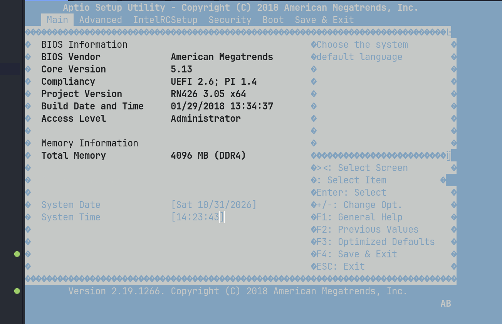
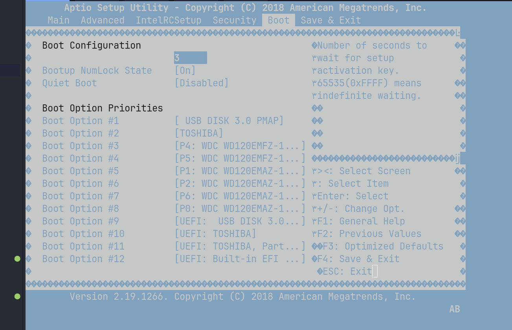
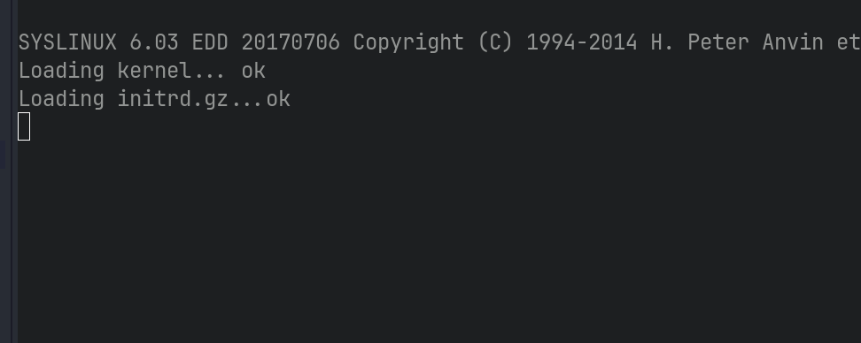
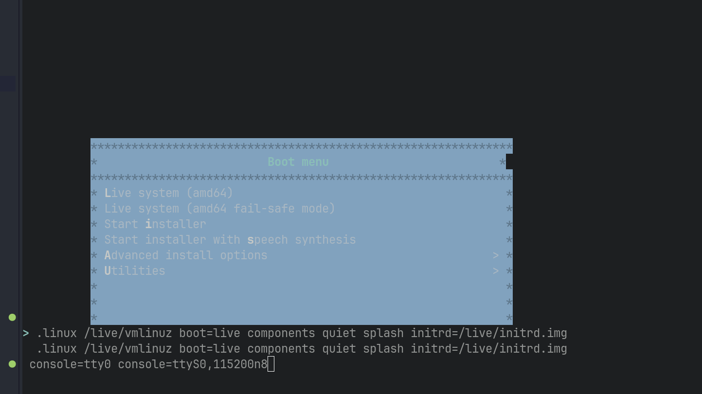

# Tenerix

Tenerix is a hardware investigation and Alpine Linux system project for the
NETGEAR ReadyNAS RN426, an Intel Atom C3538 NAS. The work explores replacing the
factory software while retaining the appliance's boot hardware, storage layout,
cooling, front-panel display, and buttons.

This repository contains investigation records, source code, build tools,
kernel patches, and selected test evidence. It is a development workspace for
the RN426, rather than a ready-to-install general-purpose NAS distribution.

## Work covered

- Investigated the factory hardware, boot process, RAID, and filesystem layout.
- Evaluated Debian Live and Alpine Linux on the RN426 and prepared a serial-console
  Alpine boot image.
- Backported IT8613E hardware-monitoring support and tested temperature readings,
  fan RPM, and supervised PWM changes on the hardware.
- Integrated the OLED and five navigation buttons through a pinned panel dependency.
- Developed internal DOM boot images, recovery and update paths, and disposable
  QEMU fixtures for boot and failure testing.
- Added a disk-system build, kernel-update integration, fan monitoring and thermal
  guards, a front-panel status daemon, and a login status summary.
- Investigated a ReadyNAS-specific Btrfs subvolume flag and prepared compatibility
  patches for upstream Linux.

The reports describe particular stages of the work. Earlier statements such as
“not loaded” or “not tested on hardware” belong to their recorded stage; later
hardware-test records document subsequent results. QEMU results and physical
hardware observations are identified separately.

## Gallery

Selected console captures from the RN426 investigation on October 31, 2026.
Click an image to view it at full resolution.

| Firmware information | Boot device priorities |
|---|---|
|  |  |
| Firmware version, build date, and installed memory. | Available boot targets and their configured order. |

| Factory boot loader | Debian serial console |
|---|---|
|  |  |
| The factory SYSLINUX loader reports successful kernel and initramfs loading. | Debian Live boot parameters configured for a 115200-baud serial console. |

## Documentation index

| Topic | Entry point |
|---|---|
| Factory hardware and storage baseline | [ReadyNAS audit](readynas-rn426-audit.md) |
| Factory boot chain and recovery investigation | [Boot audit](readynas-rn426-boot-audit.md) |
| Debian Live compatibility | [Debian audit](readynas-rn426-debian13-audit.md) |
| Alpine Live compatibility and system design | [Alpine audit](readynas-rn426-alpine-audit.md) |
| IT8613E driver sources, backport, and verification | [Driver documentation](hardware/it8613e/README.md) |
| Alpine driver build and packaging | [Alpine driver documentation](hardware/it8613e/alpine/README.md) |
| OLED, buttons, and panel adapter | [Front-panel documentation](hardware/front-panel/README.md) |
| Physical Alpine hardware and fan tests | [Hardware-test results](hardware/alpine-hardware-test/README.md) |
| Serial-console Alpine ISO and QEMU checks | [Serial image documentation](hardware/alpine-serial/README.md) |
| DOM boot prototype, fixtures, updates, and recovery | [Boot documentation](boot/rn426/README.md) |
| Self-contained Alpine system on the internal DOM | [DOM system documentation](boot/rn426/dom-system/README.md) |
| ReadyNAS Btrfs flag investigation and patches | [Btrfs compatibility notes](boot/rn426/md-system/btrfs-readynas/README.md) |

## Main implementation entry points

| Component | Source |
|---|---|
| Disk-system image and boot payload | [Build script](boot/rn426/md-system/build.py) and [QEMU tests](boot/rn426/md-system/qemu-test.py) |
| Disk-system early boot | [Initramfs init](boot/rn426/md-system/init) |
| Kernel updates and DOM boot-entry updates | [Kernel-update tool](boot/rn426/md-system/kernel-update/tenerix-kernel-update) |
| Fan control, sensor monitoring, and thermal guards | [Fan service](boot/rn426/dom-system/fan/tenerix-fan) and [configuration](boot/rn426/dom-system/fan/tenerix-fan.conf) |
| Front-panel status display | [Panel daemon](boot/rn426/md-system/panel/tenerix-panel) |
| Login status summary | [Status script](boot/rn426/dom-system/motd/tenerix-status.sh) |

Build instructions and prerequisites live with each component. Generated images,
downloaded packages, extracted filesystems, and local deployment inputs are kept
outside Git; a clone does not include those artifacts.

## Licensing and repository rules

Original contributions default to CC0 1.0 Universal. The panel integration and
Linux-derived code retain their MIT and GPL terms. See [LICENSING.md](LICENSING.md)
for the exact scope and exceptions, and [LICENSE](LICENSE) for the CC0 text.

[AGENTS.md](AGENTS.md) defines repository workflow and sensitive-data rules.
