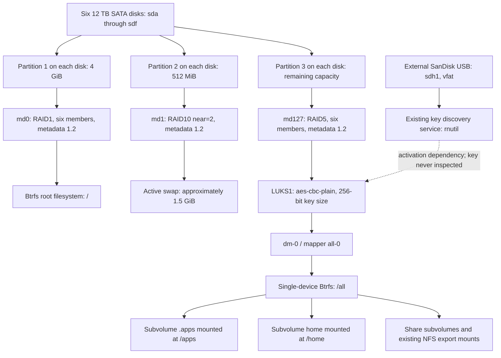

# ReadyNAS RN426 — Read-Only Hardware and Boot Architecture Audit

Audit date: 2026-10-31. Target: the user-designated RN426 at a private LAN address. Collection took place over SSH from the local development computer. This report is stored locally only.

Evidence labels used throughout:

- **VERIFIED FACT**: observed on this running appliance, unless explicitly described as an external-documentation fact.
- **INFERENCE**: an interpretation supported by observations, with limitations stated.
- **UNKNOWN**: unavailable within the authorized passive inspection.
- **REQUIRES EXPERIMENTAL VALIDATION**: a capability that requires a separately authorized future experiment.

## 1. Executive Summary

**VERIFIED FACT:** This appliance runs **ReadyNAS OS 6.10.10**, Debian identification **8.11 / Jessie**, and NETGEAR kernel **4.4.218.x86_64.1**, built on 2023-06-28. The initial estimate of 6.10.8 was incorrect. Hardware reports a NETGEAR ReadyNAS 426 board with AMI firmware **RN426v35**, dated **2018-01-29**, an Intel Atom C3538, four cores, and approximately 4 GiB RAM.

**VERIFIED FACT:** Six 12 TB SATA disks contain three parallel storage stacks: six-member RAID1 for the root filesystem, RAID10 for swap, and RAID5 for data. The data path is **md RAID5 → LUKS1 dm-crypt → single-device Btrfs**. The data array is approximately **59.98 TB decimal / 54.55 TiB**; reported Btrfs bytes used are **49.16 TiB**. All three arrays reported six active members, zero failed members, and clean state. These observations are not a data-integrity certification.

**INFERENCE:** Basic Debian amd64 operation is promising because storage uses AHCI, USB uses xHCI, and the Ethernet functions have recognized upstream ixgbe IDs. The primary hardware uncertainty is **safe cooling under another kernel**: NETGEAR's built-in `it87` supports the installed IT8613E, whereas inspected upstream Linux 6.12 `it87` does not list that chip. LCD, buttons, LEDs, and board GPIO integration are substantially customized.

**UNKNOWN:** The actual bootloader and its version, boot configuration, and kernel/initrd files could not be read safely. `/boot` is empty. A 240 MiB USB device at USB path `1-2` was present as `sdg` during startup but is no longer exposed as a block device. It is strongly consistent with the internal factory boot module. Rebinding its driver or mounting it was explicitly excluded.

**Recommendation, not executed:** Prefer a verified firmware one-time external-USB boot selection, with factory boot settings unchanged and **all production disks physically disconnected while powered off**. If all original disks must stay connected, this audit cannot establish a guarantee that initial Debian testing will leave them untouched. RAID assembly, system-root discovery, swap activation, and filesystem recovery can write without a deliberate data-volume mount. Do not proceed under that requirement without isolation or independently validated write protection.

No installations, package changes, service actions, firmware changes, mounts, unlocks, array assembly, imaging, block-device writes, maintenance, or reboots were performed. No keys, credentials, private-key files, application databases, or production file contents were collected. Existing production services continued operating and may write normally; a passive audit cannot freeze the running system. No collected evidence was sent to external services. External lookups used public product and software names only. No commit or push was performed.

## 2. System and Firmware Identification

### Observed identification

| Item | Observation | Status |
|---|---|---|
| `/etc/os-release` | `PRETTY_NAME="ReadyNASOS 6.10.10"`, Debian `VERSION_ID="8"`, Jessie | VERIFIED FACT |
| `/etc/debian_version` | `8.11` | VERIFIED FACT |
| `/etc/os_version` | `ReadyNASOS!!version=6.10.10,time=1704864002,arch=x86_64,descr=ReadyNASOS` | VERIFIED FACT |
| Kernel | `4.4.218.x86_64.1 #1 SMP Wed Jun 28 22:06:25 UTC 2023 x86_64 GNU/Linux` | VERIFIED FACT |
| Board / firmware | NETGEAR ReadyNAS 426, board version 03, AMI RN426v35, 01/29/2018 | VERIFIED FACT |
| Kernel taint | `4097`; loaded `vpd` reports `PO` | VERIFIED FACT |
| Kernel config | No `/proc/config.gz` or `/boot/config*` | UNKNOWN |
| Source tree | `/usr/src` empty; no source archive found in bounded `/lib`, `/usr/share`, `/opt` search | VERIFIED FACT, bounded search |
| Boot images | No files in `/boot`; bounded filename/package-list searches found no running kernel/initrd image | UNKNOWN location |

Command evidence:

```text
$ cat /proc/cmdline
console=tty0 console=ttyS0,115200 hpet=disable BOOT_IMAGE=kernel initrd=initrd.gz reason=normal
$ lsmod
Module                  Size  Used by
vpd                     9167  0
$ cat /proc/sys/kernel/tainted
4097
```

The taint value corresponds to proprietary-module and externally built-module flags, consistent with `dmesg` identifying `vpd` as proprietary and out of tree. It does not establish filesystem incompatibility. See [kernel taint documentation](https://docs.kernel.org/admin-guide/tainted-kernels.html).

### Software provenance

**VERIFIED FACT:** The package database contains 513 records: 507 installed packages, including four held installed packages, plus six residual-configuration records. Of the installed packages, **155 have `netgear` in the version**, and **174 have `netgear` in either version or maintainer metadata**. The other 333 lack that marker; this does not prove they are unmodified Debian binaries. This is a package-count heuristic, not a measurement of source-code or binary provenance. The full name/version/status inventory appears in section 12.

| Component | Installed package version |
|---|---|
| `readynasos` | `6.10.10` |
| `linux-image` | `4.4.218-610090002` |
| `btrfs-tools` | `4.16-netgear6` |
| `mdadm` | `4.1-0.netgear2` |
| `cryptsetup-bin` | `2:1.6.6-5` |
| `dmsetup` | `2:1.02.90-2.2+deb8u1` |
| `systemd`, `udev` | `230-7~bpo8+2.netgear3` |
| `util-linux` | `2.25.2-6.netgear1` |
| `libc6:amd64` | `2.19-18+deb8u10.netgear1` |
| `libsensors4:amd64` | `1:3.4.0-4.netgear1` |
| `smartmontools` | `6.6-netgear1` |
| OpenSSH client/server/SFTP | `1:6.7p1-5+deb8u7.netgear1`, held |

**INFERENCE:** This is a Jessie-derived appliance with extensive vendor rebuilds and selected newer components, including systemd and Apache. Firmware version alone must not be translated into an upstream Debian/kernel release. Notable vendor packages include `readynas-agent`, `rn-dictionary`, `raidar`, `radar`, `readysync`, `readytivo`, `replicate`, `xagent`, `libnml`, and `librnimage1`.

`dpkg-query -S` found the Btrfs executable owner but no ownership record for `rnutil`, `readynasd`, the system-prep script, or `modules.builtin`. File-list queries for `linux-image` and `readynasos` yielded no matching image/configuration paths. The package database warned that file lists for `libclamav9:amd64` and `samba4-clients` were missing. No repair was attempted.

### Kernel and service warnings

**VERIFIED FACT:** Filtered kernel logs show proprietary `vpd` taint, a failed attempt to insert `kdbus` (`Function not implemented`), and `ixgbe 0000:03:00.0: PCI INT A: no GSI`. Ethernet link on eth3 nevertheless came up at 1 Gbit/s. The service listing shows failed `home-assistant@admin`, `radar`, and `rn-update` services. Nothing was restarted. The inspected filtered kernel output did not show a Btrfs error or degraded-array warning; limited log inspection cannot exclude historical faults.

NAS wall-clock command output and some file/array timestamps differed by approximately one hour. Timeline conclusions should use boot-relative kernel timestamps and a separately verified clock; no time setting was changed.

## 3. Complete Hardware Inventory

### CPU and RAM

**VERIFIED FACT:** Intel Atom C3538 @ 2.10 GHz, family 6/model 95/stepping 1, x86_64, one socket, four cores, one thread/core, 800–2100 MHz reported range, VT-x. `lscpu` reports 24 KiB L1d, 32 KiB L1i, 2048 KiB L2. `/proc/meminfo` reports `MemTotal: 4002052 kB`.

An in-memory SMBIOS decoder read only memory-record fields: one populated record reports 4096 MiB DDR4 (type 26), 2133 MT/s, DIMM0/BANK 0. Three records report zero capacity. Firmware advertises four memory-device records and 128 GiB maximum array capacity, but also implausible 8-bit memory-width values. **UNKNOWN:** physical socket count, practical upgrade limit, and ECC operation; SMBIOS records are not reliable evidence for those claims. No SPD/I2C probing was performed.

### PCI inventory and board devices

`lspci` is unavailable. All PCI functions below were enumerated using sysfs vendor/device/class attributes and driver symlinks. Every listed PCI vendor is Intel (`8086`). Names beyond directly observed driver/class information are qualified interpretations.

| Device | Vendor/Device ID | Current driver | Standard upstream driver availability | Potential Debian compatibility issue |
|---|---|---|---|---|
| 00:00.0 host bridge | 8086:1980 | No driver symlink | Standard PCI infrastructure, likely | No specific blocker identified |
| 00:04.0 host bridge | 8086:19a1 | None observed | Standard PCI infrastructure, likely | Exact role not decoded |
| 00:05.0 class 080700 | 8086:19a2 | None observed | UNKNOWN exact function support | Optional system-peripheral function |
| 00:06.0 PCIe bridge | 8086:19a3 | pcieport | Standard PCIe | Untested with Debian |
| 00:12.0 class 088000 | 8086:19ac | None observed | UNKNOWN | Exact role not decoded |
| 00:13.0 SATA/AHCI | 8086:19b2 | ahci | Yes, upstream AHCI class matching | First three production disks attached here |
| 00:14.0 SATA/AHCI | 8086:19c2 | ahci | Yes, upstream AHCI class matching | Other three production disks attached here |
| 00:15.0 USB xHCI | 8086:19d0 | xhci_hcd | Standard xHCI family | Firmware USB boot remains untested |
| 00:16.0 PCIe bridge | 8086:19d1 | pcieport | Standard PCIe | Parent of eth0/eth1 |
| 00:17.0 PCIe bridge | 8086:19d2 | pcieport | Standard PCIe | Parent of eth2/eth3 |
| 00:18.0 communication class 078000 | 8086:19d3 | None observed | UNKNOWN exact interface | Do not assume it is the active console |
| 00:1f.0 ISA bridge | 8086:19dc | None observed | Standard chipset infrastructure, likely | Board peripherals need separate assessment |
| 00:1f.2 class 058000 | 8086:19de | None observed | UNKNOWN | No functional test performed |
| 00:1f.4 SMBus | 8086:19df | i801_smbus | Standard i2c-i801 family | Do not scan buses to discover board functions |
| 00:1f.5 class 0c8000 | 8086:19e0 | None observed | UNKNOWN | Exact function not decoded |
| 01:00.0 coprocessor class 0b4000 | 8086:19e2 | None observed | UNKNOWN exact support | Not required by observed storage stack |
| 02:00.0 / eth0 | 8086:15e4 | ixgbe | Upstream X550EM_A_1G_T ID | Link down; physical-port mapping unknown |
| 02:00.1 / eth1 | 8086:15e4 | ixgbe | Upstream X550EM_A_1G_T ID | Link down; physical-port mapping unknown |
| 03:00.0 / eth2 | 8086:15e5 | ixgbe | Upstream X550EM_A_1G_T_L ID | Link down; kernel reports no GSI |
| 03:00.1 / eth3 | 8086:15e5 | ixgbe | Upstream X550EM_A_1G_T_L ID | Active at 1000 Mbit/s; interface naming may differ |
| Internal-boot candidate, USB 1-2 | 13fe:5200 | No current USB interface driver | USB mass storage is standard | Present during boot, hidden/unbound now; exact boot contents unknown |
| External SanDisk Cruzer Fit, USB 1-3 | 0781:5571 | usb-storage | Standard USB mass storage | Likely key USB; its contents were not inspected |
| CPU temperature | CPU platform device | coretemp | Standard coretemp family | Sensor labels contain unusual core numbering |
| Super I/O monitor / fan | ITE IT8613E rev 3, non-PCI | Built-in it87 | Exact chip absent from inspected upstream 6.12 hwmon driver | Major thermal-management investigation required |
| Super I/O GPIO | IT8613, non-PCI | gpio_it87 | Upstream gpio-it87 has IT8613 handling | Board pin assignments still vendor-specific |
| SoC GPIO | gpio_dnv.0 | gpio_dnv | Upstream Denverton pinctrl/GPIO exists | Registration and board mapping may differ |
| Front-board I2C endpoint | I801 bus 0, address 0x1c, i2cfb | No endpoint driver symlink observed | UNKNOWN RN426-specific protocol support | Custom front-panel button handling |
| Display | readynas-lcd / rnx16-oled | readynas-lcd / rnx16-oled | Exact vendor bindings not established upstream | Requires custom integration or porting |
| Display placeholder | hd44780-lcd platform object | No driver symlink | Generic HD44780 support does not prove this board works | Do not infer active LCD type from placeholder alone |
| LEDs | readynas-led | readynas-led | Exact vendor bindings unverified | Disk/status LEDs may require custom mapping |
| Buttons | Power Button; rn_button; fb_button | ACPI/input plus vendor board code | Generic power button standard; other inputs unknown | Reset/front-board GPIO and I2C glue required |
| RTC | rtc0 | rtc_cmos | Standard RTC family | No issue established |
| Watchdog platform object | iTCO_wdt | No driver symlink | Generic iTCO family exists; board support unverified | No watchdog class device or /dev/watchdog observed |
| Board identity/VPD | Vendor platform facility | vpd, proprietary module | No equivalent established | Avoid raw VPD reads; role in key handling unknown |

Upstream evidence: the [Linux 6.12 AHCI driver](https://raw.githubusercontent.com/torvalds/linux/v6.12/drivers/ata/ahci.c) includes generic AHCI-class matching; [ixgbe IDs](https://github.com/torvalds/linux/blob/v6.12/drivers/net/ethernet/intel/ixgbe/ixgbe_type.h) name both observed Ethernet IDs. This supports driver availability, not a successful Debian boot. The generic “10 Gigabit Network Connection” kernel description must not be interpreted as a 10 Gb/s physical-port capability for these 1G IDs.

Four Ethernet functions are visible to Linux. Their correspondence to exposed connectors, disabled functions, or board variants is **UNKNOWN**; no cable or link experiments were conducted.

### Sensors, fans, GPIO and panel evidence

```text
hwmon0/name: coretemp
CPU package 42000 m°C; sampled core values 38000–41000 m°C
hwmon1/name: it8613
temp1_input=-128000; temp2_input=33000; temp3_input=-128000
fan2_input=885 RPM; fan3_input=0
pwm2_enable=3; pwm3_enable=1; pwm4_enable=1; pwm5_enable=1
thermal_zone0/type=acpitz; thermal_zone0/temp=0
gpiochip295 label=gpio_it87
gpiochip359 label=gpio_dnv.0
```

**INFERENCE:** -128 °C and 0 °C readings are invalid/unconnected/unusable sensors rather than actual appliance temperatures. Fan channel 2 is active; channel 3 reading zero does not establish a failed physical fan. The meaning and safety of vendor PWM mode 3 were not tested. Existing automatic control, BIOS SMI thermal handling, and `readynasd` responsibilities must be separated before relying on cooling under Debian.

Kernel messages identify IT8613E at Super I/O address 0xa30 and GPIO controller at 0xa00, reset button on `gpio_it87:9n`, front-board IRQ on `gpio_dnv.0:5`, and I2C front-board endpoint I801/0x1c. Left/right/up/down/OK inputs use I2CFB. These are log observations, not permission to probe or drive pins.

The [Linux 6.12 it87 source](https://raw.githubusercontent.com/torvalds/linux/v6.12/drivers/hwmon/it87.c) lacks IT8613E in its supported chip list/enum. [Upstream gpio-it87](https://raw.githubusercontent.com/torvalds/linux/v6.12/drivers/gpio/gpio-it87.c) does include IT8613 handling. GPIO support therefore must not be mistaken for working fan monitoring/control. [Denverton pinctrl source](https://raw.githubusercontent.com/torvalds/linux/v6.12/drivers/pinctrl/intel/pinctrl-denverton.c) establishes an upstream SoC GPIO implementation, not RN426 board support. Newer or Debian-patched kernel support remains to be checked against the exact intended image.

## 4. Boot Chain and Internal USB Module

### What is established

**VERIFIED FACT:** `/sys/firmware/efi` is absent. DMI identifies AMI RN426v35; the kernel log also contains an ACPI table named UEFI. The current command line requests `kernel` and `initrd.gz`, with reason `normal`, VGA/tty0 and serial `ttyS0,115200`, and disables HPET. `/boot` is empty and is not a separate mounted boot filesystem. Root is `/dev/md0`, Btrfs, mounted read/write.

**INFERENCE:** Current boot is consistent with BIOS/CSM and a Syslinux-family loader, but neither is conclusively established. Absence of EFI sysfs can also reflect kernel EFI configuration; the full kernel config is unavailable. `BOOT_IMAGE=kernel` is not a loader signature. The firmware's ACPI UEFI table does not prove native UEFI boot, a functioning one-time menu, or an enabled EFI USB boot path.

| Boot-chain stage | Finding | Confidence |
|---|---|---|
| Firmware | AMI RN426v35 | VERIFIED FACT |
| BIOS versus native UEFI execution | BIOS/CSM likely; EFI runtime interface absent | INFERENCE |
| Bootloader type/version/configuration | No accessible configuration or boot files found | UNKNOWN |
| Kernel filename requested | `kernel` | VERIFIED FACT from cmdline |
| Initrd filename requested | `initrd.gz` | VERIFIED FACT from cmdline |
| Kernel/initrd storage location | Likely internal USB module | INFERENCE |
| Early root assembly and switch | Root is six-member md0 RAID1/Btrfs; initramfs likely selects it | Observed endpoint; mechanism INFERENCE |
| Later arrays | `start-raids.service` runs `start_raids`, a symlink to `rnutil` | VERIFIED FACT |
| Encryption | Generated key-search service precedes systemd cryptsetup | VERIFIED FACT |
| Recovery paths | Factory normal boot observed; vendor recovery documented, untested | Mixed, see below |

### USB correlation

```text
USB 1-2: 13fe:5200, product "USB DISK 3.0", 480 Mbit/s
boot log: scsi host14 usb-storage -> sd 14:0:0:0 [sdg]
[sdg] 491520 512-byte logical blocks: 252 MB / 240 MiB
partition discovery: sdg1
current lsusb -t: port 2 mass-storage interface Driver= [empty]
current /proc/partitions and lsblk: no sdg

USB 1-3: 0781:5571, SanDisk Cruzer Fit, usb-storage, 480 Mbit/s
current /dev/sdh, 30,765,219,840 bytes, FAT32 partition sdh1
```

**INFERENCE:** USB 1-2 is the internal factory boot module. The startup capacity and disappearance from current block inventory distinguish it from the 28.7 GiB external SanDisk. Its physical internal placement and actual boot files remain unverified. No current block-device path can safely be used for it, and `/dev/sdg` must never be assumed stable across boots. No internal-module read, image, mount, driver rebind, or rescan was attempted. The reason it became unavailable is **UNKNOWN**; intentional startup unbinding is a possibility, not a demonstrated cause.

The root filesystem is on HDD RAID1, so preserving only the internal USB would not preserve the whole original operating system. Both the module and HDD system partitions matter. Whether the module holds a recovery root image, upgrade payload, or root reconstruction logic cannot be established here.

### Alternate-boot capabilities

| Possibility | Assessment |
|---|---|
| Additional Debian entry in existing loader | UNKNOWN until actual loader, config, writable constraints and backup are established; changing it is out of scope |
| Existing loader chainloads external USB | REQUIRES EXPERIMENTAL VALIDATION; loader features, chain module and firmware drive enumeration unknown |
| Existing loader starts Debian kernel/initramfs directly | Theoretically plausible for an x86 Linux loader; actual loader/version, image protocol and size limits unknown |
| Firmware Boot Override / one-time external USB menu | Preferred conditional option; not verified on this RN426 firmware |
| One-time selection without factory-path change | Generic firmware capability exists, but this appliance's access method and persistence behavior are untested |
| Native UEFI removable-media boot | UNKNOWN; do not change boot mode to test during this audit |

The [Debian firmware guide](https://www.debian.org/releases/stable/amd64/ch03s06.en.html) describes one-time firmware menus that do not change default boot order. It does not prove RN426 support or a particular key combination. No boot-variable utility was run.

### Recovery and console

**VERIFIED FACT:** Read-only vendor proc entries report `bootmenu-enable=0` and `bootmenu-option=Normal`. This is the NETGEAR boot-mode interface, not proof of a BIOS boot-device chooser. The active serial-getty service is on ttyS0. Electrical connector, voltage, pinout and firmware-console visibility are **UNKNOWN**; do not connect an assumed RS-232 adapter to an unverified header.

NETGEAR documents a [USB Recovery Tool](https://kb.netgear.com/29952/How-do-I-use-the-USB-Recovery-Tool-on-my-ReadyNAS-OS-6-storage-system) that reloads firmware. It is a potentially writing recovery mechanism, not a safe external Debian boot method, and was not used. The current RN426 hardware-manual PDF could not be retrieved through the documentation tool; exact reset-menu modes and access steps remain unavailable from a verified primary text in this audit. Do not treat “OS reinstall,” factory reset, firmware recovery, or a front-panel boot menu as equivalent to one-time BIOS USB selection.

## 5. Storage Architecture Diagram

### Physical disks and channel mapping

**VERIFIED FACT:** All six disks report 23,437,770,752 logical 512-byte sectors, or **12,000,138,625,024 bytes** each; GPT output reports 4096-byte physical sectors. Manufacturer model suffixes below come from persistent by-id links. Vendor `disk/internal` symlinks supply channels 0–5. Mapping those channels to printed bays 1–6 is an **INFERENCE**, pending physical label confirmation; no bay manipulation occurred.

| Linux disk | Full model | Serial number | Vendor channel | Controller / SATA path | Inferred printed bay |
|---|---|---|---|---|---|
| sda | WDC WD120EMFZ-11A6JA0 | Z2KAKLYT | 0:0 | 00:13.0 / ata5 | 1 |
| sdb | WDC WD120EMFZ-11A6JA0 | Z2K4TP1T | 0:1 | 00:13.0 / ata6 | 2 |
| sdc | WDC WD120EMAZ-11BLFA0 | 5PGG5XBD | 0:2 | 00:13.0 / ata7 | 3 |
| sdd | WDC WD120EMAZ-11BLFA0 | 5PGADPEC | 0:3 | 00:14.0 / ata9 | 4 |
| sde | WDC WD120EMAZ-11BLFA0 | 8CKABPNF | 0:4 | 00:14.0 / ata10 | 5 |
| sdf | WDC WD120EMAZ-11BLFA0 | 8CKA0EHF | 0:5 | 00:14.0 / ata11 | 6 |

GPT tables were printed for every production disk. All have the following partition extents and Linux RAID type code `FD00`:

| Partition on each disk | Start sector | End sector | Size | Function |
|---|---:|---:|---|---|
| 1 | 64 | 8,388,671 | 4 GiB | md0 root RAID1 |
| 2 | 8,388,672 | 9,437,247 | 512 MiB | md1 swap RAID10 |
| 3 | 9,437,248 | 23,437,770,703 | Approximately 10.9 TiB | md127 data RAID5 |

The old `sfdisk -d` only displayed protective MBR entries (`Id=ee`) for these GPT disks. Its output is not the actual three-partition map. Read-only `sgdisk -p` and sysfs extents resolved this ambiguity. The external SanDisk uses an MBR FAT32-LBA partition, start sector 32, length 60,088,288 sectors. Its files and key contents were not read.

### Observed dependency diagram



The dashed key relationship is an architectural inference supported by generated service ordering, vendor documentation and static binary strings; the exact key file was not identified.

### RAID metadata and filesystem state

| Array | Level / parameters | UUID | Observed state |
|---|---|---|---|
| md0 | RAID1, 6 disks, metadata 1.2, 4,190,208 KiB | `58b7f1b0:9d294f2c:2bd63fbf:960d5376` | clean, 6 active, 0 failed |
| md1 | RAID10, near=2, 512 KiB chunk, metadata 1.2, 1,566,720 KiB | `a92b18e4:5875ee28:70d8d9bf:27b72dd4` | clean, 6 active, 0 failed |
| md127 | RAID5, left-symmetric, 64 KiB chunk, metadata 1.2, 58,570,173,120 KiB | `60d8af0f:acd5d295:c1345063:0e77954a` | clean, 6 active, 0 failed |

md0 active slot order is **sda1, sdb1, sdd1, sdc1, sde1, sdf1**. md1 and md127 slot order is sda through sdf. Member numbers and slot order differ; recovery must use metadata rather than reconstructing order from names. No additional arrays were assembled. Final `/proc/mdstat` still showed `[6/6] [UUUUUU]` for all three arrays, without a resync progress line.

**VERIFIED FACT:** No LVM logical volume appears in the observed stack; `dmsetup ls --tree` shows only `all-0` over major:minor `9:127`. Available device-mapper target types include snapshot and linear, but their availability is not evidence that they are in use. The X-RAID versus Flex-RAID management setting is **UNKNOWN**; the observed on-disk data array is standard md RAID5.

| Filesystem | UUID / label | Allocation profile | Mounts |
|---|---|---|---|
| Root Btrfs | `c1c2705b-2406-4377-9620-537aeecae453`, `0a4513f8:root` | Data single; metadata/system DUP | `/`, subvolid=5 |
| Data Btrfs | `64459e2b-2ad9-4aaf-86a7-d14edd5a3a03`, `0a4513f8:all` | Data single; metadata/system DUP | `/all`, `/apps`, `/home`, existing share export mounts |

Both report one Btrfs device. This is **md RAID5 underneath Btrfs**, not native Btrfs RAID5. Root uses approximately 1.95 GiB filesystem bytes; data reports 49.16 TiB used and 52.36 TiB allocated device space. These figures include metadata/allocation distinctions and are not interchangeable with user file totals or free-space guarantees.

Observed options for root and data: `rw,noatime,nodiratime,nospace_cache,subvolid=5,subvol=/`. `/apps` uses subvolid 259 (`/.apps`); `/home` uses 260 (`/home`). Existing share mounts under `/run/nfs4/all/` expose `Arch...` (9054), `fi...` (75153), and `pli...` (83321). External FAT is already mounted at `/media/USB_FLASH_7` and `/run/nfs4/media/USB_FLASH_7`, with `rw,noatime,nodiratime,...,flush,errors=remount-ro`. No mount state was changed.

Root subvolume listing returned `.timemachine` (259). Data subvolumes returned `.purge` (257), `._share` (258), `.apps` (259), `home` (260), `.vault` (261), `home/admin` (5582), `.timemachine` (9052), and the three shares with `.snapshots` subvolumes (9055, 75154, 83322). Only subvolume metadata was inspected; no share contents were traversed.

Both filesystem feature directories expose `big_metadata=1`, `extended_iref=1`, `mixed_backref=1`, and `skinny_metadata=1`. These are recognized upstream feature names; see [Btrfs filesystem feature documentation](https://btrfs.readthedocs.io/en/latest/btrfs-man5.html). The sysfs listing is not an exhaustive proof about every on-disk tree, vendor extension, quota behavior, or metadata invariant. No superblock dump, offline check, scrub, quota rescan or compatibility mount was performed.

## 6. Encryption and Recovery Architecture

### Confirmed encryption layer

```text
$ cryptsetup status all-0
/dev/mapper/all-0 is active and is in use.
  type:    LUKS1
  cipher:  aes-cbc-plain
  keysize: 256 bits
  device:  /dev/md127
  offset:  2304 sectors
  size:    117140343936 sectors
  mode:    read/write
```

**VERIFIED FACT:** LUKS1 sits on the assembled data RAID, not separately on each disk, not above Btrfs, and not on the root/swap arrays. The string `plain` is the cipher IV-mode suffix in `aes-cbc-plain`; it does **not** mean plain dm-crypt. The mapping type and `CRYPT-LUKS1-...` device identifier independently confirm LUKS1. Mapping UUID: `901e86ee-db66-46bb-ad57-869423c374b2`. Reported key size is metadata, not key material.

Tools: cryptsetup 1.6.6; dm-crypt target v1.14.1; btrfs-progs 4.16 (NETGEAR package); mdadm 4.1 vendor package. No `dmsetup table`, `--showkeys`, LUKS dump, keyslot extraction, key-file read or process-memory inspection was performed.

### Normal activation evidence

Sanitized configuration observation:

```text
crypttab: all-0 /dev/md/all-0 [key reference omitted]
generated all-key.service:
  Description=Cryptography Key Search for all
  Before=local-fs-pre.target
  Type=oneshot
  executable=/usr/bin/rnutil [arguments omitted]
generated systemd-cryptsetup@all\x2d0.service:
  After=cryptsetup-pre.target all-key.service
  After=dev-md-all\x2d0.device
  executable=/lib/systemd/systemd-cryptsetup [arguments omitted]
```

**VERIFIED FACT:** Key discovery uses NETGEAR `rnutil` before the standard systemd cryptsetup integration. Static strings in the installed executable include a generic `cryptsetup luksOpen -d` template and a generic search-key directory. No actual key reference, key filename on USB, or contents were exported. The key-search unit was inactive after startup while the cryptsetup unit remained active/exited, consistent with a one-shot discovery step.

**INFERENCE:** The external SanDisk likely contains the separate volume-unlock key, but its purpose was not proved by opening its filesystem. Vendor documentation explains USB-stored keys for volume unlock; this is consistent with the observed architecture. See [NETGEAR OS 6 encryption documentation](https://www.downloads.netgear.com/files/GDC/READYNAS-100/readynas_os_6_4_1_23Dec2015.pdf).

**UNKNOWN:** Actual USB key-file format, any wrapping/derivation, exact search rules, dependence on appliance VPD, keyslot details, and fallback behavior. Static use of `luksOpen -d` supports an ordinary key-file workflow but is insufficient to prove that the user-held file can be passed directly to modern cryptsetup. No secret was accessed to resolve this.

### Disaster recovery on another Linux machine — requirements only

This is a future recovery design, not an executed procedure or authorization to access keys:

1. Preserve all six disks, serial-to-channel mapping, existing RAID metadata, the internal boot module, and an independently secured existing unlock key. A backup of the module alone cannot recover the data or the HDD root filesystem. Key custody and any separate backup require a distinct sensitive-data workflow outside this audit.
2. Use another amd64 Linux host with enough SATA/SAS interfaces, stable power and capacity for independent working copies. Prevent automatic RAID assembly, swap use and desktop automount before attaching any production disk. Prefer verified hardware write blockers and work on copies.
3. Identify the six partition-3 members by RAID UUID and metadata. A separately reviewed recovery would assemble only that existing array read-only, without forced assembly, creation, repair, or resync. Do not guess slot order from `/dev/sdX`.
4. A separately authorized recovery would open the existing LUKS1 container read-only using the legitimate key through a controlled local channel. Modern cryptsetup documents LUKS1 and read-only mappings; see [Debian cryptsetup-open documentation](https://manpages.debian.org/trixie/cryptsetup-bin/cryptsetup-open.8.en.html). This audit did not validate the particular key or legacy cipher availability on a future recovery kernel.
5. Validate filesystem compatibility on copies before relying on upstream Btrfs. A future read-only Btrfs mount must also prevent tree-log replay and automatic balance resume, and have a read-only lower stack. A simple `ro` mount alone is insufficient: [Btrfs documentation](https://btrfs.readthedocs.io/en/latest/btrfs-man5.html) states tree-log replay can occur on read-only mounts. No mount command is being prescribed for the originals here.
6. Recover files to separate storage. Preserve the source stack and avoid feature upgrades, quota changes or repairs. If standard tools reject metadata, stop and use an isolated matching ReadyNAS environment or a specialist working on copies.

**INFERENCE:** Standard md metadata and LUKS1 make hardware-independent recovery plausible. **REQUIRES EXPERIMENTAL VALIDATION:** actual unlock using the legitimate key, NETGEAR key preprocessing, upstream Btrfs acceptance, complete file recovery and return to the original OS. The current audit cannot establish a tested disaster-recovery procedure.

## 7. NETGEAR-Specific Kernel Modules and Services

`lsmod` lists only `vpd`, but `modules.builtin` explicitly lists AHCI, ixgbe, Btrfs, dm-crypt, it87, coretemp and several NETGEAR drivers. Their absence from `lsmod` is therefore not absence of support.

Important built-in paths include:

```text
kernel/drivers/platform/readynas/readynas-io.ko
kernel/drivers/platform/readynas/readynas-gpio.ko
kernel/drivers/platform/readynas/hd44780-lcd.ko
kernel/drivers/platform/readynas/readynas-oled.ko
kernel/drivers/platform/readynas/readynas-lcd.ko
kernel/drivers/platform/readynas/readynas-led.ko
kernel/drivers/platform/readynas/readynas-pmbus.ko
```

These entries describe built-in components, not loadable files available for transplantation into Debian. `modinfo vpd` reported the historical path `/lib/modules/4.4.218.x86_64.1/initramfs/vpd.ko` but failed to open it. A loaded module can remain resident after its original file becomes unavailable. No module was loaded or unloaded.

| Component | Purpose / integration evidence | Essential function | Modern Debian equivalent / remaining work | Local source evidence |
|---|---|---|---|---|
| `vpd` | Proprietary board VPD module, boot log and taint | Identity/configuration role; key dependency unknown | No equivalent established; investigate without reading raw VPD | None found; module file unavailable |
| readynas-io / gpio | Board setup, buttons and front-board I2C | Front panel, reset/power behavior | Generic GPIO/input frameworks exist; RN426 mapping/glue needs investigation | Built-in names and log evidence, no source tree |
| LCD / OLED / LED drivers | Platform devices and boot logs | Front display and disk/status indication | Generic display/LED frameworks need board-specific bindings | No local source found |
| it87 / gpio_it87 / gpio_dnv | Super I/O fan/sensor and board GPIO | Cooling is essential | Upstream family drivers exist; IT8613E hwmon and board policy need verification | No local source found |
| `readynasd` | Active system-management daemon, ELF64 binary | Likely thermal, storage and appliance orchestration; exact responsibilities unproved | mdadm, standard file servers and monitoring cover parts; no drop-in vendor control plane | Binary only observed; additional source analysis/reverse engineering needed |
| `rnutil` / `start_raids` | Multicall ELF; array-start unit, key-search unit, disk-event symlinks | Factory array activation and key discovery | mdadm and cryptsetup equivalents exist; vendor orchestration must be understood | Binary only observed |
| `mdadm.service` | Active MD monitoring | Array monitoring | Standard mdadm, with vendor-event differences to review | Vendor package metadata; no source tree |
| `mdcsrepaird` | Active MD repair service | Role suggested by unit name; algorithm unknown | Do not assume generic mdadm monitoring replaces it | ELF binary observed; no source found |
| Btrfs tools / snapper | Vendor tool versions; Btrfs volumes and snapshots | Data filesystem and appliance snapshot management | Upstream tools exist; compare patches and on-disk behavior on copies | No local source archive found |
| udev disk rules / `disk_chan` | Populate channel links and invoke disk-event handlers | Bay identification and hotplug management | Standard persistent IDs exist; custom bay/event mapping needed | Rules readable; helper not executed |
| udev Btrfs rules | Existing add/change handlers call Btrfs scan/ready | Factory device registration | Standard udev/Btrfs facilities exist; suppress automation in first-test media | Rules readable |
| `pilgrim` | LCD splasher unit | Cosmetic startup indication | Optional custom userspace | No source found |
| `reset-i2c.service` | ExecStart=/bin/true, ExecStop=/usr/bin/reset_i2c | Vendor shutdown handling | Hardware-specific, not established as necessary for Debian | Unit readable; helper not run |
| `readynas-misc` | Early system-prep service | Factory appliance initialization | Standard services cover individual tasks; do not transplant blindly | Shell implementation read, never executed |
| start/getty/watchdog integration | Serial getty active; watchdog platform placeholder unbound | Console useful; watchdog policy unknown | Standard getty; watchdog needs board-specific validation | Unit/platform metadata only |

Reading the system-prep script showed certificate/SSH-key initialization and remote-access setting changes. Only code was inspected; referenced secrets and configuration files were not read. Vendor cloud services, `oauth2-vault`, RAIDar, backup services and `xagent` were identified by service names; their secret-bearing settings were excluded.

**VERIFIED FACT:** The vendor rebuilds both Btrfs tools and the kernel. **UNKNOWN:** the complete vendor patch set, quota differences and appliance-specific ioctls. Observed standard feature names do not prove complete compatibility, and a customized kernel does not prove incompatible disk format. Source availability on the Internet was not established; no kernel/vendor source archive was found in the bounded local inspection.

## 8. Modern Debian Compatibility Matrix

The official [Debian amd64 installation guide](https://www.debian.org/releases/stable/amd64/) identifies Debian 13/trixie as its current stable target at lookup time. Select and verify an exact image/kernel before any future test; no image was downloaded or prepared here. No component has been tested under Debian on this appliance.

| Component | Classification | Basis and limitation |
|---|---|---|
| amd64 CPU architecture | CONFIRMED STANDARD | Actual x86_64 CPU matches Debian amd64 architecture; whole-system boot still untested |
| Firmware USB boot | REQUIRES INVESTIGATION | AMI firmware observed; selection method and supported USB mode unknown |
| Existing bootloader | UNKNOWN | No accessible boot configuration or image |
| AHCI/SATA | LIKELY COMPATIBLE | Current AHCI binding and upstream class support; no modern kernel test |
| Ethernet | LIKELY COMPATIBLE | Exact IDs present in upstream ixgbe; connector mapping and network naming untested |
| USB storage/controllers | LIKELY COMPATIBLE | xHCI and usb-storage currently work; firmware boot is separate |
| CPU/RAM/chipset basics | LIKELY COMPATIBLE | Standard x86 platform; SMBIOS upgrade/ECC claims unreliable |
| coretemp | LIKELY COMPATIBLE | Current standard-family sensor driver; readings must be checked under target kernel |
| Fan / IT8613E hwmon | REQUIRES INVESTIGATION | Vendor support observed; inspected upstream 6.12 driver lacks exact chip |
| Thermal policy | REQUIRES ADDITIONAL SOFTWARE | Board-safe policy and firmware interaction must be validated; generic fancontrol alone not proven sufficient |
| SoC/Super I/O GPIO | REQUIRES INVESTIGATION | Upstream controller drivers exist, board bindings differ |
| LCD/OLED | REQUIRES ADDITIONAL SOFTWARE | Vendor kernel/userspace integration; driver port may also be required |
| Buttons/LEDs | REQUIRES INVESTIGATION | Generic ACPI power button plus custom GPIO/I2CFB paths |
| RTC | LIKELY COMPATIBLE | rtc_cmos currently used |
| Watchdog | UNKNOWN | Platform object exists, no active watchdog device observed |
| md RAID formats | CONFIRMED STANDARD | Metadata 1.2 and standard RAID levels observed; recovery not tested |
| md RAID operation/recovery | LIKELY COMPATIBLE | Standard tooling exists; automatic activation must be prevented in first test |
| LUKS1 format | CONFIRMED STANDARD | cryptsetup status confirms standard container type |
| Unlock workflow | REQUIRES INVESTIGATION | Vendor key discovery and actual key format unverified |
| Btrfs | REQUIRES INVESTIGATION | Standard visible features, vendor patches unreviewed, no upstream compatibility test |
| Factory NAS management | REQUIRES ADDITIONAL SOFTWARE | ReadyNAS control plane is not stock Debian |
| Optional unbound PCI functions | UNKNOWN | No functional mapping/tests; no evidence they block basic NAS operation |

“CONFIRMED STANDARD” describes observed architecture or format, not demonstrated Debian compatibility. “REQUIRES ADDITIONAL SOFTWARE” can include a custom kernel driver as well as userspace.

## 9. Potential Blockers and Risks

1. **Production-disk write isolation:** The system/root and swap partitions are on the same disks as data. Leaving LUKS closed protects neither md metadata nor root/swap partitions. Early initramfs/udev assembly, root discovery and swap activation may occur before login. Normal read-only mount intentions are insufficient.
2. **Cooling:** IT8613E support and safe control policy are unverified on the target Debian kernel. Existing fan RPM, PWM modes or SMI messages do not establish autonomous safe operation after a kernel change. Long unattended tests are inappropriate until thermal behavior is established on an isolated setup.
3. **Boot access:** No verified BIOS Boot Override method, connector pinout or bootloader configuration. Headless operation may obstruct selection and recovery.
4. **Factory recovery preservation:** The internal USB module is currently inaccessible; no verified backup exists from this audit. The root OS also lives on HDD RAID1. Vendor recovery can write firmware or system partitions and is not a harmless fallback test.
5. **Encryption dependency:** An already active mapping proves current unlock succeeded, not that another machine can use the user-held key directly. No key material or key preprocessing was inspected.
6. **Btrfs compatibility:** Standard visible features reduce concern but do not rule out vendor-specific structures or behavior. Modern read/write use could also enable features that prevent return to the old kernel. Validate copies before any original-volume access.
7. **Array resilience and capacity:** RAID5 tolerates one member failure, not two. Approximately 49 TiB is already used. Clean state is not a substitute for independent backups or a health examination; no SMART self-test or integrity workload was run.
8. **Uncertain platform peripherals:** Panel, LEDs, buttons, watchdog and VPD need targeted source review. Directly copying old kernel modules into a modern kernel is not viable.

## 10. Recommended First USB Boot Procedure

**PROPOSAL ONLY — NOT EXECUTED.** This section requires a later separately authorized maintenance window. It is not an instruction to reboot or modify the current NAS now.

### Choice of boot method

| Alternative | Invasiveness / prerequisite | Recommendation |
|---|---|---|
| Firmware one-time menu / Boot Override | No intended persistent factory-path change; exact RN426 behavior must be verified | Preferred if accessible and demonstrably one-time |
| Existing loader temporary selection/prompt | Depends on actual loader and ability to specify external files without saving | Second choice only after loader is identified |
| Existing loader chainloading | Requires verified loader support and external drive addressing; may require config changes | Defer; not established safe or available |
| Modified factory boot configuration after backup | Intentionally changes factory module; requires verified restorable backup and independent recovery | Outside first-test recommendation |
| Physically disconnect factory boot module | Chassis handling and connector risk; alters topology but not its contents | Last resort only, powered off, after physical identification and recovery planning |

**INFERENCE:** A genuine one-time firmware selection is the least invasive boot-path option. **UNKNOWN:** whether RN426v35 exposes it through usable video/serial/keyboard access, and whether selection causes any firmware bookkeeping writes. If absolutely no persistent firmware write is permitted, even a menu labelled Boot Override needs validation before reliance. Stop if only permanent boot-order changes or factory reset/recovery options are available.

### Proposed sequence

1. Establish physical console access, documented electrical interface if serial is needed, a visible boot-device menu, and a known return-to-factory route. Record current external cabling and disk serial-to-bay mapping. Do not assume a universal AMI hotkey or that front-panel reset invokes a boot-device selector.
2. Prepare and verify a minimal Debian amd64 live/rescue USB **on another computer**, with boot files, root filesystem and any optional persistence entirely on that expendable USB. Do not run an installer on the RN426. Verify signatures/checksums from Debian's official distribution channel.
3. Review the exact USB initramfs and userspace before use. For the first hardware-only boot, omit/disable automatic MD activation, cryptsetup discovery, LVM activation, HDD swap/resume and desktop automount. A minimal RAM-root image with no AHCI driver is an additional isolation measure when SATA testing is deliberately deferred. Kernel command-line switches are image-specific and cannot replace inspecting the image. A generic netinst/rescue image is not established safe for attached production disks.
4. During the future maintenance window, perform a controlled factory shutdown under separate authorization. With power removed, label and disconnect all six production disks, preserving bay order. Set aside the encryption USB without opening its files. Leave the internal boot module intact and connected. Do not use the encryption USB as Debian boot media.
5. Select only the external Debian USB through the verified one-time mechanism. Do not save boot order, create EFI boot variables, flash firmware or touch the factory loader. If it falls through to ReadyNAS with disks absent, stop and power down through the separately agreed method; do not select initialization, installation or recovery.
6. Perform a short, attended hardware-only session. Verify USB root/RAM-root, kernel log, CPU, RAM, Ethernet, temperature visibility and actual airflow. Establish whether cooling remains safe. Do not use stress tests or fan/GPIO writes as an initial diagnostic. Keep a predefined thermal stop criterion based on documented hardware limits and the agreed future power-control procedure.
7. End the isolated experiment, remove Debian media, and restore production disks and key USB in their original positions while powered off. Use normal factory boot only; verify the original arrays and mounts with passive status checks. Normal factory startup may itself write logs and RAID/filesystem state; “untouched during Debian” is different from “no writes during normal factory operation.”
8. Use replacement/expendable disks for later SATA/RAID experiments. Any test involving the original data filesystem, key handling or boot-module backup belongs to a distinct, explicitly reviewed phase. A later module backup must be read-only, saved locally, verified and restorable; none was made now.

### Debian kernel, initramfs and bootloader requirements

- An amd64 kernel for the Atom platform, USB xHCI, USB mass storage/SCSI disk, and the chosen USB-root filesystem; include these drivers in initramfs or built-in. Use a stable UUID for the external root and suitable USB-root wait behavior. Root, swap and resume configuration must not reference production arrays.
- For BIOS/CSM, an external USB bootloader capable of BIOS boot (for example GRUB i386-pc on that USB only). For an independently verified native UEFI path, a removable-media EFI loader at `EFI/BOOT/BOOTX64.EFI`, without creating NVRAM entries. Dual-mode removable media can reduce mode assumptions; actual firmware support remains untested.
- A working local/serial console. The factory uses ttyS0 at 115200; external console behavior and physical wiring need verification. Do not automatically copy `hpet=disable` or vendor boot-reason parameters to Debian.
- AHCI and ixgbe are required for later storage/network tests; MD RAID1/10/5, dm-crypt, AES/CBC/plain-IV, LUKS1 userspace and Btrfs are required only for a later approved recovery/data phase. They need not be activated in the first USB-only experiment.
- A validated IT8613E monitoring/control solution and board-safe thermal policy are prerequisites for sustained operation. Display/button support can follow after basic safe hardware operation is proven.

**Explicit production-disk assessment:** With all disks connected and no write blockers, **NO**, this audit does not support a claim that they can remain completely untouched during first USB boot testing. With disks physically disconnected, **YES**, Debian cannot write to them; they would no longer satisfy a requirement that they remain installed and electrically connected. Keeping them connected requires independently validated hardware write protection or equivalent isolation established before boot; software-only precautions reduce risk but are not an established guarantee here. If disconnection or verified write protection is unacceptable, defer the boot experiment.

## 11. Additional Information Needed

| Missing information | Why needed | Safe next evidence source |
|---|---|---|
| Actual loader/config/version and kernel/initrd location | Choose direct boot or chainloading correctly | Offline analysis of a separately authorized verified module backup, or matching public firmware/source |
| Internal USB physical identity and preservation method | Avoid confusing factory media, key media and experiment media | Chassis documentation/photographs during authorized powered-off work |
| RN426v35 one-time device selection and firmware console | Establish genuinely reversible external USB access | Model-specific firmware documentation and later isolated console observation |
| Serial connector voltage/pinout | Prevent electrical damage | Board/service documentation before connecting equipment |
| Exact Debian image and kernel support for IT8613E | Cooling is a blocker for extended operation | Review selected kernel source/configuration; later isolated observation |
| Fan-policy owner and vendor PWM semantics | Determine whether firmware, kernel or daemon controls cooling | Matching NETGEAR source and static code review; no probing |
| Vendor key-file wrapping / VPD dependency | Establish disaster recovery independent of RN426 hardware | Source review without accessing secrets; separately authorized recovery validation |
| Exact Btrfs patch set and metadata compatibility | Avoid incorrect assumptions about upstream recovery | Matching vendor GPL source, then tests on independent copies |
| Confirmed printed bay mapping | Preserve disk order during later handling | Physical labels versus captured serial/channel table |
| Verified independent backups and recovery capacity | Avoid making production disks the only experiment substrate | Owner-controlled backup verification outside this audit |
| Clock discrepancy explanation | Reliable event timeline | Passive comparison with trusted time in a future session |

Skipped/unavailable within scope: internal module mounting/imaging/rebinding, boot-variable queries that might be confused with updates, BIOS menu entry, SMART maintenance, filesystem checks, I2C scans, sensor auto-detection, module loading, GPIO experiments, key-file inspection, encryption-header/keyslot dumps, broad application logs/configuration and source-data traversal. Missing tools were not installed.

## 12. Read-Only Commands Executed

Commands ran as the user-authorized SSH login `root`, using fixed reviewed command strings, never an interactive root shell or unrestricted sudo shell. Shell loops only enumerated specified metadata paths. No script found on the NAS was executed. A short Python decoder supplied inline read SMBIOS memory fields in memory; it created no NAS file. Local evidence captures were made under `/tmp` on the Codex computer. SSH incidental authentication/system logging is expected.

### Connection and identification

```sh
# SSH from the local machine; credentials intentionally omitted.
# Initial connection used IdentitiesOnly, password authentication and no startup config.
# Host fingerprint was accepted for this session, not independently verified.
# A local ControlMaster socket reused that authenticated connection.
ssh ... root@<private-LAN-address> '<reviewed read-only command list>'
date -u
id
cat /etc/os-release /etc/debian_version /etc/os_version
uname -a
cat /proc/cmdline /proc/sys/kernel/tainted
lscpu
head -n 6 /proc/meminfo
lsmod
modinfo vpd
cat /sys/module/vpd/taint
command -v lscpu lsblk findmnt lspci lsusb mdadm dmsetup cryptsetup btrfs modinfo python python3 rg
command -v fdisk sfdisk dmidecode lsinitramfs readelf strings
command -v sgdisk gdisk
```

Local SSH options used `/dev/null` for host-key storage, disabled local SSH configuration, and did not enable agent forwarding. The first sandboxed connection was blocked before connecting; a reviewed network-permitted connection succeeded. No password is included in this report. Host trust relied on the user-provided private address and first-use acceptance, a limitation of identity verification.

### Hardware, filesystem and package inspection

```sh
lsusb
lsusb -t
lsblk -o NAME,MAJ:MIN,SIZE,MODEL,SERIAL,TRAN,TYPE,FSTYPE,MOUNTPOINT
cat /proc/partitions /proc/mdstat /proc/swaps
findmnt -rn -o SOURCE,TARGET,FSTYPE,OPTIONS
ls -la /boot
ls -l /dev/disk/by-id /dev/disk/by-path /dev/disk/internal /dev/disk/external
mdadm --detail --scan
mdadm --detail /dev/md0
mdadm --detail /dev/md1
mdadm --detail /dev/md127
dmsetup ls --tree
dmsetup targets
cryptsetup --version
cryptsetup status all-0
btrfs version
btrfs filesystem show /
btrfs filesystem show /all
btrfs filesystem df /
btrfs filesystem df /all
btrfs subvolume list /
btrfs subvolume list /all | head -n 70
sfdisk -d /dev/sda  # repeated individually through sdf, and sdh
sgdisk -p /dev/sda  # repeated individually through sdf
dpkg-query -W -f='${binary:Package}\t${Version}\t${Maintainer}\n'
dpkg-query -W -f='${db:Status-Abbrev}\t${binary:Package}\t${Version}\n'
dpkg-query -L linux-image readynasos | grep -Ei 'kernel|initrd|boot|config|source|crypt|key|fan|thermal|misc|udev|readynasd|rnutil'
dpkg-query -S /usr/bin/rnutil /usr/sbin/readynasd /sbin/btrfs /lib/systemd/readynas-misc /lib/modules/4.4.218.x86_64.1/modules.builtin
systemctl list-units --type=service --all --no-pager --plain
```

An initial package-format invocation was incorrectly shell-expanded and returned empty fields. It was repeated with literal dpkg format variables; counts and the inventory below use the corrected output and explicit status fields.

Sysfs loops used `cat`, `readlink` and `ls` only, on these fields:

- Every `/sys/bus/pci/devices/*`: `vendor`, `device`, `class`, driver symlink.
- `/sys/class/hwmon/hwmon*`: `name`, device path, `temp*_input`, `temp*_label`, `fan*_input`, `pwm*_enable`; no values were written.
- `/sys/class/net/eth*`: device/driver paths, `operstate`, `speed`.
- Existing `/sys/bus/i2c/devices/*`, `/sys/bus/platform/devices/*`, `/sys/class/watchdog/*`, `/sys/class/rtc/*`, `/sys/class/gpio/gpiochip*`, `/sys/class/input/input*`: names, labels, modaliases, driver links. No debugfs GPIO state or button-poll file was read.
- `/sys/class/dmi/id/`: only BIOS/board/product/vendor descriptive attributes. Metadata (`ls -l`) for product UUID and DMI table; no product UUID content was read.
- `/sys/block/sd[a-f]`: device path, model, sector count, logical block size, device-directory names; partition `start` and `size`.
- USB `1-2` and `1-3`: manufacturer/product, vendor/product IDs, authorization flag and driver link; no key USB directory listing.
- Existing `/sys/fs/btrfs/*/features/*`: feature values; `/sys/block/md*/md/`: `array_state`, `sync_action`, `degraded`, `metadata_version`.
- `/sys/class/thermal/thermal_zone0/type` and `temp`; thermal class symlink listing.
- `/proc/readynas/bootmenu-enable` and `bootmenu-option` (read-only files).

SMBIOS decoding used `python3 -c` to open `/sys/firmware/dmi/tables/DMI` in binary read mode, iterate SMBIOS record lengths/string terminators, and print only type-16 memory capacity/slot/error-correction fields and type-17 size/type/locator/bank/speed/width fields. It did not print serials, asset tags, UUIDs, or unrelated records.

Other bounded file/diagnostic reads:

```sh
cat /etc/udev/rules.d/99-disk-chan.rules
cat /etc/udev/rules.d/99-btrfs-scan.rules /lib/udev/rules.d/64-btrfs-dm.rules
cat /lib/modules/4.4.218.x86_64.1/modules.builtin | grep -Ei 'readynas|gpio|it87|ixgbe|ahci|btrfs|crypt|watch|i2c|lcd|oled|usb|rtc|coretemp'
cat /lib/systemd/readynas-misc
# cat of six named vendor units: readynas-misc, readynasd,
# start-raids, mdcsrepair, reset-i2c and pilgrim under /lib/systemd/system.
readelf -h /usr/bin/start_raids /usr/bin/rnutil /usr/sbin/readynasd | head -n 60
strings /usr/bin/rnutil | grep -E '^(/[^ ]*(boot|key|crypt|initrd|syslinux|fan)|.*(usb_key|cryptsetup|luksOpen|key_search).*)$' | head -n 50
strings /usr/sbin/readynasd | grep -Ei '^(fan_control|fan_speed|fancontrol|/sys/[^ ]*(hwmon|pwm)|.*IT8613.*|.*fan.*\.conf)$' | head -n 20
# Key-reference field deliberately omitted; no key files were opened:
awk 'NF && $1 !~ /^#/ {print $1, $2, "[key reference omitted]", $4}' /etc/crypttab
# Generated all-key and systemd-cryptsetup unit reads printed only
# Description/ordering/type fields and executable paths, with all arguments omitted.
dmesg | grep -Ei 'DMI:|BIOS|EFI|syslinux|extlinux|readynas|netgear|vpd|ahci|ata[0-9]|igb|i2c|gpio|hwmon|watchdog|rtc|thermal|fan|lcd|usb |usb-storage|scsi|taint|out-of-tree|BTRFS.*(feature|error|warn|extent)|error|fail|warn' | head -n 220
dmesg | grep -Ei 'sdg|vpd|boot|flash|unbind|detach|error|fail|warn|it87|ixgbe' | tail -n 100
```

`ls`/`find` inspected names and file metadata in `/`, `/boot`, `/etc/init.d`, udev directories, `/lib/modules`, `/usr/src`, `/lib/systemd/system-generators`, `/frontview/bin`, `/frontview/lib`, `/run/initramfs`, `/sys/firmware`, `/sys/class/leds`, `/proc/readynas`, `/proc/driver`, selected wildcard boot/version/config/module/watchdog paths, and USB-driver links. Bounded filename searches covered `/etc`, `/lib/systemd`, `/usr/share`, `/opt`, `/var/readynasd` to depth 3, and `/lib`, `/usr/share`, `/opt` to depth 4 for boot/image/source-archive names. Missing paths were recorded, not created. Reading scripts and unit definitions did not execute their contents. No `rnutil`, `start_raids`, repair daemon, disk-event helper or reset helper was invoked.

Public external reference reads covered the Debian guide and cryptsetup manual, upstream Linux AHCI/ixgbe/it87/GPIO/taint documentation, Btrfs documentation and NETGEAR manuals/recovery documentation. Searches contained public model/software identifiers, no collected serials, filesystem UUIDs, LAN details, credentials or configuration.

### Complete package name/version/status inventory

The following collected inventory includes installed and residual records. `ii` means installed; `hi` means held and installed; `rc` means removed with residual configuration. Maintainer contact fields are omitted from the report. This inventory describes package metadata, not package-file integrity.

<details>
<summary>Expand all 513 package records</summary>

| Status | Package | Version |
|---|---|---|
| `ii` | `acl` | `2.2.52-2` |
| `ii` | `adduser` | `3.113+nmu3` |
| `ii` | `apache2` | `2.4.25-3+deb9u6.netgear2` |
| `ii` | `apache2-bin` | `2.4.25-3+deb9u6.netgear2` |
| `ii` | `apache2-data` | `2.4.25-3+deb9u6.netgear2` |
| `ii` | `apache2-utils` | `2.4.25-3+deb9u6.netgear2` |
| `ii` | `apt` | `1.2.29+netgear1` |
| `ii` | `apt-transport-https` | `1.2.29+netgear1` |
| `ii` | `attr` | `1:2.4.47-2` |
| `ii` | `auditd` | `1:2.8.5-1.netgear1` |
| `ii` | `avahi-daemon` | `0.6.32-0.netgear2` |
| `ii` | `avahi-utils` | `0.6.32-0.netgear2` |
| `ii` | `base-files` | `8+deb8u11` |
| `ii` | `base-passwd` | `3.5.37` |
| `ii` | `bash` | `4.3-11+deb8u2` |
| `ii` | `bind9-host` | `1:9.9.5.dfsg-9+deb8u18` |
| `ii` | `binfmt-support` | `2.1.5-1` |
| `ii` | `binutils` | `2.25-5+deb8u1` |
| `ii` | `bsdtar` | `3.1.2-11+deb8u8` |
| `ii` | `bsdutils` | `1:2.25.2-6.netgear1` |
| `ii` | `btrfs-tools` | `4.16-netgear6` |
| `ii` | `build-essential` | `11.7` |
| `ii` | `busybox` | `1:1.22.0-9+deb8u4` |
| `ii` | `busybox-dnsutils` | `1:1.22.0-4.netgear1` |
| `ii` | `busybox-less` | `1:1.22.0-4.netgear1` |
| `ii` | `busybox-tftp` | `1:1.22.0-4.netgear1` |
| `ii` | `busybox-unzip` | `1:1.22.0-4.netgear1` |
| `ii` | `bzip2` | `1.0.6-7+deb8u2` |
| `ii` | `ca-certificates` | `20141019+deb8u4` |
| `ii` | `cifs-utils` | `2:6.6-1.netgear1` |
| `ii` | `clamav` | `0.103.7+dfsg-1+deb8u1.netgear1` |
| `ii` | `clamav-base` | `0.103.7+dfsg-1+deb8u1.netgear1` |
| `ii` | `clamav-daemon` | `0.103.7+dfsg-1+deb8u1.netgear1` |
| `ii` | `clamav-freshclam` | `0.103.7+dfsg-1+deb8u1.netgear1` |
| `ii` | `connman` | `1.37-netgear2` |
| `ii` | `coreutils` | `8.25-2` |
| `ii` | `cpp` | `4:4.9.2-2` |
| `ii` | `cpp-4.9` | `4.9.2-10+deb8u2` |
| `ii` | `cron` | `3.0pl1-127.netgear1` |
| `ii` | `cryptsetup-bin` | `2:1.6.6-5` |
| `ii` | `curl` | `7.64.0-0.netgear1` |
| `ii` | `dash` | `0.5.7-4+b1` |
| `ii` | `dbus` | `1.8.22-0+deb8u2` |
| `ii` | `dconf-cli` | `0.22.0-1` |
| `ii` | `dconf-gsettings-backend:amd64` | `0.22.0-1` |
| `ii` | `dconf-service` | `0.22.0-1` |
| `ii` | `debconf` | `1.5.56+deb8u1` |
| `ii` | `debconf-i18n` | `1.5.56+deb8u1` |
| `ii` | `debian-archive-keyring` | `2017.5~deb8u1` |
| `ii` | `debianutils` | `4.4+b1` |
| `ii` | `diffutils` | `1:3.3-1+b1` |
| `ii` | `dmsetup` | `2:1.02.90-2.2+deb8u1` |
| `ii` | `dosfstools` | `3.0.27-1` |
| `ii` | `dpkg` | `1.17.27` |
| `ii` | `dpkg-dev` | `1.17.27` |
| `ii` | `dropbear` | `2018.76-netgear1` |
| `ii` | `e2fslibs:amd64` | `1.42.13-1.netgear2` |
| `ii` | `e2fsprogs` | `1.42.13-1.netgear2` |
| `ii` | `etherwake` | `1.09-4` |
| `ii` | `ethtool` | `1:3.16-1` |
| `ii` | `exif` | `0.6.21-1` |
| `ii` | `exifprobe` | `2.0.1-3` |
| `ii` | `exiftran` | `2.09-1+b1` |
| `ii` | `exiv2` | `0.24-4.1+deb8u5` |
| `ii` | `fdupes` | `1.51-1` |
| `ii` | `findutils` | `4.4.2-9+b1` |
| `ii` | `fontconfig-config` | `2.11.0-6.3+deb8u1` |
| `ii` | `forked-daapd` | `24.2-0.netgear3` |
| `ii` | `freeapp-collection` | `1581304664` |
| `ii` | `g++` | `4:4.9.2-2` |
| `ii` | `g++-4.9` | `4.9.2-10+deb8u2` |
| `ii` | `gcc` | `4:4.9.2-2` |
| `ii` | `gcc-4.9` | `4.9.2-10+deb8u2` |
| `ii` | `gcc-4.9-base:amd64` | `4.9.2-10+deb8u2` |
| `ii` | `gdisk` | `1.0.4-1.netgear1` |
| `ii` | `glib-networking:amd64` | `2.42.0-2` |
| `ii` | `glib-networking-common` | `2.42.0-2` |
| `ii` | `glib-networking-services` | `2.42.0-2` |
| `ii` | `gnupg` | `1.4.18-7+deb8u5` |
| `ii` | `gpgv` | `1.4.18-7+deb8u5` |
| `ii` | `gphoto2` | `2.5.17-1.netgear2` |
| `ii` | `grep` | `2.20-4.1` |
| `ii` | `gsettings-desktop-schemas` | `3.14.1-1` |
| `ii` | `gzip` | `1.6-4` |
| `ii` | `hdparm` | `9.43-2` |
| `ii` | `hfsprogs` | `332.25-11` |
| `ii` | `hostname` | `3.15` |
| `ii` | `init-system-helpers` | `1.22` |
| `ii` | `initscripts` | `2.88dsf-59` |
| `ii` | `inotify-tools` | `3.14-1+b1` |
| `ii` | `insserv` | `1.14.0-5` |
| `ii` | `iptables` | `1.4.21-2+b1` |
| `ii` | `kmod` | `18-3` |
| `ii` | `leafp2p:amd64` | `2.2.2` |
| `ii` | `libacl1:amd64` | `2.2.52-2` |
| `rc` | `libaio1:amd64` | `0.3.110-1` |
| `ii` | `libantlr3c-3.2-0:amd64` | `3.2-3` |
| `ii` | `libapache2-mod-auth-token` | `1.0.9` |
| `ii` | `libapache2-mod-authnz-external` | `3.3.2-0.1.netgear1` |
| `ii` | `libapache2-mod-authz-unixgroup` | `1.1.0-0.1.netgear1` |
| `ii` | `libapache2-mod-csrf` | `1.0+netgear1` |
| `ii` | `libapache2-mod-parp` | `1.1+netgear1` |
| `ii` | `libapparmor1:amd64` | `2.10.95-4~bpo8+2` |
| `ii` | `libapr1:amd64` | `1.5.1-3` |
| `ii` | `libaprutil1:amd64` | `1.5.4-1` |
| `ii` | `libaprutil1-dbd-sqlite3:amd64` | `1.5.4-1` |
| `ii` | `libaprutil1-ldap:amd64` | `1.5.4-1` |
| `ii` | `libapt-pkg5.0:amd64` | `1.2.29+netgear1` |
| `ii` | `libarchive13:amd64` | `3.1.2-11+deb8u8` |
| `ii` | `libasan1:amd64` | `4.9.2-10+deb8u2` |
| `ii` | `libasound2:amd64` | `1.0.28-1` |
| `ii` | `libasound2-data` | `1.0.28-1` |
| `ii` | `libatomic1:amd64` | `4.9.2-10+deb8u2` |
| `ii` | `libattr1:amd64` | `1:2.4.47-2` |
| `ii` | `libaudit-common` | `1:2.8.5-1.netgear1` |
| `ii` | `libaudit1:amd64` | `1:2.8.5-1.netgear1` |
| `ii` | `libauparse0:amd64` | `1:2.8.5-1.netgear1` |
| `ii` | `libavahi-client3:amd64` | `0.6.32-0.netgear2` |
| `ii` | `libavahi-common-data:amd64` | `0.6.32-0.netgear2` |
| `ii` | `libavahi-common3:amd64` | `0.6.32-0.netgear2` |
| `ii` | `libavahi-core7:amd64` | `0.6.32-0.netgear2` |
| `ii` | `libavcodec57:amd64` | `7:3.4.4-netgear1` |
| `ii` | `libavfilter6:amd64` | `7:3.4.4-netgear1` |
| `ii` | `libavformat57:amd64` | `7:3.4.4-netgear1` |
| `ii` | `libavutil55:amd64` | `7:3.4.4-netgear1` |
| `ii` | `libbind9-90` | `1:9.9.5.dfsg-9+deb8u18` |
| `ii` | `libblkid1:amd64` | `2.25.2-6.netgear1` |
| `ii` | `libbluetooth3:amd64` | `5.40-0.netgear1` |
| `ii` | `libboost-system1.55.0:amd64` | `1.55.0+dfsg-3` |
| `ii` | `libboost-thread1.55.0:amd64` | `1.55.0+dfsg-3` |
| `ii` | `libbsd0:amd64` | `0.7.0-2` |
| `ii` | `libbz2-1.0:amd64` | `1.0.6-7+deb8u2` |
| `ii` | `libbz2-dev:amd64` | `1.0.6-7+deb8u2` |
| `ii` | `libc-bin` | `2.19-18+deb8u10.netgear1` |
| `ii` | `libc-dev-bin` | `2.19-18+deb8u10.netgear1` |
| `ii` | `libc6:amd64` | `2.19-18+deb8u10.netgear1` |
| `ii` | `libc6-dev:amd64` | `2.19-18+deb8u10.netgear1` |
| `ii` | `libcap-ng0:amd64` | `0.7.4-2.netgear1` |
| `ii` | `libcap2:amd64` | `1:2.24-8` |
| `ii` | `libcap2-bin` | `1:2.24-8` |
| `ii` | `libcgicc5:amd64` | `3.2.9-3.netgear1` |
| `ii` | `libcilkrts5:amd64` | `4.9.2-10+deb8u2` |
| `ii` | `libclamav9:amd64` | `0.103.7+dfsg-1+deb8u1.netgear1` |
| `ii` | `libcloog-isl4:amd64` | `0.18.2-1+b2` |
| `ii` | `libcomerr2:amd64` | `1.42.13-1.netgear2` |
| `ii` | `libconfuse-common` | `2.7-5+deb8u1` |
| `ii` | `libconfuse0:amd64` | `2.7-5+deb8u1` |
| `ii` | `libcrypto++9` | `5.6.1-6+deb8u3` |
| `ii` | `libcryptsetup4:amd64` | `2:1.6.6-5` |
| `ii` | `libcsv3:amd64` | `3.0.3+dfsg-2` |
| `ii` | `libcups2:amd64` | `1.7.5-11+deb8u6` |
| `ii` | `libcurl3:amd64` | `7.64.0-0.netgear1` |
| `ii` | `libcurl3-gnutls:amd64` | `7.64.0-0.netgear1` |
| `ii` | `libcurl4-openssl-dev:amd64` | `7.64.0-0.netgear1` |
| `ii` | `libdaemon0:amd64` | `0.14-6` |
| `ii` | `libdb5.1:amd64` | `5.1.29-5` |
| `ii` | `libdb5.3:amd64` | `5.3.28-9+deb8u1` |
| `ii` | `libdbus-1-3:amd64` | `1.8.22-0+deb8u2` |
| `ii` | `libdconf1:amd64` | `0.22.0-1` |
| `ii` | `libdebconfclient0:amd64` | `0.192` |
| `ii` | `libdevmapper1.02.1:amd64` | `2:1.02.90-2.2+deb8u1` |
| `ii` | `libdns100` | `1:9.9.5.dfsg-9+deb8u18` |
| `ii` | `libdpkg-perl` | `1.17.27` |
| `ii` | `libedit2:amd64` | `3.1-20140620-2` |
| `ii` | `libenca0:amd64` | `1.16-1` |
| `ii` | `libevent-2.0-5:amd64` | `2.0.21-stable-2+deb8u1` |
| `ii` | `libexempi3:amd64` | `2.2.1-2` |
| `ii` | `libexif12:amd64` | `0.6.21-2` |
| `rc` | `libexiv2-12` | `0.23-1` |
| `ii` | `libexiv2-13:amd64` | `0.24-4.1+deb8u4` |
| `ii` | `libexpat1:amd64` | `2.1.0-6+deb8u6` |
| `ii` | `libexpat1-dev:amd64` | `2.1.0-6+deb8u6` |
| `ii` | `libffi-dev:amd64` | `3.1-2+deb8u1` |
| `ii` | `libffi6:amd64` | `3.1-2+deb8u1` |
| `ii` | `libflac8:amd64` | `1.3.0-3` |
| `ii` | `libfontconfig1:amd64` | `2.11.0-6.3+deb8u1` |
| `ii` | `libfontconfig1-dev:amd64` | `2.11.0-6.3+deb8u1` |
| `ii` | `libfreetype6:amd64` | `2.5.2-3+deb8u4` |
| `ii` | `libfreetype6-dev` | `2.5.2-3+deb8u4` |
| `ii` | `libgcc-4.9-dev:amd64` | `4.9.2-10+deb8u2` |
| `ii` | `libgcc1:amd64` | `1:4.9.2-10+deb8u2` |
| `ii` | `libgcrypt20:amd64` | `1.6.3-2+deb8u7` |
| `ii` | `libgdbm-dev` | `1.8.3-13.1` |
| `ii` | `libgdbm3:amd64` | `1.8.3-13.1` |
| `ii` | `libgeoip1:amd64` | `1.6.2-4` |
| `ii` | `libgflags2v5:amd64` | `2.1.2-3~netgear1` |
| `ii` | `libgif4:amd64` | `4.1.6-11+deb8u1` |
| `ii` | `libglib2.0-0:amd64` | `2.48.0-1~bpo8+1` |
| `ii` | `libgmp10:amd64` | `2:6.0.0+dfsg-6` |
| `ii` | `libgnutls-deb0-28:amd64` | `3.3.30-0+deb8u1` |
| `ii` | `libgomp1:amd64` | `4.9.2-10+deb8u2` |
| `ii` | `libgoogle-glog0v5:amd64` | `0.3.4-2~netgear1` |
| `ii` | `libgpg-error0:amd64` | `1.17-3` |
| `ii` | `libgphoto2-6:amd64` | `2.5.19-0.netgear2` |
| `ii` | `libgphoto2-port12:amd64` | `2.5.19-0.netgear2` |
| `ii` | `libgpm2:amd64` | `1.20.4-6.1+b2` |
| `ii` | `libgsasl7` | `1.8.0-6` |
| `ii` | `libgsf-1-114` | `1.14.30-2` |
| `ii` | `libgsf-1-common` | `1.14.30-2` |
| `ii` | `libgsoap5:amd64` | `2.8.17-1+deb8u2` |
| `ii` | `libgssapi-krb5-2:amd64` | `1.12.1+dfsg-19+deb8u5` |
| `ii` | `libhogweed2:amd64` | `2.7.1-5+deb8u2` |
| `ii` | `libice-dev:amd64` | `2:1.0.9-1+deb8u1` |
| `ii` | `libice6:amd64` | `2:1.0.9-1+deb8u1` |
| `ii` | `libicu52:amd64` | `52.1-8+deb8u7` |
| `ii` | `libid3tag0` | `0.15.1b-11` |
| `ii` | `libidn11:amd64` | `1.29-1+deb8u3` |
| `ii` | `libidn2-0:amd64` | `0.10-2+deb8u1` |
| `ii` | `libimage-exiftool-perl` | `9.74-1` |
| `ii` | `libinotifytools0` | `3.14-1+b1` |
| `ii` | `libiptcdata0:amd64` | `1.0.4-4+0.netgear1` |
| `ii` | `libisc95` | `1:9.9.5.dfsg-9+deb8u18` |
| `ii` | `libisccc90` | `1:9.9.5.dfsg-9+deb8u18` |
| `ii` | `libisccfg90` | `1:9.9.5.dfsg-9+deb8u18` |
| `ii` | `libisl10:amd64` | `0.12.2-2` |
| `ii` | `libitm1:amd64` | `4.9.2-10+deb8u2` |
| `ii` | `libjbig0:amd64` | `2.1-3.1` |
| `ii` | `libjpeg62-turbo:amd64` | `1:1.5.1-2` |
| `ii` | `libjson-c2:amd64` | `0.11-4` |
| `ii` | `libjson-glib-1.0-0:amd64` | `1.0.2-1` |
| `ii` | `libjson-glib-1.0-common` | `1.0.2-1` |
| `ii` | `libjson7:amd64` | `7.6.1-netgear2` |
| `ii` | `libk5crypto3:amd64` | `1.12.1+dfsg-19+deb8u5` |
| `ii` | `libkeyutils1:amd64` | `1.5.9-5+b1` |
| `ii` | `libkmod2:amd64` | `18-3` |
| `ii` | `libkrb5-3:amd64` | `1.12.1+dfsg-19+deb8u5` |
| `ii` | `libkrb5support0:amd64` | `1.12.1+dfsg-19+deb8u5` |
| `ii` | `libldap-2.4-2:amd64` | `2.4.40+dfsg-1+deb8u5` |
| `ii` | `libldb1:amd64` | `2:1.3.8-0.netgear1` |
| `ii` | `libllconf0:amd64` | `0.4.6-netgear2` |
| `rc` | `libllvm3.5:amd64` | `1:3.5-10` |
| `ii` | `liblocale-gettext-perl` | `1.05-8+b1` |
| `ii` | `liblsan0:amd64` | `4.9.2-10+deb8u2` |
| `ii` | `libltdl7:amd64` | `2.4.6-2` |
| `ii` | `liblua5.1-0:amd64` | `5.1.5-7.1` |
| `ii` | `liblua5.2-0:amd64` | `5.2.3-1.1` |
| `ii` | `liblwres90` | `1:9.9.5.dfsg-9+deb8u18` |
| `ii` | `liblz4-1:amd64` | `0.0~r131-2` |
| `ii` | `liblz4-tool` | `0.0~r131-2` |
| `ii` | `liblzma-dev:amd64` | `5.1.1alpha+20120614-2+b3` |
| `ii` | `liblzma5:amd64` | `5.1.1alpha+20120614-2+b3` |
| `ii` | `liblzo2-2:amd64` | `2.08-1.2` |
| `ii` | `libmount1:amd64` | `2.25.2-6.netgear1` |
| `ii` | `libmp3lame0:amd64` | `3.99.5+repack1-7+deb8u2` |
| `ii` | `libmpc3:amd64` | `1.0.2-1` |
| `ii` | `libmpfr4:amd64` | `3.1.2-2` |
| `ii` | `libmspack0:amd64` | `0.5-1+deb8u4` |
| `ii` | `libmxml1` | `2.6-2+deb8u1` |
| `ii` | `libncurses5:amd64` | `5.9+20140913-1+deb8u3` |
| `ii` | `libncurses5-dev:amd64` | `5.9+20140913-1+deb8u3` |
| `ii` | `libncursesw5:amd64` | `5.9+20140913-1+deb8u3` |
| `ii` | `libncursesw5-dev:amd64` | `5.9+20140913-1+deb8u3` |
| `ii` | `libnettle4:amd64` | `2.7.1-5+deb8u2` |
| `ii` | `libnfnetlink0:amd64` | `1.0.1-3` |
| `ii` | `libnfsidmap2:amd64` | `0.25-5` |
| `ii` | `libnml` | `197` |
| `ii` | `libnss-llmnr:amd64` | `0.10-netgear2` |
| `ii` | `libnss-mdns:amd64` | `0.10-6` |
| `ii` | `libnss-myhostname:amd64` | `230-7~bpo8+2.netgear3` |
| `ii` | `libnss-winbind:amd64` | `2:4.8.0-12.netgear5` |
| `ii` | `libntfs-3g851` | `1:2014.2.15AR.1-1.netgear1` |
| `ii` | `libntlm0:amd64` | `1.4-3` |
| `ii` | `libogg0:amd64` | `1.3.2-1` |
| `ii` | `libp11-kit0:amd64` | `0.20.7-1` |
| `ii` | `libpam-modules:amd64` | `1.1.8-3.1+deb8u2.netgear3` |
| `ii` | `libpam-modules-bin` | `1.1.8-3.1+deb8u2.netgear3` |
| `ii` | `libpam-runtime` | `1.1.8-3.1+deb8u2.netgear3` |
| `ii` | `libpam0g:amd64` | `1.1.8-3.1+deb8u2.netgear3` |
| `ii` | `libparson0:amd64` | `0.0.0` |
| `ii` | `libpci3:amd64` | `1:3.2.1-3` |
| `ii` | `libpcre3:amd64` | `2:8.35-3.3+deb8u4` |
| `ii` | `libperl5.20` | `5.20.2-3+deb8u12` |
| `ii` | `libpipeline1:amd64` | `1.4.0-1` |
| `ii` | `libpng12-0:amd64` | `1.2.50-2+deb8u3` |
| `ii` | `libpng12-dev:amd64` | `1.2.50-2+deb8u3` |
| `ii` | `libpococrypto50:amd64` | `1.8.1-netgear3` |
| `ii` | `libpocodata50:amd64` | `1.8.1-netgear3` |
| `ii` | `libpocodatasqlite50:amd64` | `1.8.1-netgear3` |
| `ii` | `libpocofoundation50:amd64` | `1.8.1-netgear3` |
| `ii` | `libpocojson50:amd64` | `1.8.1-netgear3` |
| `ii` | `libpoconet50:amd64` | `1.8.1-netgear3` |
| `ii` | `libpoconetssl50:amd64` | `1.8.1-netgear3` |
| `ii` | `libpocoutil50:amd64` | `1.8.1-netgear3` |
| `ii` | `libpocoxml50:amd64` | `1.8.1-netgear3` |
| `ii` | `libpopt0:amd64` | `1.16-10` |
| `ii` | `libprocps3:amd64` | `2:3.3.9-9+deb8u1` |
| `ii` | `libprotobuf-c1` | `1.0.2-1` |
| `ii` | `libproxy1:amd64` | `0.4.11-4+b2` |
| `ii` | `libpsl0:amd64` | `0.5.1-1` |
| `ii` | `libpthread-stubs0-dev:amd64` | `0.3-4` |
| `rc` | `libpython2.7-minimal:amd64` | `2.7.9-2+deb8u1` |
| `ii` | `libquadmath0:amd64` | `4.9.2-10+deb8u2` |
| `ii` | `libraw10:amd64` | `0.16.0-9+deb8u3.netgear1` |
| `ii` | `librddclient` | `5903` |
| `ii` | `libreadline-gplv2-dev:amd64` | `5.2+dfsg-2` |
| `ii` | `libreadline5:amd64` | `5.2+dfsg-2` |
| `ii` | `libreadline6:amd64` | `6.3-8+b3` |
| `ii` | `librnimage1` | `1.0.1` |
| `ii` | `libsasl2-2:amd64` | `2.1.26.dfsg1-13+deb8u1` |
| `ii` | `libsasl2-modules-db:amd64` | `2.1.26.dfsg1-13+deb8u1` |
| `ii` | `libseccomp2:amd64` | `2.2.3-3~bpo8+1` |
| `ii` | `libselinux1:amd64` | `2.3-2` |
| `ii` | `libsemanage-common` | `2.3-1` |
| `ii` | `libsemanage1:amd64` | `2.3-1+b1` |
| `ii` | `libsensors4:amd64` | `1:3.4.0-4.netgear1` |
| `ii` | `libsepol1:amd64` | `2.3-2` |
| `ii` | `libsgutils2-2:amd64` | `1.42-2.netgear1` |
| `ii` | `libslang2:amd64` | `2.3.0-2` |
| `ii` | `libsm-dev:amd64` | `2:1.2.2-1+b1` |
| `ii` | `libsm6:amd64` | `2:1.2.2-1+b1` |
| `ii` | `libsmartcols1:amd64` | `2.25.2-6.netgear1` |
| `ii` | `libsmbclient:amd64` | `2:4.8.0-12.netgear5` |
| `ii` | `libsnmp-base` | `5.7.2.1+dfsg-1+deb8u2.netgear1` |
| `ii` | `libsnmp30:amd64` | `5.7.2.1+dfsg-1+deb8u2.netgear1` |
| `ii` | `libsoup2.4-1:amd64` | `2.48.0-1+deb8u2` |
| `ii` | `libsqlite3-0:amd64` | `3.25.2-0.netgear1` |
| `ii` | `libsqlite3-dev:amd64` | `3.25.2-0.netgear1` |
| `ii` | `libss2:amd64` | `1.42.13-1.netgear2` |
| `ii` | `libssh2-1:amd64` | `1.4.3-4.1+deb8u6` |
| `ii` | `libssl-dev:amd64` | `1.0.1t-1+deb8u12` |
| `ii` | `libssl1.0.0:amd64` | `1.0.1t-1+deb8u12` |
| `ii` | `libstdc++-4.9-dev:amd64` | `4.9.2-10+deb8u2` |
| `ii` | `libstdc++6:amd64` | `4.9.2-10+deb8u2` |
| `ii` | `libstemmer0d:amd64` | `0+svn585-1` |
| `ii` | `libsubunit0:amd64` | `0.0.18-4` |
| `ii` | `libswresample2:amd64` | `7:3.4.4-netgear1` |
| `ii` | `libswscale4:amd64` | `7:3.4.4-netgear1` |
| `ii` | `libsystemd0:amd64` | `230-7~bpo8+2.netgear3` |
| `ii` | `libtalloc2:amd64` | `2.1.11-0.netgear1` |
| `ii` | `libtasn1-6:amd64` | `4.2-3+deb8u3` |
| `ii` | `libtcl8.6:amd64` | `8.6.2+dfsg-2` |
| `ii` | `libtdb1:amd64` | `1.3.15-0.netgear1` |
| `ii` | `libtevent0:amd64` | `0.9.36-0.netgear1` |
| `ii` | `libtext-charwidth-perl` | `0.04-7+b3` |
| `ii` | `libtext-iconv-perl` | `1.7-5+b2` |
| `ii` | `libtext-wrapi18n-perl` | `0.06-7` |
| `ii` | `libtiff5:amd64` | `4.0.3-12.3+deb8u9` |
| `ii` | `libtimedate-perl` | `2.3000-2` |
| `ii` | `libtinfo-dev:amd64` | `5.9+20140913-1+deb8u3` |
| `ii` | `libtinfo5:amd64` | `5.9+20140913-1+deb8u3` |
| `ii` | `libtirpc1:amd64` | `0.2.5-1+deb8u2` |
| `ii` | `libtk8.6:amd64` | `8.6.2-1` |
| `ii` | `libtracker-control-1.0-0:amd64` | `1.12.3-0.netgear2` |
| `ii` | `libtracker-miner-1.0-0:amd64` | `1.12.3-0.netgear2` |
| `ii` | `libtracker-sparql-1.0-0:amd64` | `1.12.3-0.netgear2` |
| `ii` | `libtsan0:amd64` | `4.9.2-10+deb8u2` |
| `ii` | `libubsan0:amd64` | `4.9.2-10+deb8u2` |
| `ii` | `libudev1:amd64` | `230-7~bpo8+2.netgear3` |
| `ii` | `libunistring0:amd64` | `0.9.3-5.2+b1` |
| `ii` | `libunwind8` | `1.1-3.2` |
| `ii` | `libupsclient4:amd64` | `2.7.4-3.netgear4` |
| `ii` | `liburiparser1:amd64` | `0.8.4-1+deb9u1.netgear1` |
| `ii` | `libusb-0.1-4:amd64` | `2:0.1.12-25+0.netgear1` |
| `ii` | `libusb-1.0-0:amd64` | `2:1.0.19-1` |
| `ii` | `libustr-1.0-1:amd64` | `1.0.4-3+b2` |
| `ii` | `libuuid1:amd64` | `2.25.2-6.netgear1` |
| `ii` | `libvorbis0a:amd64` | `1.3.4-2+deb8u1` |
| `ii` | `libvorbisfile3:amd64` | `1.3.4-2+deb8u1` |
| `ii` | `libwbclient0:amd64` | `2:4.8.0-12.netgear5` |
| `ii` | `libwrap0:amd64` | `7.6.q-25` |
| `ii` | `libx11-6:amd64` | `2:1.6.2-3+deb8u2` |
| `ii` | `libx11-data` | `2:1.6.2-3+deb8u2` |
| `ii` | `libx11-dev:amd64` | `2:1.6.2-3+deb8u2` |
| `ii` | `libxau-dev:amd64` | `1:1.0.8-1` |
| `ii` | `libxau6:amd64` | `1:1.0.8-1` |
| `ii` | `libxcb1:amd64` | `1.10-3+b1` |
| `ii` | `libxcb1-dev:amd64` | `1.10-3+b1` |
| `ii` | `libxdmcp-dev:amd64` | `1:1.1.1-1+deb8u1` |
| `ii` | `libxdmcp6:amd64` | `1:1.1.1-1+deb8u1` |
| `ii` | `libxext-dev:amd64` | `2:1.3.3-1` |
| `ii` | `libxext6:amd64` | `2:1.3.3-1` |
| `ii` | `libxft-dev` | `2.3.2-1` |
| `ii` | `libxft2:amd64` | `2.3.2-1` |
| `ii` | `libxml2:amd64` | `2.9.1+dfsg1-5+deb8u7` |
| `ii` | `libxrender-dev:amd64` | `1:0.9.8-1+b1` |
| `ii` | `libxrender1:amd64` | `1:0.9.8-1+b1` |
| `ii` | `libxss-dev:amd64` | `1:1.2.2-1` |
| `ii` | `libxss1:amd64` | `1:1.2.2-1` |
| `ii` | `libxt-dev:amd64` | `1:1.1.4-1+b1` |
| `ii` | `libxt6:amd64` | `1:1.1.4-1+b1` |
| `ii` | `libxtables10` | `1.4.21-2+b1` |
| `ii` | `linux-image` | `4.4.218-610090002` |
| `ii` | `linux-libc-dev:amd64` | `4.4.218.1` |
| `ii` | `llvm` | `1:3.5-25` |
| `ii` | `llvm-3.5` | `1:3.5-10` |
| `ii` | `llvm-3.5-runtime` | `1:3.5-10` |
| `ii` | `llvm-runtime` | `1:3.5-25` |
| `ii` | `login` | `1:4.2-3+deb8u4` |
| `ii` | `logrotate` | `3.8.7-1+b1` |
| `ii` | `lsb-base` | `4.1+Debian13+nmu1` |
| `ii` | `lsof` | `4.86+dfsg-1.netgear1` |
| `ii` | `lsyncd` | `2.1.5-2` |
| `ii` | `lua5.1` | `5.1.5-7.1` |
| `ii` | `lzop` | `1.03-3` |
| `ii` | `make` | `4.0-8.1` |
| `ii` | `makedev` | `2.3.1-93` |
| `ii` | `mawk` | `1.3.3-17` |
| `ii` | `mc` | `3:4.8.13-3` |
| `ii` | `mc-data` | `3:4.8.13-3` |
| `ii` | `mdadm` | `4.1-0.netgear2` |
| `ii` | `mime-support` | `3.58` |
| `ii` | `minidlna` | `1.3.2-netgear4` |
| `ii` | `minissdpd` | `1.4-netgear5` |
| `ii` | `mount` | `2.25.2-6.netgear1` |
| `ii` | `msmtp` | `1.6.8-netgear1` |
| `ii` | `multiarch-support` | `2.19-18+deb8u10.netgear1` |
| `ii` | `ncftp` | `2:3.2.5-1.1` |
| `ii` | `ncurses-base` | `5.9+20140913-1+deb8u3` |
| `ii` | `ncurses-bin` | `5.9+20140913-1+deb8u3` |
| `ii` | `net-tools` | `1.60-26+b1` |
| `ii` | `netatalk` | `3.1.12-netgear2` |
| `ii` | `netbase` | `5.3` |
| `ii` | `nfs-common` | `1:1.2.8-9` |
| `ii` | `nfs-kernel-server` | `1:1.2.8-9` |
| `ii` | `noflushd` | `2.8.netgear12` |
| `ii` | `ntfsprogs` | `1:2014.2.15AR.1-1.netgear1` |
| `ii` | `ntpdate` | `1:4.2.6.p5+dfsg-7+deb8u2` |
| `ii` | `nut` | `2.7.4-3.netgear4` |
| `ii` | `nut-client` | `2.7.4-3.netgear4` |
| `ii` | `nut-server` | `2.7.4-3.netgear4` |
| `ii` | `nut-snmp` | `2.7.4-3.netgear4` |
| `hi` | `openssh-client` | `1:6.7p1-5+deb8u7.netgear1` |
| `hi` | `openssh-server` | `1:6.7p1-5+deb8u7.netgear1` |
| `hi` | `openssh-sftp-server` | `1:6.7p1-5+deb8u7.netgear1` |
| `ii` | `openssl` | `1.0.1t-1+netgear1` |
| `ii` | `passwd` | `1:4.2-3+deb8u4` |
| `ii` | `patch` | `2.7.5-1+deb8u3` |
| `ii` | `perl` | `5.20.2-3+deb8u12` |
| `ii` | `perl-base` | `5.20.2-3+deb8u12` |
| `ii` | `perl-modules` | `5.20.2-3+deb8u12` |
| `ii` | `pkg-config` | `0.28-1` |
| `ii` | `procps` | `2:3.3.9-9+deb8u1` |
| `ii` | `proftpd` | `1.3.6-netgear9` |
| `ii` | `psmisc` | `22.21-2.netgear1` |
| `ii` | `pwauth` | `2.3.11-0.1.netgear1` |
| `rc` | `python2.7` | `2.7.9-2+deb8u1` |
| `rc` | `python2.7-minimal` | `2.7.9-2+deb8u1` |
| `ii` | `radar` | `1.0.6-0` |
| `ii` | `raidar` | `1.1.10` |
| `ii` | `readline-common` | `6.3-8` |
| `ii` | `readynas-agent` | `1.0` |
| `ii` | `readynasos` | `6.10.10` |
| `ii` | `readysync` | `1.3.0+610090006` |
| `ii` | `readytivo` | `1.4.0` |
| `ii` | `replicate` | `1.3.0-2` |
| `ii` | `rn-dictionary` | `20210107` |
| `ii` | `rpcbind` | `0.2.1-6+deb8u2` |
| `ii` | `rrd-tool` | `1.6.0-netgear1` |
| `ii` | `rsync` | `3.1.3-1.netgear1` |
| `ii` | `samba` | `2:4.8.0-12.netgear5` |
| `ii` | `samba-common` | `2:4.8.0-12.netgear5` |
| `ii` | `samba-common-bin` | `2:4.8.0-12.netgear5` |
| `ii` | `samba-libs:amd64` | `2:4.8.0-12.netgear5` |
| `ii` | `samba-vfs-modules` | `2:4.8.0-12.netgear5` |
| `ii` | `samba4-clients` | `2:4.8.0-12.netgear5` |
| `ii` | `screen` | `4.2.1-3+deb8u1` |
| `ii` | `sed` | `4.2.2-4+deb8u1` |
| `ii` | `sensible-utils` | `0.0.9+deb8u1` |
| `ii` | `sg3-utils` | `1.42-2.netgear1` |
| `ii` | `shared-mime-info` | `1.3-1` |
| `ii` | `smartmontools` | `6.6-netgear1` |
| `ii` | `smbclient` | `2:4.8.0-12.netgear5` |
| `ii` | `snapper` | `0.6.0-netgear1` |
| `ii` | `snmpd` | `5.7.2.1+dfsg-1+deb8u2.netgear1` |
| `ii` | `sqlite3` | `3.25.2-0.netgear1` |
| `ii` | `startpar` | `0.59-3` |
| `ii` | `sysstat` | `11.0.1-1` |
| `ii` | `systemd` | `230-7~bpo8+2.netgear3` |
| `ii` | `systemd-sysv` | `230-7~bpo8+2.netgear3` |
| `ii` | `sysv-rc` | `2.88dsf-59` |
| `ii` | `sysvinit-utils` | `2.88dsf-59` |
| `ii` | `tar` | `1.27.1-2+deb8u2` |
| `ii` | `target-isns` | `0.6.5-netgear5` |
| `ii` | `tcl` | `8.6.0+8` |
| `ii` | `tcl-dev:amd64` | `8.6.0+8` |
| `ii` | `tcl8.6` | `8.6.2+dfsg-2` |
| `ii` | `tcl8.6-dev:amd64` | `8.6.2+dfsg-2` |
| `ii` | `tk` | `8.6.0+8` |
| `ii` | `tk-dev:amd64` | `8.6.0+8` |
| `ii` | `tk8.6` | `8.6.2-1` |
| `ii` | `tk8.6-dev:amd64` | `8.6.2-1` |
| `ii` | `tracker` | `1.12.3-0.netgear2` |
| `ii` | `tracker-extract` | `1.12.3-0.netgear2` |
| `ii` | `tracker-miner-fs` | `1.12.3-0.netgear2` |
| `ii` | `ttf-bitstream-vera` | `1.10-8` |
| `ii` | `tzdata` | `2019c-0+deb8u1` |
| `ii` | `ucf` | `3.0030` |
| `ii` | `udev` | `230-7~bpo8+2.netgear3` |
| `ii` | `udhcpc` | `1:1.22.0-9+deb8u4` |
| `ii` | `unrar` | `1:5.3.2-1` |
| `ii` | `usbutils` | `1:007-2` |
| `ii` | `util-linux` | `2.25.2-6.netgear1` |
| `ii` | `uuid-runtime` | `2.25.2-6.netgear1` |
| `ii` | `vault` | `6.3.1` |
| `ii` | `vim-common` | `2:7.4.488-7+deb8u4` |
| `ii` | `vim-tiny` | `2:7.4.488-7+deb8u4` |
| `hi` | `wget` | `1.16-1+deb8u5.netgear1` |
| `ii` | `winbind` | `2:4.8.0-12.netgear5` |
| `ii` | `wsdd2` | `1.8` |
| `ii` | `x11-common` | `1:7.7+7` |
| `ii` | `x11proto-core-dev` | `7.0.26-1` |
| `ii` | `x11proto-input-dev` | `2.3.1-1` |
| `ii` | `x11proto-kb-dev` | `1.0.6-2` |
| `ii` | `x11proto-render-dev` | `2:0.11.1-2` |
| `ii` | `x11proto-scrnsaver-dev` | `1.2.2-1` |
| `ii` | `x11proto-xext-dev` | `7.3.0-1` |
| `ii` | `xagent` | `3.2.7-1` |
| `ii` | `xorg-sgml-doctools` | `1:1.11-1` |
| `ii` | `xtrans-dev` | `1.3.4-1` |
| `ii` | `xz-utils` | `5.1.1alpha+20120614-2+b3` |
| `ii` | `zip` | `3.0-8` |
| `ii` | `zlib1g:amd64` | `1:1.2.8.dfsg-2+b1` |
| `ii` | `zlib1g-dev:amd64` | `1:1.2.8.dfsg-2+deb8u1` |

</details>

## 13. Conclusions

**VERIFIED FACT:** The RN426 is an x86_64 appliance using recognizable AHCI, ixgbe, md RAID, LUKS1 and Btrfs components. Its factory root and swap reside on the production disks. The internal USB boot candidate is visible in startup evidence but inaccessible through the current block inventory.

**INFERENCE:** A reversible Debian USB environment is technically plausible. Essential uncertainties are one-time boot access, factory-module recovery, IT8613E cooling, vendor key discovery and Btrfs compatibility. The observed standards support further investigation; they do not establish a safe migration or tested disaster recovery.

**REQUIRES EXPERIMENTAL VALIDATION:** First boot should use isolated, expendable USB media, a verified one-time selection, preserved factory module and disconnected production disks. If the disks must remain connected without verified write protection, defer the experiment. No Debian migration or experiment has been implemented by this audit.
