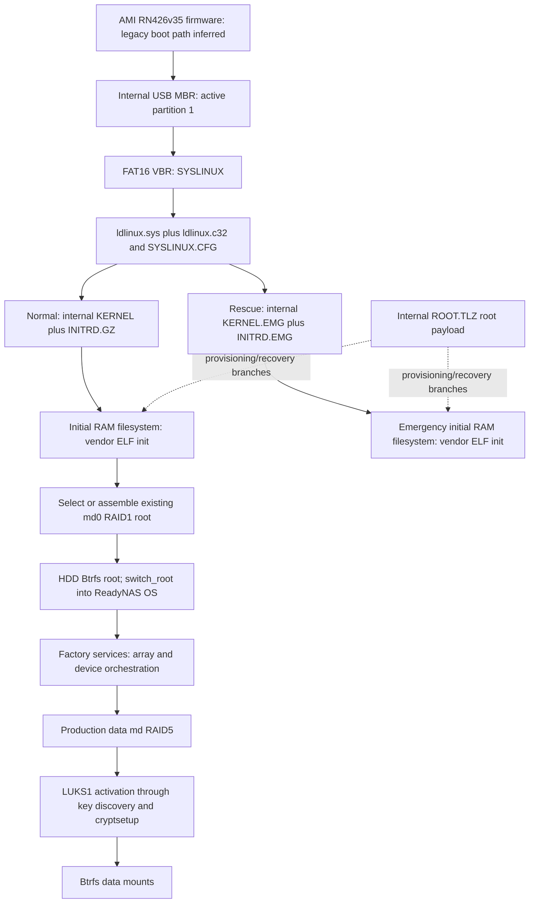

# ReadyNAS RN426 — Internal Boot Module Investigation

Date: 2026-10-31. Scope: passive SSH investigation and future-design analysis only. This report is stored on the local development computer. No boot-switching script, boot changes, image acquisition, installation, device-state changes, reboot, commit or push was performed.

Finding classes:

- **VERIFIED** — observed on the appliance, or explicitly identified as a documented upstream capability.
- **INFERRED** — supported interpretation, not directly demonstrated.
- **UNKNOWN** — evidence unavailable or insufficient.
- **REQUIRES TEST** — needs a separately authorized experiment.

The earlier [hardware audit](readynas-rn426-audit.md) was read and left unchanged. Its observations about the original unbound USB interface remain historically correct. The user subsequently rebound and mounted the module; this investigation observes that new state without repeating either operation. Earlier verified OS, hardware and storage facts are cited as prior evidence rather than represented as a fresh hardware inventory. No production disk serial numbers or credentials are reproduced here.

## 1. Executive Summary

**VERIFIED:** The factory module is now positively correlated to **USB 13fe:5200 at topology path 1-2**, currently exposed as `/dev/sdg`, with `/dev/sdg1` mounted at `/mnt/internal`. Its complete capacity is **251,658,240 bytes / 240 MiB**. It contains one active MBR partition, **FAT16**, labelled `readynasos`. The current mount is writable but has `noatime,nodiratime`.

**VERIFIED:** The installed loader is **BIOS SYSLINUX 6.03**, banner `SYSLINUX 6.03 20170706`. Evidence includes the FAT boot-sector OEM identifier `SYSLINUX`, `ldlinux.sys`, ELF32 `ldlinux.c32`, the actual configuration, and the running kernel's loader ID `0x30` identifying Syslinux. This replaces the prior audit's unverified loader hypothesis with direct evidence. There are no GRUB, EFI, chainloading or menu modules in the observed partition directory.

**VERIFIED:** `/SYSLINUX.CFG` defaults to `Normal`, with `prompt 0`, `timeout 30`, serial port 0 at 115200, and `onerror Rescue`. Normal boot uses `KERNEL` plus `INITRD.GZ`; rescue uses the older `KERNEL.EMG` plus `INITRD.EMG`. Both initramfs files, including the one named `.GZ`, are actually LZMA-compressed cpio archives. `ROOT.TLZ` is LZMA-compressed tar, distinct from the currently mounted root filesystem. Its use as a factory-root provisioning/recovery payload is **INFERRED** from vendor init references.

**Recommendation:** **The existing factory loader is a credible candidate for reuse, without disconnecting or replacing the internal module, but it cannot currently select external Debian as installed.** The strongest long-term design is an additive, version-matched BIOS chainloading path to an independently bootable external USB, while keeping `default Normal`, with a separately validated **ADV boot-once** mechanism. Chainloading modules and a suitable ADV-setting helper are currently absent. Actual external BIOS-disk visibility, module compatibility, failure handling and one-shot consumption remain **REQUIRES TEST**.

A simpler alternative is to add a separately named Debian kernel/initramfs on the internal FAT partition and put Debian's root filesystem on external USB. That uses the existing Linux loader directly, but it is not an entirely self-contained external installation: kernel/initramfs updates would also affect the internal module. A pathname pointing to an ordinary external USB filesystem is not a demonstrated cross-device loading mechanism for factory SYSLINUX.

**Important limit:** ADV provides a plausible *next-boot selection*, not an automatic watchdog or return from a hung kernel. Existing `onerror Rescue` does not monitor a running Debian system. Recovery after control transfer generally needs an explicitly authorized reset/reboot and a working console. Factory normal/rescue fallback is also not an innocuous hardware test: vendor init binaries contain root-creation and factory-reset paths.

The least invasive first boot remains a genuine firmware one-time USB choice **if its availability can be established**. Otherwise test the factory-loader design on a verified disposable clone before changing the original. For the future appliance test, all six production disks will be physically removed as specified by the user, the key USB set aside, and the internal module left connected. No such experiment took place now.

## 2. Internal USB Device Identification

### Mount and identity correlation

**VERIFIED** command evidence:

```text
findmnt -rn /mnt/internal -o SOURCE,TARGET,FSTYPE,OPTIONS
/dev/sdg1 /mnt/internal vfat rw,noatime,nodiratime,fmask=0022,dmask=0022,
  codepage=437,iocharset=iso8859-1,shortname=mixed,errors=remount-ro

readlink -f /sys/class/block/sdg
/sys/devices/pci0000:00/0000:00:15.0/usb1/1-2/1-2:1.0/
  host16/target16:0:0/16:0:0:0/block/sdg

USB /sys/bus/usb/devices/1-2:
idVendor=13fe
idProduct=5200
product=USB DISK 3.0
interface driver=/sys/bus/usb/drivers/usb-storage

lsblk ... /dev/sdg
sdg     240M disk
  sdg1  224M part vfat readynasos 6B6B-F920 /mnt/internal
```

The partition sysfs path is under the same block parent and USB interface. Identity was checked before any raw block read. The raw-read code independently asserted the topology path, vendor/product IDs and 491,520-sector capacity before reading 512 bytes each from the device and partition. No other USB storage device was inspected.

**VERIFIED:** `/mnt/internal` is an actual mount, not merely a directory inside the HDD root. Its backing device is the user-described rebound module. The current `/dev/sdg` name is incidental. Any future procedure must rediscover the mount source and USB/block ancestry, reject ambiguity, and never rely on the letter `g`.

**INFERRED:** This is the physically internal factory module, strongly established by topology, capacity, factory loader contents and matching active kernel. Its actual connector has not been inspected physically.

### Read-only limitation

The mount was already `rw` when this investigation began and remained so at the final check. `errors=remount-ro` is an error policy, not a read-only mount. `noatime,nodiratime` suppress ordinary file/directory access-time updates and reduces incidental filesystem writes caused by reads. Nevertheless, no claim is made that the module was hardware write-protected or immune to concurrent vendor activity. No atime policy, mount option, device binding or firmware state was changed. No write operation was intentionally issued by the investigation.

The previous local SSH control socket had already been closed. A new authenticated SSH transport to the same supplied NAS was therefore necessary; the presented host fingerprint matched the previous session. No interactive root shell or boot utility was executed. Credentials were excluded from saved evidence and this report.

## 3. Partition and Filesystem Layout

**VERIFIED:** sysfs reports 491,520 logical sectors of 512 bytes. A bounded read of the MBR gives:

| Area | Sector range | Length | Meaning |
|---|---:|---:|---|
| MBR | 0 | 512 bytes | BIOS boot code, four MBR entries, `55 aa` signature |
| Pre-partition gap after MBR | 1–31 | 15,872 bytes | Not inspected beyond MBR; contents unknown |
| Partition 1 | 32–458,751 | 458,720 sectors = 234,864,640 bytes = 223.984375 MiB | Active (`0x80`), type `0x06`, FAT16 |
| Trailing space outside partition | 458,752–491,519 | 32,768 sectors = 16 MiB | Unallocated according to the MBR; contents unknown |

MBR entries 2–4 are empty. No additional partition was observed. No full-device scan was done to classify the unallocated bytes; they must not be treated as expendable. Their existence is one reason a full physical image is preferable to file-only backup.

The partition boot sector reports `SYSLINUX`, 512 bytes/sector, 8 sectors/cluster, one reserved sector, two FATs, `FAT16`, and the valid `55 aa` trailer. The filesystem UUID is `6B6B-F920`, label `readynasos`. `df -k` reports 229,116 KiB filesystem space, 99,140 KiB used, **129,976 KiB available**, approximately **126.93 MiB**. These are current filesystem free-space figures, not permission to use trailing sectors or resize anything.

### Complete visible file inventory

The directory and bounded depth-3 enumeration showed only these nine regular files, with no subdirectories:

| File | Bytes | Role supported by evidence |
|---|---:|---|
| `SYSLINUX.CFG` | 601 | Factory boot labels and global settings |
| `ldlinux.sys` | 64,512 | SYSLINUX core with two ADV records at its end |
| `ldlinux.c32` | 116,624 | ELF32 little-endian loader component |
| `KERNEL` | 5,656,224 | Linux 4.4.218.x86_64.1 normal kernel |
| `INITRD.GZ` | 4,591,612 | Normal LZMA/newc initramfs |
| `KERNEL.EMG` | 6,243,424 | Linux 4.4.111.x86_64.1 emergency kernel |
| `INITRD.EMG` | 4,313,527 | Emergency LZMA/newc initramfs |
| `ROOT.TLZ` | 80,511,874 | LZMA/tar factory-root payload |
| `CSUMS.MD5` | 128 | Three MD5 entries for normal kernel/initramfs/root payload |

No `chain.c32`, `libcom32.c32`, `libutil.c32`, `menu.c32`, `vesamenu.c32`, `mboot.c32`, GRUB files, `EFI/` directory or `memtest` file was present. The MD5 manifest was read as metadata; its listed payload hashes were not recomputed. MD5 is not an authenticity proof. SHA-256 was calculated only for configuration and loader files, as recorded below.

## 4. Actual Bootloader Identification

### Independent evidence

```text
ldlinux.sys strings:
  SYSLINUX 6.03
  SYSLINUX 6.03 20170706

FAT boot-sector OEM bytes: SYSLINUX
ldlinux.c32 first bytes: 7f 45 4c 46 01 01 ...  [ELF32 little endian]

running /sys/kernel/boot_params/data, selected fields:
  HdrS signature present
  boot protocol 0x020d
  type_of_loader 0x30
  ext_loader_ver 0
  ext_loader_type 0
```

**VERIFIED:** The Linux boot protocol assigns loader type 3 to Syslinux, so the running kernel's `0x30` field corroborates Syslinux use; it is not an encoding of version 6.03. The loader file supplies that version. See [Linux/x86 boot protocol](https://docs.kernel.org/arch/x86/boot.html).

**VERIFIED:** This installed boot path uses the BIOS FAT variant SYSLINUX, not EXTLINUX, ISOLINUX, GRUB or EFI Syslinux. The module has BIOS MBR/VBR code and a FAT filesystem; it has neither an ISO boot layout nor EFI files. **INFERRED:** the running factory firmware path is BIOS/CSM, supported by these findings and the prior absence of EFI sysfs. **UNKNOWN:** other boot modes the AMI firmware may support. A legacy loader cannot simply chainload `BOOTX64.EFI` as though it were another BIOS boot sector.

The banner build marker is `20170706`; loader-file timestamps are from January 2018. Exact NETGEAR build provenance, patches and reproducibility are **UNKNOWN**. Do not assume any random 6.03 or Debian 6.04 COM32 module is ABI-compatible merely because its name matches.

### Baseline hashes

SHA-256 was unchanged at the second read:

```text
SYSLINUX.CFG
15d582a62db8be66e6e733138b26ed5b0a38654513ce99d0a79a7d0f33310198
ldlinux.sys
4901d635877226edb747e3c16f2316384bc528888d20da4c36920c3cb60a18a7
ldlinux.c32
25ebdfd4cc1707f863674640da7ccbb6596b8820a1f12154006a3a12dc9235cd
```

These are evidence baselines for the observed files, not a complete-module backup or evidence of freedom from concurrent writes elsewhere.

## 5. Bootloader Configuration Analysis

The complete, nonsecret factory configuration is:

```text
serial 0 115200 0
timeout 30
prompt 0

default Normal
onerror Rescue

label Normal
kernel kernel
append initrd=initrd.gz reason=normal

label FactoryDefault
kernel kernel
append initrd=initrd.gz reason=factory

label OSReinstall
kernel kernel
append initrd=initrd.gz reason=os_reinstall

label TechSupport
kernel kernel
append initrd=initrd.gz reason=diag

label ReadOnly
kernel kernel
append initrd=initrd.gz reason=vol_ro

label MemoryTest
kernel memtest

label TestDisks
kernel kernel
append initrd=initrd.gz reason=test_disks

label Rescue
kernel kernel.emg
append initrd=initrd.emg reason=rescue
```

**VERIFIED:** All configured kernel/initramfs paths resolve within the internal FAT partition, except the absent `memtest` image. FAT case-insensitivity accounts for lower-case configuration references and upper-case filenames. No `UI`, `INCLUDE`, alternate config, `ONTIMEOUT`, `NOESCAPE`, `ALLOWOPTIONS` restriction, or Debian entry is configured.

**Documented capability:** `timeout 30` represents three seconds in Syslinux timeout units; `prompt 0` suppresses the ordinary prompt, so a visible three-second selection menu must not be assumed. The configuration contains named labels but no graphical/text menu module. Syslinux documentation describes an interruptible boot prompt and serial-console support. Keyboard/serial interruption on this headless appliance is **REQUIRES TEST**. Port 0 is COM1/ttyS0, 115200 baud; the zero flow-control mask requests no listed hardware flow-control bits. See [upstream configuration documentation](https://kernel.googlesource.com/pub/scm/boot/syslinux/syslinux/+/refs/tags/syslinux-6.03-pre20/txt/syslinux.cfg.txt).

**VERIFIED:** `onerror Rescue` names the emergency entry, not `Normal`. **INFERRED from upstream semantics:** it can handle loader-side failures such as an image that cannot be loaded; coverage of errors returned by a particular COM32 chainloader must be tested. It cannot detect a Debian panic/hang after control transfer. Failure of Rescue itself could leave a prompt, loop or halt; no error path was exercised. The missing MemoryTest image means that label is not a verified usable memory-test route.

The active `/proc/cmdline` also contains `console=tty0 console=ttyS0,115200 hpet=disable`. These are not in the inspected SYSLINUX `append` lines. Their injection source, such as a built-in kernel command line, remains **UNKNOWN**. A Debian kernel must receive its own intentional console settings rather than relying on factory kernel defaults.

### ADV state and one-time capability

The final 1,024 bytes of `ldlinux.sys` contain two 512-byte records:

```text
ADV copy 0: head=0x5a2d2fa5, tail=0xdd28bf64, checksum=0xa3041767
ADV copy 1: head=0x5a2d2fa5, tail=0xdd28bf64, checksum=0xa3041767
Both payloads immediately terminate; no tags were present.
```

**VERIFIED:** Two structurally valid, currently empty Syslinux auxiliary data vectors exist. No current boot-once selection was found there. Loader-component strings also include `syslinux_getadv`, `syslinux_setadv` and `syslinux_adv_write`.

**Documented upstream capability:** Syslinux's ADV `--once` option specifies a command for one boot, separately from the persistent default; see [upstream utility documentation](https://kernel.googlesource.com/pub/scm/boot/syslinux/syslinux/+/refs/tags/syslinux-6.03-pre20/txt/syslinux.txt). The [upstream loader implementation](https://raw.githubusercontent.com/geneC/syslinux/master/com32/elflink/ldlinux/ldlinux.c) reads `ADV_BOOTONCE`, attempts to clear/write it, then loads that command. This source is corroboration of the family mechanism, not an exact reproducible source match for NETGEAR's 20170706 build.

**REQUIRES TEST:** this appliance's ADV write/clear behavior and a compatible setting helper. The inspected upstream implementation does not establish a fail-closed guarantee if clearing the record cannot be persisted. A nominal one-shot could repeat if clearing fails. Thus “automatically returns on subsequent boots” is a conditional design goal, not a verified appliance feature. The mechanism deliberately writes internal-module metadata, including during boot; it is not a no-write selection method.

No `syslinux`, `extlinux`, or `syslinux-once` command was found in the NAS command path or inspected binary-name locations. No utility was run or installed. An ADV-aware helper would have to be supplied and reviewed in a future implementation phase; do not hand-edit the end of `ldlinux.sys` or run installer/update modes as a shortcut.

## 6. Factory Boot Chain

### Reconstructed normal path



**VERIFIED:** Kernel header inspection found `HdrS`, protocol 2.13 and 64-bit flag for both images. `KERNEL` embeds `4.4.218.x86_64.1`, build 2023-06-28, matching the running kernel. `KERNEL.EMG` embeds `4.4.111.x86_64.1`, build 2018-01-10. Emergency is significantly older; its successful recovery of the current system is untested.

**VERIFIED:** Both initial RAM filesystem files have LZMA-alone headers and parse as `070701`/newc cpio. Each contains a vendor ELF64 `/init`, a `bin/start_raids` symlink to `../usr/bin/rnutil`, and `libreadynas`. Normal `/init` is 82,656 bytes, emergency `/init` 82,296 bytes. Neither is an inspected shell script. No archive file was extracted to the NAS or saved locally; only entry metadata and selected boot-related static strings were reported.

Selected static code evidence:

```text
normal and emergency init:
  /dev/md0
  /sbin/switch_root
  /media/boot/root.tlz
  /sysroot/.os_reinstall
  /dev/boot_reason
normal init:
  No partitions found on any disk!  Going to factory default...
  Factory default initiated due to new disks (no RAID, no partitions)
emergency init:
  tar xaf /media/boot/root.tlz
  Format used disks requested!  Going to factory default...
```

**INFERRED:** Vendor init discovers the factory root array, handles boot-reason/boot-menu logic, and switches to the HDD root. This is supported by static strings and the prior verified `/dev/md0` root mount, not a full control-flow reverse engineering. The exact ordering of every vendor decision is **UNKNOWN**.

| Location | Established content / role |
|---|---|
| Internal USB raw sectors | MBR, partition table, FAT VBR; other gaps unexamined |
| Internal USB FAT partition | Loader/core/config, normal and emergency kernel/initramfs, root payload, MD5 manifest |
| Initial RAM filesystem | Vendor `/init`, multicall RAID helper, libraries and early userspace |
| HDD partition-1 RAID1 | Running ReadyNAS root and installed userspace; verified by prior audit |
| HDD partition-2 RAID10 | Factory swap; verified by prior audit |
| HDD partition-3 RAID5 | LUKS1 and production Btrfs data; verified by prior audit |
| External encryption USB | Existing key-unlock dependency from prior audit; not inspected in this phase |
| Other nonvolatile hardware | AMI firmware; exact SPI/VPD storage implementation unknown |

`ROOT.TLZ` yields a tar header with `ustar` magic. Its role as a factory-root payload is **INFERRED** from this and vendor init references. Normal root is not running directly from that archive. The early init also mentions optional `/media/boot/addition.tlz`, `/media/boot/vpd` and `/media/boot/skip_download`; these were absent from the current partition listing. Their branch behavior was not investigated, and no VPD data was opened.

**VERIFIED:** The visible SYSLINUX configuration has no files referenced outside the boot partition. **UNKNOWN:** complete firmware/loader raw-sector dependencies, vendor hardware/VPD requirements and optional init paths. **INFERRED:** the loader itself is self-contained in the module, while a functioning normal ReadyNAS userspace depends on HDD root; these are different claims. A module backup alone is not a backup of ReadyNAS configuration or the production data.

## 7. Recovery and Special Boot Modes

| Label | Images | Boot argument | Assessment |
|---|---|---|---|
| Normal | KERNEL + INITRD.GZ | `reason=normal` | Default and matches running system |
| FactoryDefault | Normal images | `reason=factory` | Explicitly destructive intent; never selected |
| OSReinstall | Normal images | `reason=os_reinstall` | Reinstallation path; can write system/configuration |
| TechSupport | Normal images | `reason=diag` | Vendor diagnostic path; effects not fully mapped |
| ReadOnly | Normal images | `reason=vol_ro` | Vendor mode, not a hardware no-write guarantee |
| MemoryTest | `memtest` | None | Referenced image absent; not usable as verified |
| TestDisks | Normal images | `reason=test_disks` | Maintenance/test mode; outside passive audit |
| Rescue | KERNEL.EMG + INITRD.EMG | `reason=rescue` | Existing loader-error target; actions and compatibility untested |

Read-only proc values remained `bootmenu-enable=0`, `bootmenu-option=Normal`. Static vendor init strings include `Boot Menu`, `entering boot menu`, `boot reason[%d]: %s`, `OS Reinstall`, `Tech Support`, `Volume Read Only` and `Memory Test`; init and rnutil also reference `/dev/boot_reason`. **INFERRED:** reason parameters and vendor kernel/device interfaces participate in special-mode selection. Their precedence, button timing and storage persistence are **UNKNOWN** without source/control-flow analysis or testing.

The **firmware device chooser**, **SYSLINUX label/prompt selection**, and **NETGEAR init/front-panel boot menu** are separate mechanisms. The presence of the latter two does not prove BIOS Boot Override or enable booting another disk. No menu was entered and no `/dev/boot_reason` or button-poll interface was read.

**INFERRED safety implication:** Vendor init contains factory creation/formatting branches. Consequently, deliberately falling back to factory normal/rescue while production disks are absent is not a neutral Debian diagnostic. Those paths may interact with replacement storage or the module itself. Preserve the factory files, use attended tests, and do not rely on Rescue as an automatic non-writing fallback. No factory mode was executed.

## 8. Debian USB Boot Alternatives

### Option A — chainload an external USB bootloader

**INFERRED feasible; REQUIRES TEST on this build and hardware.** Syslinux provides `chain.c32` to load another disk's MBR or partition boot sector. This module is absent. A future additive deployment would need a matching BIOS `chain.c32` and its actual ELF dependency closure, commonly involving `libcom32.c32`/`libutil.c32`; verify the chosen binaries instead of assuming their dependencies or replacing the factory loader components.

Upstream chainloading documentation describes BIOS-number selection and MBR-signature/GPT-GUID selection. Prefer an unambiguous identifier for the expendable external drive; `hd1` is not stable when production disks or other USB devices change. Filesystem UUID selection for Debian root is a separate mechanism. BIOS enumeration and identifier lookup must be tested with the intended hardware. Avoid chain options that save sectors or modify partition entries. See [upstream chain documentation](https://kernel.googlesource.com/pub/scm/boot/syslinux/syslinux/+/syslinux-5.00-pre11/doc/chain.txt) and [chain source](https://raw.githubusercontent.com/geneC/syslinux/master/com32/chain/chain.c).

- Required changes: additive internal module files and a new label or reviewed boot-once command; a complete independently BIOS-bootable external USB, preferably with GRUB i386-pc controlling its own kernel/initramfs/root. No reason to alter factory MBR, VBR, normal images or default.
- Reversibility: remove/cancel only experiment-owned additions after verification; preserve all original files and recovery entries. Full backup remains prerequisite because FAT directory/FAT updates and power loss can damage shared metadata.
- External USB absent: with no override, `Normal` still runs; with an armed override, the loader/chain module can fail or enter existing Rescue. Immediate return to Normal is not verified. SSH preflight cannot guarantee USB presence at boot.
- Debian failure after handoff: no return to Syslinux is assured. A subsequent explicitly authorized reset should follow factory default only if the one-shot was successfully consumed. Console recovery remains required.
- Temporary unbootability: incompatible modules, a wrong BIOS target or failed ADV clear can leave a prompt/hang/repeated attempt. Never select a disk merely by its Linux letter or a guessed BIOS number.

An external UEFI-only installation is unsuitable for this BIOS chainloading path. The external loader is additional, but the internal factory bootloader is retained and its physical connection remains intact.

### Option B — factory SYSLINUX directly loads Debian Linux

**Documented family capability:** SYSLINUX supports Linux bzImage and initrd loading. **INFERRED feasible:** add uniquely named Debian images to the internal FAT partition, leaving factory images intact, and pass an external root UUID. No additional second-stage loader on the external root is required for this route. See [upstream loader documentation](https://kernel.googlesource.com/pub/scm/boot/syslinux/syslinux/+/refs/tags/syslinux-6.03-pre20/txt/syslinux.txt).

**Limitation:** the loader reads files from its boot filesystem. An ordinary path on an external USB root cannot simply be used as if SYSLINUX were GRUB with cross-disk filesystem search. No installed module supplies that abstraction. Thus the straightforward version of B stores Debian kernel/initramfs internally and Debian root externally; it does not load everything from external media.

- Changes: additive kernel/initramfs and label, optionally ADV selection. Reversibility is reasonable after a verified backup, but internal free space is only about 127 MiB. Check the actual compressed images, FAT overhead and safety margin; do not resize or consume unallocated sectors.
- Image constraints: retain the normal x86 bzImage entry, compatible loader protocol, initrd placement/address limits and available boot memory. Neither the 4 GiB RAM total nor filesystem free space proves a large Debian initramfs will load. Compression is handled by the target kernel; use a supported format, and do not infer it from a suffix.
- External USB absent: Debian kernel may start and wait/fail to locate its UUID root, bypassing loader `onerror`. Bounded root-wait behavior belongs in the custom initramfs. Next-reset fallback still depends on consumed ADV.
- Updates: Debian kernel/initramfs updates on external USB do not update internal copies. This couples maintenance to the module; chainloading keeps those updates on the external drive instead.
- Factory recovery: original labels/images can remain byte-for-byte intact, but shared FAT metadata and optional vendor provisioning behavior still require clone validation.

### Option C — one-time firmware selection

**UNKNOWN / REQUIRES TEST:** AMI RN426v35 has not been shown to offer an accessible one-time external USB choice. If available, this avoids editing the module and requires a complete bootable external USB. It must select a BIOS path for consistency, or separately validate a native EFI external path. No firmware variable was queried or altered.

Reversibility is strongest because the module need not change. A missing external device may return to firmware selection/default or halt; a hanging external kernel does not necessarily trigger automatic fallback. Persistence and failure behavior must be observed, not assumed. No generic AMI hotkey is asserted for this RN426. This remains the preferred first test if verified, despite not delivering the SSH-only user experience.

### Option D — temporary selection through existing loader

**INFERRED supported by family design, not yet verified on appliance:** ADV boot-once is the relevant mechanism. An interrupted prompt can also select a label for the current boot without a config edit, but is a console action rather than an SSH-prepared choice. A persistent `DEFAULT Debian` edit with an intention to undo it later is not a one-time mechanism.

ADV requires internal metadata writes and a compatible helper. It can coexist with persistent `default Normal` and additive A/B entries. It does not supply chainloading by itself and does not remove the need for the modules/images described above. No GRUB environment, BootNext variable or vendor next-boot API was discovered that could be assumed as an alternative.

| Option | Additional bootloader? | Internal changes | Next boot with no override | Failure after Debian starts |
|---|---|---|---|---|
| A: chainload | External BIOS loader; matching internal COM32 support | Additions and selection metadata/config | Normal if default preserved | Manual recovery/reset; one-shot consumption must be proven |
| B: direct Linux | No external loader required | Debian images, selection metadata/config | Normal if default preserved | Kernel/initramfs failure; no loader-controlled return |
| C: firmware one-time | External loader | None intended | Factory firmware default, subject to firmware behavior | Manual recovery/reset generally needed |
| D: ADV/prompt | Depends on A or B | ADV write for SSH choice; none for prompt-only choice | Normal after successful one-shot clearing | Does not detect hang or reset hardware |

## 9. Feasibility of an SSH Boot-Switching Script

**Conclusion: feasible as a small orchestration wrapper after validation; not ready to implement safely today.** A pure configuration-file replacement cannot provide a proven one-shot. The proposed wrapper needs a reviewed ADV-aware helper and pre-provisioned, validated boot assets. It should not install/reinstall a bootloader each time.

### Proposed design, not code

1. **Discover and assert identity.** Resolve mount source to a block parent; verify USB ancestry `1-2`, ID `13fe:5200`, complete capacity, active FAT16 partition layout, expected original configuration hash and loader hashes. Abort on mismatches, ambiguity, missing mount, an unknown filesystem or an unexpected pending override. Do not rebind/mount automatically as an implicit prerequisite.
2. **Separate provisioning from selection.** A future explicit provisioning action adds only tested module/dependency/label files for A, or separately named Debian images for B. Preserve `default Normal`, existing recovery labels and original image/core bytes. No HDD configuration, data-array state or firmware variable is involved.
3. **Require a completed backup record.** Record full-image verification plus configuration/loader hashes locally before any change. A script invoked over SSH must fail if its prerequisite backup is absent or does not match the intended baseline. A new backup of an already modified module is a new baseline, not a replacement for the factory baseline.
4. **Validate external media.** Identify a unique expendable USB distinct from the module and key device; check its intended BIOS boot identifier, media marker/manifest, architecture, kernel/initramfs compatibility and chosen root UUID. If an inspection would need mounting an unmounted filesystem, stop and require that separately authorized preparation; do not silently mount it.
5. **Arm only one selection.** Use a tested helper's ADV-only operation, not installer/update/MBR/activate/reset-all modes. Preserve unrelated ADV tags, validate both copies/checksums and read back the intended record. Updating ADV necessarily changes the loader-file hash; compare its code region separately from allowed metadata changes. Do not promise that unchanged full-file SHA-256 is a valid post-arm requirement.
6. **Report state and return.** Report an armed attempt and restoration/cancel instructions; do not reboot. Reboot authorization must remain a separate action. Refuse to replace an already armed request silently. Future cancellation clears only the intended boot-once tag and verifies the result.
7. **Verify after boot.** In the isolated experiment prove that consumption happened before handoff, that the next boot uses Normal, and that missing-media behavior is understood. Do not rely on a post-boot ReadyNAS script to clear the choice: that script cannot run while Debian is hung.

For A, a compatible external loader gives the cleanest separation of normal Debian maintenance. For B, the wrapper also needs an explicit internal-image update process, making the total workflow larger even if the first label is simpler.

### Prerequisites and limits

- A full verified factory-module image, configuration baseline, rollback hardware and a tested recovery console.
- Matching loader/module sources or reproducible compatible binaries; correct BIOS COM32 dependencies; a helper that can run on Jessie-era libc or a separately reviewed self-contained helper. A current Debian executable must not be assumed runnable on Jessie.
- Disposable clone tests of normal boot, one-shot consumption, cancellation, absent media, unbootable target and target-kernel failure. A helper must demonstrate ADV-only writes and handle interrupted operations safely.
- A future maintenance window, production HDD removal and separation of the key USB. No thermal or network success is presumed from loader success.
- No unattended guarantee against power loss, flash failure or hangs. Remote SSH cannot recover a machine that has not booted its network stack.

If ADV does not work reliably with this factory build, the best reversible alternative is **leave Normal as default and select an additive entry manually at the loader prompt**, or use verified firmware one-time selection. A persistent default switch should be a last-resort, explicitly acknowledged multi-boot setting with console restoration available, not disguised as a one-shot. Restoring the factory config from Debian would require accessing the module and is not an automatic safety guarantee. No such script or configuration was written.

## 10. Recommended Safest Boot Method

**First experiment:** independently BIOS-bootable external USB, selected through verified firmware one-time selection if available, with all production HDDs removed and the internal module connected. This makes no intentional changes to factory loader files. If no usable firmware choice exists, postpone appliance boot until a full image and a validated clone-based factory-loader path are available.

**Preferred long-term reuse:** factory SYSLINUX → matched `chain.c32` → external BIOS loader → external Debian. Keep factory Normal as persistent default and use tested ADV only to arm individual attempts. This meets the goal of leaving the internal module connected and retaining its loader, while keeping Debian kernels/initramfs updates outside it. It does require additive internal changes in a later phase; there is no verified zero-change SSH switch to external media today.

**Fallback design:** direct Debian Linux images on internal FAT with external USB root, selected through a tested one-shot or manual prompt. This may avoid COM32 dependency uncertainty but consumes internal space and creates an image-update coupling. It should not overwrite `KERNEL`, `INITRD.GZ`, emergency images or `ROOT.TLZ`.

### Debian 13 amd64 environment requirements

**VERIFIED from prior audit:** Intel Atom C3538 is Intel 64/x86_64 with four cores. Debian 13 supports Intel 64/amd64; no CPU architectural blocker is identified. Whole-appliance operation and thermal behavior remain **REQUIRES TEST**. See [Debian 13 supported hardware](https://www.debian.org/releases/trixie/amd64/ch02s01.en.html).

- **Boot mode:** use a BIOS-capable external loader for chainloading. GRUB i386-pc is a BIOS loader platform name and can load a 64-bit Debian kernel. If native UEFI is tested separately, use a proper EFI removable-media path; do not expect factory BIOS chainloading to switch modes.
- **Kernel:** ordinary Debian amd64 `vmlinuz`/bzImage with normal Linux boot entry. A UKI/PE-only boot workflow or raw ELF `vmlinux` must not be substituted without proving compatibility. Version/header comparison and successful isolated loading are required.
- **Initramfs:** built for that exact kernel, handling its compression, required USB/SCSI/root-filesystem modules and any supplied early microcode correctly. Syslinux passes the initramfs to the kernel; the factory `reason=` logic must not be reused. Large-image/low-memory and initrd-address constraints need testing against the exact files.
- **USB root:** include xHCI PCI/host support, usb-storage or the chosen UAS path, SCSI disk, partition and root-filesystem drivers before root discovery. For a conventional USB installation, use its filesystem UUID, not `/dev/sdX`, and root wait behavior appropriate to the chosen initramfs. Test missing-media timeout separately from successful discovery.
- **Console:** deliberately provide `console=tty0 console=ttyS0,115200n8` if ttyS0 remains the correct interface, with serial getty or RAM-init console access. Bootloader serial output, kernel console and userspace login are separate settings. Electrical connector/pinout still needs verification. See [Debian serial-console parameters](https://www.debian.org/releases/trixie/amd64/ch05s03.en.html).
- **Headless behavior:** visible serial logs and a usable prearranged local/network login are required. NIC naming/IP setup can differ from ReadyNAS. The LCD may not work and is not a dependable boot-progress signal. ixgbe availability does not guarantee network access before userspace configuration.
- **Storage isolation:** the first environment must not auto-assemble MD arrays, open LUKS, activate HDD swap/resume, mount data filesystems or run desktop automount. Review the actual initramfs/udev/userspace rather than relying on switches intended for another distribution. Do not include factory init or its disk-creation fallback.
- **Cooling:** preserve the earlier audit's IT8613E fan-control uncertainty. A short attended boot and proven airflow/temperature monitoring precede any sustained run; do not load or exercise speculative fan/GPIO controls.

| Environment | Advantages | Limits | Recommendation |
|---|---|---|---|
| Full Debian installation on expendable USB | Natural long-term updates and independent external loader/root | Persistent writes to USB; initramfs/services must be reviewed for storage automation | Long-term target, prepared elsewhere |
| Minimal Debian Live/rescue | Fast functional exploration and standard packages | Generic rescue/installer defaults may discover storage; larger initramfs/root payload | Acceptable after explicit configuration review; no installer actions |
| Custom Debian-kernel/initramfs RAM environment | Small, explicit init path; no disk-root dependency or RAID tools needed | Requires deliberate preparation of console/network/drivers | Preferred first hardware-only experiment, booted from external USB |

The initial RAM environment should keep its root in memory and use the external USB for boot assets only. Omit AHCI and MD/crypto activation where practical when SATA testing is not yet needed. This also reduces the consequences of an operational mistake, although physical removal of production HDDs is the principal safeguard for the forthcoming test.

## 11. Factory USB Backup and Rollback Design

**DESIGN ONLY — no image was acquired.** Full-module backup is a prerequisite for future changes. File-only copies preserve configuration and payloads but omit the MBR, partition table, VBR, FAT/directory placement, Syslinux patched sector references, ADV state and unallocated regions. Copying `ldlinux.sys` back as an ordinary file can move it and break its installed boot references. Therefore configuration backup alone is insufficient for reliable boot recovery.

### Future full-image acquisition

1. Obtain separate authorization for imaging and for any state changes needed for consistency. Identify the module dynamically from USB ancestry, ID, capacity, partition table, filesystem identity and known loader hashes. Use exact major/minor identity checks and exclusive target selection, not a hardcoded name.
2. Establish a stable source. The present FAT mount is writable. A raw read of a changing mounted filesystem can yield an inconsistent image, and matching hashes of three files do not prove stability. In a future authorized window, quiesce potential module writers and preferably unmount this partition before imaging. If that cannot be safely arranged while ReadyNAS runs, use a separately planned offline acquisition method. No unmount, sync, service stop or other quiescing operation was performed in this investigation.
3. Read the **whole block device**, exactly **491,520 × 512 = 251,658,240 bytes**, including MBR, gaps, partition and trailing 16 MiB. Stream binary stdout over SSH directly into a restricted-permission local temporary image, with remote diagnostics on stderr. Allocate no NAS image file and use no output block device there. An acquisition transport must not allocate a TTY or merge stderr/banner text with binary stdout.
4. On the local computer require successful SSH/reader status and exact byte count. Treat interrupted/short/oversized output as failure; preserve a clearly incomplete filename until validation succeeds. Calculate SHA-256 locally and record the independently checked source identity/layout and collection conditions.
5. With the source stable, repeat the full read as a second **stream into a local SHA-256 calculation**, checking its byte count/status too, and compare with the local image hash. This verifies transport/repeatability more strongly than hashing only a single received stream. If the source could have changed, repeated matching hashes still do not substitute for the consistency prerequisite.
6. Inspect partition/boot signatures and filesystem structure only in the local image or on a disposable clone. Any later filesystem check must be explicitly non-writing and applied to a copy. Keep the original baseline image immutable to subsequent experiments; store a separate local checksum/manifest and an independent secured copy.

The image is a confidential device backup even though current visible files look like firmware. Unallocated sectors or future additions may contain private information. Keep it local/offline; never publish it in the repository or upload it for analysis. The current report does not establish that imaging is secret-free.

### Future restoration and verification

Prefer restoring first onto an expendable replacement module/USB of suitable capacity and testing it while the original remains preserved. Restoration is destructive and requires a separately authorized exact destination identity check, production HDD isolation, and a non-running/non-mounted destination. A full image preserves fixed sector relationships; arbitrary file replacement does not.

After a future restore, read back the complete restored extent, verify the local baseline checksum and partition/loader metadata, then test factory-loader behavior in the isolated setup. Do not overwrite the working internal module merely to test that restoration is possible. A cloned external USB may differ from the internal module in BIOS enumeration, geometry or USB behavior; clone success is valuable evidence, not proof of every internal-device behavior.

An image does not contain the entire ReadyNAS system on md0 or the encrypted data array. Preserving the module, original disk order, HDD system partitions and independently managed encryption-key recovery are separate requirements. This investigation did not access any key, acquire any disk backup, or verify disaster recovery.

## 12. Remaining Unknowns

| Question | Evidence now available | What resolves it |
|---|---|---|
| Exact loader build/source and COM32 ABI | 6.03/20170706 banner; baseline hashes | Matching vendor source/binaries or validated clone |
| Reliable ADV clearing before handoff | Two valid empty ADV copies; upstream family mechanism | Disposable clone tests with read-back before/after attempts |
| Safe ADV-only setting helper on Jessie | No existing helper found | Source review and host-compatible build in future phase |
| External USB BIOS visibility and disk identifiers | Linux USB identity only | Firmware/loader observation with production disks absent |
| Accessible firmware one-time menu | AMI identity; BIOS loader path | Documented console access and isolated physical test |
| Serial wiring and firmware/loader input | Factory serial settings and running console | Hardware pinout/voltage documentation, then passive console observation |
| Missing-media error control flow | Existing `onerror Rescue`; no chain module | Tests distinguishing missing module, missing target and post-handoff hang |
| Emergency compatibility | 2018 kernel/initramfs and boot label | Source review and isolated recovery validation |
| Full vendor init mode precedence | Static reason/menu/device strings | Matching sources or deeper static code analysis, without executing modes |
| Whether firmware provisioning rewrites boot additions | `/media/boot` copy/provisioning references in init | Source review and clone observation |
| Debian image-size/address behavior | Linux boot-protocol support; internal free space | Test exact intended kernel/initramfs on clone and isolated hardware |
| Cooling and front-panel support | Prior hardware audit | Selected-kernel source review and attended isolated validation |
| Unallocated module contents | Layout only | Separately authorized secured full backup, analyzed locally |

No unanswered question was “resolved” by rebinding, remounting, rescanning, launching a vendor utility, touching firmware variables, executing boot code or accessing secrets. Parts requiring those actions were stopped at the analysis boundary.

## 13. Proposed Next Experiment

**PROPOSAL ONLY.** The user has specified that production disks will be removed before boot testing. This investigation does not perform their removal, shutdown or reboot.

1. First authorize and obtain the stable, verified full-module backup described above, and establish a working recovery console. Keep the original audit and this report as distinct historical evidence.
2. On a development machine, make a disposable clone and test the exact BIOS Syslinux/module/helper combination, including boot-once clearing and absence/failure cases. Prepare an external BIOS-bootable minimal Debian-kernel RAM environment separately, with no production-array activation. No development or USB preparation has been done in this phase.
3. Decide the appliance route based on evidence: firmware one-time selection if actually available; otherwise a separately reviewed additive factory-loader route, backed by clone results. Prefer chainloading for a complete external installation; direct internal Linux images remain a fallback.
4. During the separately authorized maintenance window, shut down properly, remove power, label/remove all six production disks, and set aside the encryption USB. Leave the factory module connected. Do not insert replacement disks during the first USB/RAM-only experiment.
5. Conduct an attended first boot with visible console. Verify selected media, kernel, RAM-root and temperatures/airflow. Do not execute factory-reset, reinstall or disk-test options. If the experiment falls into vendor normal/rescue paths with no disks, stop under the pre-agreed power/recovery procedure rather than exploring factory initialization.
6. After the experiment, verify the intended one-shot has cleared and the baseline factory configuration/core remains as designed. A no-disk test cannot prove ReadyNAS reaches its original HDD root; restoration of HDDs and normal startup is a distinct authorized step with passive storage verification afterward.

**Decision:** reuse of the internal factory loader is **recommended conditionally**, with backup and clone validation first. Physical disconnection of the internal module is not required by the proposed architecture. Neither external boot nor safe unattended fallback has yet been demonstrated on the appliance. The next phase should validate these specific gaps, not replace the obsolete OS in place.

## 14. Read-Only Commands Executed

Collection used fixed reviewed SSH command strings, not an interactive root shell. All redirections and evidence files were local. No commands targeting production RAID, cryptsetup, the key USB, personal files or authentication databases were executed in this phase. The earlier report was read locally, including its package inventory; it was not rewritten.

### Initial connection checks

```sh
findmnt -rn -T /mnt/internal -o SOURCE,TARGET,FSTYPE,OPTIONS
findmnt -rn /mnt/internal -o SOURCE,TARGET,FSTYPE,OPTIONS
cat /proc/cmdline
uname -r
```

The initial sandboxed SSH attempt failed before connection. A network-permitted transport succeeded. Host trust used the previously observed matching fingerprint; credentials and the private address are intentionally omitted. The prior local socket was absent, so a new local ControlMaster socket was used for this phase.

### Exact subsequent remote diagnostic command strings

The Python snippets below are inline in-memory readers, not files or scripts deployed to the NAS. `-B` disables Python bytecode-cache writes. They open only named boot files or metadata; their selected archive processing does not extract or display credential/key entries. Forward traversal decompresses/skips archive bytes to locate metadata and explicitly named boot binaries; it is not a copy of the archive.

<details>
<summary>Diagnostic batch 1</summary>

```sh
findmnt -rn /mnt/internal -o SOURCE,TARGET,FSTYPE,OPTIONS
readlink -f /sys/class/block/sdg /sys/class/block/sdg1 /sys/class/block/sdg/device /sys/bus/usb/devices/1-2:1.0/driver
cat /sys/bus/usb/devices/1-2/idVendor /sys/bus/usb/devices/1-2/idProduct /sys/bus/usb/devices/1-2/product
cat /sys/class/block/sdg/size /sys/class/block/sdg/queue/logical_block_size /sys/class/block/sdg1/start /sys/class/block/sdg1/size
lsblk -o NAME,SIZE,TYPE,FSTYPE,LABEL,UUID,MOUNTPOINT /dev/sdg
ls -la /mnt/internal
find /mnt/internal -xdev -maxdepth 3 -printf '%y %s %p\n'
command -v file od hexdump strings gzip cpio sha256sum python3
```

</details>

<details>
<summary>Diagnostic batch 2</summary>

```sh
cat /mnt/internal/SYSLINUX.CFG /mnt/internal/CSUMS.MD5
strings /mnt/internal/ldlinux.sys | grep -Ei 'syslinux|[456]\\.[0-9][0-9]|copyright|boot:|config|ldlinux' | head -n 35
strings /mnt/internal/ldlinux.c32 | grep -Ei 'syslinux|[456]\\.[0-9][0-9]|copyright|com32' | head -n 25
python3 -c 'import os,struct
base="/mnt/internal/"
for name in ["KERNEL","KERNEL.EMG","INITRD.GZ","INITRD.EMG","ROOT.TLZ","ldlinux.sys","ldlinux.c32"]:
 with open(base+name,"rb") as f: b=f.read(4096)
 print("FILE",name,"size",os.stat(base+name).st_size,"first16",b[:16].hex())
 if name.startswith("KERNEL"):
  print("Linux_boot_signature",b[0x1fe:0x200].hex(),"HdrS",repr(b[0x202:0x206]),"protocol",hex(struct.unpack_from("<H",b,0x206)[0]),"xloadflags",hex(struct.unpack_from("<H",b,0x236)[0]))
  off=512+struct.unpack_from("<H",b,0x20e)[0]
  print("kernel_version",b[off:].split(b"\0",1)[0].decode("ascii","replace"))
p=os.path.realpath("/sys/class/block/sdg")
assert "/usb1/1-2/1-2:1.0/" in p
assert open("/sys/bus/usb/devices/1-2/idVendor").read().strip()=="13fe"
assert open("/sys/bus/usb/devices/1-2/idProduct").read().strip()=="5200"
assert open("/sys/class/block/sdg/size").read().strip()=="491520"
with open("/dev/sdg","rb",buffering=0) as f: m=f.read(512)
print("MBR_signature",m[510:512].hex(),"bootcode_ascii",repr(bytes(x if 32<=x<127 else 46 for x in m[:440])))
for i in range(4):
 e=m[446+16*i:462+16*i]; start,size=struct.unpack_from("<II",e,8)
 print("MBR_partition",i+1,"active",hex(e[0]),"type",hex(e[4]),"start",start,"sectors",size)
with open("/dev/sdg1","rb",buffering=0) as f: b=f.read(512)
print("VBR_OEM",repr(b[3:11]),"bytes_sector",struct.unpack_from("<H",b,11)[0],"sectors_cluster",b[13],"reserved",struct.unpack_from("<H",b,14)[0],"FAT_count",b[16],"signature",b[510:512].hex())
print("VBR_ascii",repr(bytes(x if 32<=x<127 else 46 for x in b)))
'
```

</details>

<details>
<summary>Diagnostic batch 3</summary>

```sh
python3 -B -c 'import lzma,struct,os
for name in ["KERNEL","KERNEL.EMG"]:
 with open("/mnt/internal/"+name,"rb") as f:
  b=f.read(65536)
 off=512+struct.unpack_from("<H",b,0x20e)[0]
 print("KERNEL_VERSION",name,"offset",off,b[off:].split(b"\0",1)[0].decode("ascii","replace"))
for name in ["INITRD.GZ","INITRD.EMG"]:
 print("ARCHIVE",name)
 with lzma.open("/mnt/internal/"+name,"rb") as f:
  for i in range(4000):
   h=f.read(110)
   if len(h)<110 or h[:6] not in [b"070701",b"070702"]:
    print("archive_stop",repr(h[:16]));break
   fields=[int(h[j:j+8],16) for j in range(6,110,8)]
   size,ns=fields[6],fields[11]
   n=f.read(ns).rstrip(b"\0").decode("utf-8","replace")
   f.read((-(110+ns))%4)
   if n=="TRAILER!!!": break
   if n in ["init","linuxrc"] or any(x in n.lower() for x in ["init.d","boot","readynas","syslinux","raid","reinstall","factory","rescue"]):
    print("ENTRY",oct(fields[1]),size,n)
   f.seek(size+(-size)%4,1)
'
command -v syslinux extlinux syslinux-once
ls -l /usr/bin/syslinux* /usr/sbin/syslinux* /sbin/syslinux* /usr/bin/boot* /usr/sbin/boot* /sbin/boot*
cat /proc/readynas/bootmenu-enable /proc/readynas/bootmenu-option
df -k /mnt/internal
sha256sum /mnt/internal/SYSLINUX.CFG /mnt/internal/ldlinux.sys /mnt/internal/ldlinux.c32
```

</details>

<details>
<summary>Diagnostic batch 4</summary>

```sh
python3 -B -c 'import lzma,struct,re
with open("/mnt/internal/ldlinux.sys","rb") as f:
 f.seek(-1024,2); b=f.read(1024)
for i in range(2):
 a=b[512*i:512*(i+1)]
 print("ADV",i,"head",hex(struct.unpack_from("<I",a)[0]),"tail",hex(struct.unpack_from("<I",a,508)[0]),"data_checksum",hex(sum(struct.unpack("<126I",a[4:508]))&0xffffffff))
 p=8
 while p<508 and a[p]:
  tag,n=a[p:p+2]; print("ADV_TAG",tag,"length",n)
  p+=2+n
 print("ADV_terminated",p<508 and a[p]==0)
for name in ["INITRD.GZ","INITRD.EMG"]:
 print("ARCHIVE_SELECTED",name)
 with lzma.open("/mnt/internal/"+name,"rb") as f:
  for i in range(4000):
   h=f.read(110)
   if h[:6] not in [b"070701",b"070702"]:break
   fs=[int(h[j:j+8],16) for j in range(6,110,8)];size,ns=fs[6],fs[11]
   n=f.read(ns).rstrip(b"\0").decode("utf-8","replace");f.read((-(110+ns))%4)
   if n=="TRAILER!!!":break
   if n in ["init","bin/start_raids","usr/lib/libreadynas.so.0.1.1"]:
    data=f.read(size)
    print("SELECTED",n,"first16",data[:16].hex())
    if n=="bin/start_raids":print("SYMLINK",data.decode("ascii","replace"))
    else:
     for s in re.findall(rb"[ -~]{5,}",data):
      if re.search(rb"reason=|factory|os_reinstall|vol_ro|test_disks|bootmenu|syslinux|/dev/md0|switch_root|pivot_root|root.tlz|ROOT.TLZ|initrd|usb-storage|/sys/.*/unbind",s,re.I):
       print("STATIC",s.decode("ascii")[:300])
    f.read((-size)%4)
   else:f.seek(size+(-size)%4,1)
with lzma.open("/mnt/internal/ROOT.TLZ","rb") as f: h=f.read(512)
print("ROOT_payload_first_name",h[:100].split(b"\0",1)[0].decode("ascii","replace"),"tar_magic",repr(h[257:265]))
'
```

</details>

<details>
<summary>Diagnostic batch 5</summary>

```sh
python3 -B -c 'import os,struct,lzma
p="/sys/kernel/boot_params/data"
if os.path.isfile(p):
 with open(p,"rb") as f: f.seek(0x200); b=f.read(64)
 print("RUNNING_BOOT_PARAMS","HdrS",repr(b[2:6]),"protocol",hex(struct.unpack_from("<H",b,6)[0]),"type_of_loader",hex(b[16]),"ext_loader_ver",hex(b[38]),"ext_loader_type",hex(b[39]))
else: print("RUNNING_BOOT_PARAMS unavailable")
# Inspect only boot-relevant entry names and selected executable headers, never credential entries.
with lzma.open("/mnt/internal/INITRD.GZ","rb") as f:
 for i in range(4000):
  h=f.read(110)
  if h[:6] not in [b"070701",b"070702"]:break
  fs=[int(h[j:j+8],16) for j in range(6,110,8)]; size,ns=fs[6],fs[11]
  n=f.read(ns).rstrip(b"\0").decode("utf-8","replace");f.read((-(110+ns))%4)
  if n=="TRAILER!!!":break
  if n in ["usr/bin/rnutil","usr/bin/readynas","etc/syslinux.cfg","bin/sh","sbin/init"]:
   print("INITRAMFS_ENTRY",n,"size",size,"mode",oct(fs[1]))
  f.seek(size+(-size)%4,1)
'
findmnt -rn /mnt/internal -o SOURCE,TARGET,FSTYPE,OPTIONS
```

</details>

<details>
<summary>Diagnostic batch 6</summary>

```sh
python3 -B -c 'import lzma,re
with lzma.open("/mnt/internal/INITRD.GZ","rb") as f:
 for i in range(4000):
  h=f.read(110)
  if h[:6] not in [b"070701",b"070702"]:break
  fs=[int(h[j:j+8],16) for j in range(6,110,8)];size,ns=fs[6],fs[11]
  n=f.read(ns).rstrip(b"\0").decode("utf-8","replace");f.read((-(110+ns))%4)
  if n=="TRAILER!!!":break
  if n in ["init","usr/bin/rnutil"]:
   data=f.read(size);f.read((-size)%4)
   print("SELECTED_BOOT_MODE_STRINGS",n)
   for s in re.findall(rb"[ -~]{5,}",data):
    if re.search(rb"bootmenu|reason|boot_menu|reinstall|Tech Support|Read.?Only|Memory Test|Boot Menu|^Normal$|/media/boot|/sys/.*/unbind",s,re.I):
     print(s.decode("ascii")[:300])
  else:f.seek(size+(-size)%4,1)
'
sha256sum /mnt/internal/SYSLINUX.CFG /mnt/internal/ldlinux.sys /mnt/internal/ldlinux.c32
```

</details>

### Passive inspection limits and local verification

Raw-device inspection was limited to the first 512 bytes of the identity-checked module and its first partition. No image or complete raw-device checksum was acquired. Kernel image reads were bounded first to 4 KiB and then 64 KiB to reach the declared version-string offset. `ROOT.TLZ` inspection decompressed only one 512-byte tar header. Other archive passes enumerated metadata or inspected selected vendor boot-code strings only. No executable from the boot module or archive was run.

Local work comprised reading the earlier Markdown report, checking repository status, capturing nonsecret SSH output under local `/tmp`, writing this report, and checking its structure, evidence and lack of sensitive identifiers. Public research used only public product/software names and upstream source/documentation URLs. Some exact-tag/source URLs were unavailable; those failures were not interpreted as evidence of unsupported appliance features. No collected NAS data was uploaded to research services.

The three configuration/core SHA-256 values and mount options matched at final inspection. These checks support that those specific files were not changed by the investigation; they do not claim a full-device write audit. The module remains in the user's mounted/bound state. No commit or push was performed.
