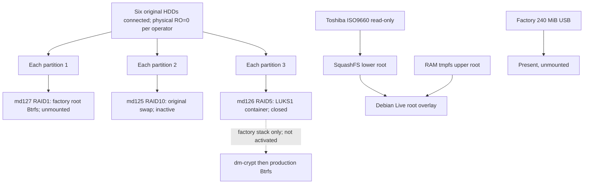

# ReadyNAS RN426 — Debian 13 Live Hardware Compatibility Audit

Audit date: 2026-10-31. Passive SSH measurements: approximately 14:46–14:53 UTC. Diagnostic captures were stored on the development computer. Only this sanitized report is intended for Git; raw logs, credentials, disk serials and WWNs are excluded.

Baselines read: [factory hardware audit](readynas-rn426-audit.md) and [factory boot-module investigation](readynas-rn426-boot-audit.md). Their observations remain historical facts. Current Debian measurements are distinguished from those baselines.

Evidence labels:

- **VERIFIED** — measured in this Debian session, unless explicitly attributed to public documentation/source.
- **OPERATOR-REPORTED** — supplied by the operator, including actions outside this audit.
- **INFERRED** — supported interpretation with limitations.
- **UNKNOWN** — insufficient evidence within scope.
- **REQUIRES TEST** — needs a separately authorized experiment.

Compatibility classes: **WORKING**, **PARTIAL**, **MISSING**, **UNKNOWN**, **REQUIRES TEST**. Driver/module availability alone does not establish functional operation.

## 1. Executive summary

**VERIFIED:** Debian **13.7 Standard Live**, kernel **6.12.107+deb13-amd64**, boots and operates on this RN426. Four CPU cores, RAM, serial console, USB mass storage, both AHCI controllers and all six HDDs initialize. One Ethernet interface, `enp3s0f0`, demonstrates DHCP, SSH, DNS and gateway connectivity at **1000 Mbit/s full duplex**. Three other NIC functions bind to `ixgbe` but have no carrier; their traffic operation remains untested.

**VERIFIED:** CPU temperatures are readable: package **33–34 °C**, cores approximately **29–32 °C** during a short, mostly idle audit. **Fan RPM, board temperature and PWM controls are unavailable in current Debian sysfs.** No IT8613 hwmon device exists. The operator reports continuous loud, fast fans; actual RPM and percentage of maximum are **UNKNOWN**. No controller writes or module loads were attempted.

**VERIFIED, public source:** upstream Linux 6.12.107 `it87` lacks IT8613E support. Newer upstream development source now includes it. A reviewed backport or suitable later kernel is a candidate for investigation, not a tested RN426 solution. This updates support research without invalidating the earlier audit's Linux 6.12 observation.

**VERIFIED:** Denverton GPIO probe fails with `-61`, QuickAssist (QAT) probe fails with `-14`, and EDAC reports ECC disabled on channel 0 and fails to register. Firmware DMAR/RMRR and PCI resource/routing warnings occur. There are zero failed systemd units, which does not negate kernel driver failures. NETGEAR enclosure drivers, LED endpoints and panel-button devices are absent.

**Storage safety finding:** all six production HDDs are connected. Before the first audit command, Live had automatically assembled the three factory MD arrays, complete at 6/6. Initial measurements showed `read-auto`, which permits transition to writes. The operator subsequently made all three strictly read-only and reports `RO=1`; physical HDDs remain `RO=0`. That was an **operator action**, not an audit action. No further HDD/MD queries were issued after they were declared off-limits. Sections 8 and 11 preserve the chronology and describe prevention on future media.

**Assessment — INFERRED:** Debian 13 is a promising standard amd64 replacement foundation, but **not ready for unattended production migration**. Cooling observability/control, enclosure integration, safe activation policy, actual LUKS/Btrfs interoperability, persistent boot and recovery remain unresolved. No installation or migration was performed.

## 2. Actual hardware inventory

### CPU, memory and firmware

| Component | Current evidence | Interpretation |
|---|---|---|
| Board | NETGEAR ReadyNAS 426, revision 03 | Matches factory baseline |
| Firmware | AMI RN426v35, 2018-01-29 | Settings unchanged by audit |
| CPU | Atom C3538, family 6/model 95/stepping 1 | Four online cores, one thread/core, one socket |
| Capabilities | `lm`, `aes`, `pclmulqdq`, `sha_ni`, SSE4.2, VT-x | amd64 and AES-NI capability verified, throughput untested |
| CPU range | 800–2100 MHz | `acpi-cpufreq`, `schedutil`; current-frequency sample 2000 MHz |
| Caches | L1d 96 KiB/4 instances; L1i 128 KiB/4; L2 8 MiB/4 | Modern aggregate reporting matches prior per-core figures |
| Physical RAM | Prior SMBIOS: one 4096 MiB DDR4 record | Physical layout not re-probed |
| Kernel-visible RAM | `MemTotal: 3976932 kB`, about 3884 MiB | Slightly less than factory kernel; reservations/accounting differ |
| Microcode | Boot log early update `0x20` → `0x3e` | Applied by this boot, not BIOS flashing by audit |
| ECC | `EDAC pnd2: ECC disabled on channel 0` | ECC protection unestablished; registration failure is not a measured RAM fault |

Commands: `lscpu`, `free -m`, selected `/sys/class/dmi/id/{bios_vendor,bios_version,bios_date,board_vendor,board_name,board_version}`, `/proc/meminfo`, `sudo -n dmesg --color=never`.

### Complete PCI inventory

All IDs below have vendor ID `8086`. Names come from installed `lspci -nnk` decoding; binding failures were checked through driver symlinks.

| PCI function | Device ID | Device/function | Current driver/state |
|---|---|---|---|
| `00:00.0` | `1980` | C3000 System Agent | No driver listed; host bridge |
| `00:04.0` | `19a1` | Error Registers | No driver listed |
| `00:05.0` | `19a2` | Root Complex Event Collector | `pcieport` |
| `00:06.0` | `19a3` | QAT root port | `pcieport` |
| `00:12.0` | `19ac` | SMBus host | `ismt_smbus` / `i2c_ismt` |
| `00:13.0` | `19b2` | SATA controller 0 | `ahci` |
| `00:14.0` | `19c2` | SATA controller 1 | `ahci` |
| `00:15.0` | `19d0` | xHCI USB | `xhci_hcd` / `xhci_pci` |
| `00:16.0` | `19d1` | LAN root port 0 | `pcieport` |
| `00:17.0` | `19d2` | LAN root port 1 | `pcieport` |
| `00:18.0` | `19d3` | ME HECI 1 | No driver listed; not working UART |
| `00:1f.0` | `19dc` | LPC/eSPI bridge | `lpc_ich` |
| `00:1f.2` | `19de` | Power Management Controller | No driver listed |
| `00:1f.4` | `19df` | SMBus | `i801_smbus` / `i2c_i801` |
| `00:1f.5` | `19e0` | SPI controller | No driver listed |
| `01:00.0` | `19e2` | QuickAssist accelerator | Modules loaded, device unbound after failed probe |
| `02:00.0` | `15e4` | X553 1GbE | `ixgbe`, `enp2s0f0` |
| `02:00.1` | `15e4` | X553 1GbE | `ixgbe`, `enp2s0f1` |
| `03:00.0` | `15e5` | X553 1GbE | `ixgbe`, `enp3s0f0` |
| `03:00.1` | `15e5` | X553 1GbE | `ixgbe`, `enp3s0f1` |

No additional PCI display function appears. A loaded `bochs` DRM module does not establish usable physical video output.

### USB topology and boot-device identity

```text
$ lsusb
13fe:5200  Phison Electronics Corp. DataTraveler R3.0
0930:6544  Toshiba Corp. TransMemory-Mini / Kingston DataTraveler 2.0 Stick

$ lsusb -t
Bus 001 root hub: xhci_hcd, 480M
  Port 002: mass storage, usb-storage, 480M
  Port 003: mass storage, usb-storage, 480M
Bus 002 root hub: xhci_hcd, 5000M; no attached device shown
```

| Role | Identity correlation | Current name, not persistent identity | Current use |
|---|---|---|---|
| Factory internal module | `13fe:5200`, USB `1-2`, 491520 × 512 bytes = 240 MiB, `USB DISK 3.0` | `sdh`, `sdh1` approximately 224 MiB FAT | Unmounted; contents not read |
| Toshiba Live USB | `0930:6544`, USB `1-3`, `TransMemory`, 60549120 × 512 bytes ≈ 28.9 GiB | `sdg`; ISO9660 `sdg1`, small FAT `sdg2` | `sdg1` read-only at `/run/live/medium` |

**VERIFIED:** block sysfs ancestry maps both to xHCI `0000:00:15.0`, with `sdh` at `1-2` and `sdg` at `1-3`. The factory module was `sdg` previously: letters have changed. No SanDisk `0781:5571` encryption-key device appears; physical key custody is not independently verified.

The controller has a 5 Gbit/s root hub, but both attached devices actually enumerate at **480 Mbit/s**. USB 3 transfer performance is untested.

### SATA disks and paths

Collected before the later off-limits instruction; no disk commands followed that instruction.

| Current disk | Model | SATA path | Controller | Capacity, sectors |
|---|---|---|---|---:|
| `sda` | WDC WD120EMFZ-11A6JA0 | `ata5` | `00:13.0` | 23437770752 |
| `sdb` | WDC WD120EMFZ-11A6JA0 | `ata6` | `00:13.0` | Same |
| `sdc` | WDC WD120EMAZ-11BLFA0 | `ata7` | `00:13.0` | Same |
| `sdd` | WDC WD120EMAZ-11BLFA0 | `ata9` | `00:14.0` | Same |
| `sde` | WDC WD120EMAZ-11BLFA0 | `ata10` | `00:14.0` | Same |
| `sdf` | WDC WD120EMAZ-11BLFA0 | `ata11` | `00:14.0` | Same |

Each has 12,000,138,625,024 bytes, 512-byte logical/4096-byte physical sectors. All six negotiated **6.0 Gbit/s**, with NCQ and no ATA error/reset observed in the captured boot. Unused `ata8` and `ata12`–`ata14` are link down; `ata1`–`ata4` are dummy ports. These messages do not indicate failed production disks.

Paths match the factory baseline. Printed bay numbers remain **UNKNOWN** without operator confirmation. No serials or WWNs are reproduced. No SMART command addressed a disk: the already-running smartd journal shows all six opened and added to monitoring. Disk health, temperatures, hotplug and sustained I/O were not tested.

## 3. Boot and kernel diagnostics

### Release and live-root evidence

```text
$ cat /etc/debian_version
13.7
$ uname -a
Linux debian 6.12.107+deb13-amd64 #1 SMP PREEMPT_DYNAMIC Debian
6.12.107-1 (2026-08-29) x86_64 GNU/Linux
$ cat /proc/cmdline
BOOT_IMAGE=/live/vmlinuz boot=live components quiet splash
initrd=/live/initrd.img console=tty0 console=ttyS0,115200n8
```

`/etc/os-release`: trixie, `IMAGE_ID=live`, `DEBIAN_VERSION_FULL=13.7`, build `20260912T075541Z`. On the already-mounted Toshiba, `/live/vmlinuz` is **12142528 bytes**, `initrd.img` **113383147 bytes**, and `filesystem.squashfs` **1284431872 bytes**. Versioned kernel/initrd filenames also exist. No image was downloaded or modified.

```text
$ findmnt -rn -o SOURCE,TARGET,FSTYPE,OPTIONS
/dev/sdg1 /run/live/medium iso9660 ro,noatime,...
/dev/loop0 /run/live/rootfs/filesystem.squashfs squashfs ro,noatime,...
tmpfs /run/live/overlay tmpfs rw,noatime,size=1988468k,...
overlay / overlay rw,noatime,
  lowerdir=/run/live/rootfs/filesystem.squashfs/,
  upperdir=/run/live/overlay/rw,workdir=/run/live/overlay/work,...
```

**VERIFIED:** root is RAM overlay over read-only squashfs, not HDD root. No persistent overlay backing storage appears. Swap was inactive in audit samples; the operator confirms it remains inactive. Credential mounts under `/run` were observed only as mount metadata; their contents were not read.

**VERIFIED/OPERATOR-REPORTED:** EFI sysfs is absent despite `CONFIG_EFI=y`; the operator confirms Legacy BIOS boot. Kernel console is `ttyS0`, 115200n8, with active `serial-getty@ttyS0.service`. Boot log identifies a 16550A at `0x3f8`, IRQ 7. Operator UART interaction works; the audit used SSH and sent no UART input.

Successful external boot does **not** establish how it was selected, factory SYSLINUX chainloading, ADV one-shot operation, unchanged firmware boot order, or automatic return to ReadyNAS. These remain separate from BIOS boot success. The earlier report establishes factory SYSLINUX 6.03; its files were not mounted/rechecked here.

### Initialization and loaded modules

```text
$ systemd-analyze time
Startup finished in 9.401s (kernel) + 15.035s (userspace) = 24.436s
graphical.target reached after 15.033s in userspace.
$ systemctl --failed --no-pager
0 loaded units listed.
$ cat /proc/sys/kernel/tainted
2048
```

The time excludes firmware/loader time. DHCP completed at approximately 28.6 seconds, after target activation. `graphical.target` does not prove a desktop or physical display works.

Taint **2048** denotes a platform-firmware workaround, unlike factory taint 4097 from proprietary/out-of-tree `vpd`. Exact warning-to-taint attribution was not traced. See [kernel taint definitions](https://docs.kernel.org/admin-guide/tainted-kernels.html).

| Function | Selected modules observed in `lsmod` |
|---|---|
| Storage | `ahci`, `libahci`, `libata`, `sd_mod`, `sg`, `md_mod`, `raid1`, `raid10`, `raid456`, `raid0`, `btrfs`, `dm_mod` |
| Live/USB | `xhci_pci`, `xhci_hcd`, `usb_storage`, `uas`, `loop`, `isofs`, `squashfs`, `overlay` |
| Ethernet | `ixgbe`, `libphy`, `mdio`, `8021q` |
| CPU/crypto | `coretemp`, `x86_pkg_temp_thermal`, `acpi_cpufreq`, `intel_cstate`, `aesni_intel`, SHA modules, `ghash_clmulni_intel`, `cryptd` |
| Platform | `lpc_ich`, `i2c_i801`, `i2c_ismt`, `ee1004`, `button`, `wdat_wdt` |
| Other | `qat_c3xxx`, `intel_qat`, `kvm_intel`, `kvm`, `bochs`, DRM helpers, `cfg80211`, `rfkill`, parallel-port modules |

`dm_crypt` and `it87` are not loaded. `pinctrl_denverton` is built in but failed to probe. QAT module presence is not successful accelerator initialization. No modules were loaded or unloaded by this audit.

## 4. Driver compatibility matrix

| Subsystem | Classification | Evidence and limit |
|---|---|---|
| CPU/amd64/basic RAM | WORKING | Live userspace, four CPUs, normal brief idle samples; no memory/load test |
| External Legacy boot | WORKING | Running Toshiba Live; persistent selection/fallback REQUIRES TEST |
| UART | WORKING | Console/getty measured, operator interaction confirmed |
| xHCI/USB storage | WORKING | Live boot and both USB devices; USB 3 throughput untested |
| SATA/AHCI | WORKING | All six disks at 6 Gbit/s; hotplug/sustained I/O untested |
| Active Ethernet | WORKING | enp3s0f0: DHCP, SSH, DNS, gateway, 1 Gbit/s full duplex |
| Other three NICs | PARTIAL | ixgbe binding/capabilities only, no carrier |
| CPU temperature | WORKING | Plausible coretemp and package thermal-zone values |
| Board temperature | MISSING | No IT8613 hwmon; ACPI 0 °C unusable |
| Fan tach/PWM | MISSING | No fan/PWM attributes or current safe control interface |
| Firmware fan fail-safe | UNKNOWN | Fast sound reported, maximum RPM/failure behavior unproved |
| Denverton GPIO | MISSING | Probe -61, no GPIO chips |
| IT8613 GPIO | MISSING | Kernel option disabled, no module/device |
| LCD/OLED/status/bay LEDs | MISSING | Vendor modules absent; no corresponding class endpoints |
| ACPI power button | PARTIAL | Input device registered, delivery/action untested |
| Reset/panel buttons | MISSING | Factory input devices absent |
| SMBus | PARTIAL | I801/iSMT bound; enclosure protocol untested |
| RTC | PARTIAL | rtc_cmos registered/initial clock read; accuracy/alarm untested |
| Hardware watchdog | PARTIAL | WDAT registered, inactive; reset/recovery untested |
| MD recognition | PARTIAL | Three original arrays recognized 6/6; no authorized I/O/recovery test |
| LUKS1/dm-crypt | REQUIRES TEST | Module/algorithms available, cryptsetup absent, no unlock |
| Production Btrfs | REQUIRES TEST | Driver loaded, tools absent, filesystem unmounted |
| SMART monitoring | PARTIAL | Existing smartd monitors six disks; no health certification |
| QAT | MISSING | Admin/init failure; PCI function unbound |
| ECC/EDAC | MISSING | ECC-disabled report, EDAC registration failed |
| NFS/SMB servers | REQUIRES TEST | Servers absent, no shares/workload tested |

## 5. Network interface findings

Commands: `ip -br link`, `ip -br address`, IPv4/IPv6 routes, `ip -s link show dev INTERFACE`, `sudo -n /usr/sbin/ethtool -i INTERFACE`, plain ethtool query, and filtered DHCP journal.

Full MACs were collected locally for correlation; suffixes suffice in the published table.

| Interface | PCI / ID | Factory name for same function | MAC, redacted | NIC firmware | Link |
|---|---|---|---|---|---|
| enp2s0f0 | 02:00.0 / 15e4 | eth0 | xx:xx:xx:xx:xx:f8 | 0x80000700 | No carrier |
| enp2s0f1 | 02:00.1 / 15e4 | eth1 | xx:xx:xx:xx:xx:f9 | 0x80000700 | No carrier |
| enp3s0f0 | 03:00.0 / 15e5 | eth2 | xx:xx:xx:xx:xx:fa | 0x8000071c | **1000 Mbit/s full duplex** |
| enp3s0f1 | 03:00.1 / 15e5 | eth3 | xx:xx:xx:xx:xx:fb | 0x8000071c | No carrier |

All report `ixgbe`, version `6.12.107+deb13-amd64`, twisted-pair 10/100/1000 full-duplex capabilities, autonegotiation on, Wake-on-LAN `g`. No EEPROM/register dump, cable test, self-test or settings command ran. The generic “10 Gigabit Network Connection” boot string does not describe these ports' maximum speed.

The active function differs from factory `eth3`/03:00.1. Cable position/operator changes are **UNKNOWN**; this is not merely renaming that same PCI function. Printed connector mapping is unverified.

**VERIFIED:** `ifupdown`/`networking.service` owns networking, with `allow-hotplug` and `inet dhcp` stanzas for all four interfaces; dhcpcd performs DHCP. NetworkManager, systemd-networkd and systemd-resolved are inactive. `networkctl` reports unmanaged interfaces, consistent with ifupdown ownership. dhcpcd generates resolv.conf using the LAN router as DNS server.

IPv4 is DHCP in `192.168.1.0/24`, with router default route and DNS; host identifiers are omitted. Only a link-local IPv6 address in `fe80::/64` exists on the active interface, without global IPv6 or IPv6 default route.

```text
DHCP journal, addresses omitted:
[15.989] enp3s0f0: carrier acquired
[23.959] offered [LAN address] from [router]
[28.643] leased [LAN address] for 86400 seconds
[29.988] no IPv6 Routers available
[43.123] three other DHCP clients timed out

$ ping -n -c 2 -W 2 [LAN router]
2 packets transmitted, 2 received, 0% packet loss
rtt min/avg/max = 0.353/0.377/0.402 ms
$ getent ahostsv4 debian.org
[public IPv4 answer] STREAM debian.org
```

SSH verifies bidirectional TCP. Active-port snapshots showed zero RX/TX errors, drops, missed packets and collisions. Unlinked-port timeouts and no IPv6 router are explained by current link/network state. Internet throughput, bonding, VLAN traffic, WOL and simultaneous four-port operation were not tested. No configuration changed.

## 6. Temperatures, fan readings, and control capabilities

### Measurements

```text
$ ls -la /sys/class/hwmon/
hwmon0 -> .../thermal_zone0/hwmon0
hwmon1 -> .../coretemp.0/hwmon/hwmon1
$ sensors
acpitz-acpi-0: temp1 +0.0°C
coretemp-isa-0000:
  Package id 0: +34.0°C (high +74.0°C, crit +94.0°C)
  Core 2: +30.0°C
  Core 6: +31.0°C
  Core 8: +32.0°C
  Core 12: +32.0°C
```

Final package sample: 33 °C; cores: 29–32 °C. Sparse core labels are hardware-ID presentation, not 13 usable cores. Four cores are online. coretemp/package-zone agreement supports plausibility; external calibration and load response are untested.

| Interface | Result | Meaning |
|---|---|---|
| CPU core/package | Plausible readings | Usable for attended observation |
| acpitz | 0 °C, trip 94 °C | Invalid current temperature |
| x86_pkg_temp | 34 °C initial sample | Package monitor works |
| Package-zone trip attributes | Two -274000 m°C values | Unusable configured thresholds |
| Board/drive temperature | No board hwmon; no drive-temperature query | UNKNOWN |
| Fan RPM | No fan*_input | Unavailable, not zero RPM |
| PWM duty/mode | No PWM attributes | Unavailable, not a measured disabled mode |
| Throttle counters | Requested thermal_throttle/*throttle_count paths absent | No counter evidence; not proof of no throttling |

Factory measurements were it8613 `temp2_input=33000`, `fan2_input=885`, `pwm2_enable=3`; other -128 °C channels were invalid. Monitoring hardware exists despite missing Debian exposure. Vendor mode 3 must not be equated with another driver's numeric modes.

### Support research and feasibility

**VERIFIED:** `CONFIG_SENSORS_IT87=m`; an in-tree module exists but is not loaded. `modinfo -p it87` reports force_id, ignore_resource_conflict, update_vbat and dangerous fix_pwm_polarity. Passive decompression/string inspection showed it8603/8620/8622/8628 model names, no it8613; this corroborates source comparison, not a complete binary proof.

**VERIFIED, public source:** [Linux 6.12.107 it87 source](https://raw.githubusercontent.com/gregkh/linux/v6.12.107/drivers/hwmon/it87.c) has no IT8613 case. Loading stock it87 is not an established solution. The complete Debian source patch set was not obtained, and later Debian kernels are not covered by this conclusion.

**VERIFIED, public source:** [newer upstream development it87](https://raw.githubusercontent.com/torvalds/linux/master/drivers/hwmon/it87.c), inspected on this audit date, explicitly includes IT8613E, tachometer/PWM register handling and only three currently known temperature inputs. Initialization writes controller registers. This is a candidate, not proof of support in the current image, any particular released kernel or RN426 wiring. Pin and review an immutable revision before a backport; loading it requires separate authorization.

The [a1wong source](https://raw.githubusercontent.com/a1wong/it87/master/it87.c) also has explicit IT8613 detection and chip-specific PWM/pin handling. Its [README](https://raw.githubusercontent.com/a1wong/it87/master/README) contains a historical maintenance/removal notice. Treat it as comparative source, not a validated Debian 13 package. Prefer evaluating a narrowly reviewed upstream backport. Nothing was fetched onto the NAS, built or loaded.

**INFERRED:** missing vendor initialization/management policy probably explains the operator's different fan behavior. **UNKNOWN:** BIOS/SMI involvement, retained Super I/O settings, exact full-speed duty and crash/failure behavior. Loud fans and low idle CPU temperature do not certify cooling under disk workload or management failure.

These drivers involve direct Super I/O access. `/proc/ioports` lists PNP reservations at 0xa00–0xa1f, 0xa20–0xa2f and 0xa30–0xa3f, consistent with prior board evidence but not a fresh chip-ID read. Analyze resource ownership before any candidate load. Do not force another chip ID, force PWM polarity, ignore ACPI conflicts or use raw port utilities.

A complete solution needs a correct chip driver plus board-safe sensor/channel mapping, thermal policy, tach-failure detection and alarms. A generic fan daemon cannot compensate for missing/wrong hardware support. Factory 4.4 modules cannot be copied into kernel 6.12.

## 7. Enclosure-specific functionality

| Feature | Factory evidence | Debian observation | Remaining work / effort, INFERRED |
|---|---|---|---|
| Board integration | readynas-io/readynas-gpio | Vendor modules absent | Reconstruct bindings/policy; substantial |
| LCD/OLED | readynas-lcd/readynas-oled/rnx16-oled | No LCD class or vendor modules | Transport/protocol investigation, driver port or userspace component; moderate/substantial |
| Status/bay LEDs | readynas-led | LED class empty | Controller/pin mapping; physical retained state UNKNOWN |
| Activity LEDs | Factory integration | No LED endpoints | Autonomous behavior possible; needs operator observation |
| Power button | ACPI plus vendor management | Power Button input device, kbd event0 | Event delivery/action untested; do not risk shutdown |
| Reset/directional/panel buttons | rn_button/fb_button/I2CFB | Only Power Button and PC Speaker inputs | Board GPIO/I2C glue missing; no presses tested |
| IT8613 GPIO | gpio_it87 | CONFIG_GPIO_IT87 disabled, module absent | Enable/build correct driver later, then map board pins |
| Denverton GPIO | gpio_dnv registered | CONFIG_PINCTRL_DENVERTON=y, probe -61, no GPIO chips | Analyze binding/resources; loading same driver cannot resolve a built-in probe failure |
| I801 SMBus/front board | Factory client at address 0x1c | I801 bound, no 0-001c client | Missing registration does not mean absent hardware; protocol unknown |
| iSMT | Previously unbound host function | iSMT adapter bound | Controller registration only; no enclosure transaction test |
| PMBus | readynas-pmbus | Vendor module absent, board endpoint unestablished | Identify actual hardware/protocol; no inference that PMBus hardware necessarily exists |
| RTC | rtc_cmos | rtc0, initial clock read | Accuracy/alarm/power-cycle behavior untested |
| Watchdog | Unbound iTCO placeholder | wdat_wdt registered, inactive | Separate timeout/recovery test and policy needed |

Commands: class-directory listings, `/proc/bus/input/devices`, existing I2C `name` and driver links, platform names, selected kernel configuration, modinfo and watchdog sysfs. No scans, EEPROM/SPD reads, GPIO export, input injection or watchdog-device open occurred.

Existing I2C clients: 0-0036/0-0037 (`dummy`), 0-0050 (`ee1004`); contents not read. Adapters: I801 at f000 and iSMT at dff1e000. Passive endpoint enumeration does not establish panel compatibility.

```text
$ cat /sys/class/watchdog/watchdog0/{identity,state,status,timeout,nowayout}
wdat_wdt
inactive
0x200
30
0
```

This is stronger registration evidence than the factory placeholder, **not a tested watchdog**. No `/dev/watchdog*` was opened. NMI watchdog is separate and does not prove appliance reset recovery. Standard GPIO/input/LED/display frameworks may help once bindings are known; they do not supply RN426 wiring or protocol.

## 8. Storage-stack compatibility assessment

### Observed layout and chronology

**VERIFIED before the off-limits update:**

```text
$ cat /proc/mdstat
md125 : active (auto-read-only) raid10 ... [6/6] [UUUUUU]
        1566720 blocks super 1.2 512K chunks 2 near-copies
md126 : active (auto-read-only) raid5 ... [6/6] [UUUUUU]
        58570173120 blocks super 1.2 level 5, 64k chunk, algorithm 2
md127 : active (auto-read-only) raid1 ... [6/6] [UUUUUU]
        4190208 blocks super 1.2

For each /sys/block/md*/md/:
array_state=read-auto; degraded=0; sync_action=idle;
sync_completed=none; raid_disks=6; metadata_version=1.2
For each /sys/block/md*/ro: 0
```

At those samples, no HDD/MD filesystem was mounted, `/proc/swaps` was empty, `/dev/mapper` contained only `control`, and no dm-* block mapping existed. Btrfs sysfs contained only `features`, without a mounted filesystem instance. LUKS remained closed.

**OPERATOR-REPORTED, later state:** the operator executed `mdadm --readonly` on md125/md126/md127. All now show **active (read-only), RO=1**, complete 6/6. Physical HDDs remain **RO=0**, with no swap, HDD mounts or LUKS mappings. This is the latest supplied state; no protected-device query was repeated afterward. Earlier read-auto evidence is retained rather than retroactively presenting initial boot as strictly protected.



MD numbers changed from factory md0 root/md1 swap/md127 data. Match roles by membership/metadata, never number or disk letter.

Two pre-update block-stat samples showed **zero completed writes, zero sectors written and zero discards** for the six HDDs, Toshiba and internal module. HDD read counters were unchanged between those samples. This is reassuring snapshot evidence in this kernel session, not proof against firmware/drive-internal activity, future writes or every state change. Strict MD RO does not protect direct access to underlying RO=0 disks. No write protection was applied by the audit.

### Software and kernel capability

Commands: selected `dpkg-query -W` records, absolute binary paths, `/usr/sbin/modinfo`, `/proc/filesystems`, `/proc/crypto`, running `/boot/config-*`. No refresh/install, unlock, assemble, disk metadata examination, filesystem check or scan occurred.

| Component | Installed/runtime evidence | Limit |
|---|---|---|
| mdadm | 4.4-11, command reports v4.4 | Metadata recognition, not I/O/rebuild/recovery validation |
| MD RAID1/10/5 | CONFIG_MD=y, personalities=m, loaded | Already assembled before audit; no new assembly |
| dm-crypt | CONFIG_DM_CRYPT=m, module available, not loaded | Kernel capability only |
| cryptsetup | cryptsetup/cryptsetup-bin uninstalled | Image lacks required userspace for authorized LUKS recovery |
| AES/CBC | CONFIG_CRYPTO_AES=y, CONFIG_CRYPTO_CBC=y; aesni_intel loaded | /proc/crypto registers cbc(aes)/cbc-aes-aesni; legacy unlock untested |
| Btrfs | CONFIG_BTRFS_FS=m, loaded, ACL support | Driver only; production tree acceptance untested |
| btrfs-progs | Not installed | Later media preparation or separate install authorization needed |
| smartmontools | 7.4-3, smartd running already | Monitoring registration, not health/hotplug test |
| Samba/NFS servers | Packages absent; CONFIG_NFSD=m and NFSv4 enabled | No server/share/workload tests; CIFS module is a client, not SMB server |

**INFERRED:** modern Debian can implement MD RAID5 → LUKS1 AES-CBC → Btrfs. AES-NI does not depend on QAT. Actual LUKS1 parsing and legitimate key discovery/derivation remain unverified. No key, key-file content/name or encryption header was read.

Factory Btrfs exposed ordinary feature names (big_metadata, extended_iref, mixed_backref, skinny_metadata), with vendor kernel/tools. This establishes neither incompatible on-disk changes nor full compatibility. Validate independently protected copies in a separate task, including snapshots/subvolumes, ACL/xattrs, quotas and error behavior. Future read-only mounts also need log-replay and automatic-maintenance prevention; ordinary ro alone is insufficient. See [Btrfs mount documentation](https://btrfs.readthedocs.io/en/latest/btrfs-man5.html). No mount was performed.

### Automatic MD assembly: evidence and prevention

**VERIFIED:** `/usr/lib/udev/rules.d/64-md-raid-assembly.rules` contains:

```text
ENV{ID_FS_TYPE}=="linux_raid_member", GOTO="md_inc"
...
ACTION!="remove", IMPORT{program}="/usr/sbin/mdadm --incremental --export $devnode --offroot $env{DEVLINKS}"
```

Its noiswmd/nodmraid handling follows the native-member branch and concerns IMSM/DDF: these switches do not suppress this native MD 1.2 path. The inspected policy subset of `/etc/mdadm/mdadm.conf` contained only `HOMEHOST <system>`, without observed AUTO restrictions or ARRAY exclusions.

**VERIFIED:** `lsinitramfs /run/live/medium/live/initrd.img` lists mdadm.conf, mdadm/mdmon, both MD udev rules and scripts/local-block/mdadm. The installed local-block script retriggers block events, calls `mdadm --assemble --scan --no-degraded`, and has later last-resort --run paths. It was read, never executed by the audit. The installed build hook copies policy/rules and force-loads RAID personalities.

**INFERRED, strong evidence:** early userspace assembly explains arrays appearing at about 6.49–6.99 seconds, before root systemd userspace. Actual initramfs file contents were not extracted, so the precise executed branch remains unproved. No audit assembly command caused this activation.

**Future design only — no changes applied:**

1. Physically remove production HDDs in a separately authorized powered-off maintenance window for hardware/fan experiments. Preserve order and separate key media. No current removal/shutdown/reboot is authorized by this report.
2. Prepare hardware-only USB media elsewhere, omitting MD activation from both initramfs and root userspace. Review udev, local-block/live hooks, explicit arrays, swap/resume and automount. Stopping mdmonitor alone is ineffective: monitoring is separate from assembly.
3. Where MD tools must remain, a reviewed policy can use `AUTO -all` and explicit `ARRAY <ignore> UUID=[original-array-UUID]` entries, with no positive production ARRAY whitelist. Include policy in the **actual booted initramfs and final root**, covering effective config locations. [Debian mdadm.conf documentation](https://manpages.debian.org/trixie/mdadm/mdadm.conf.5.en.html) specifies AUTO restrictions, explicit-array exceptions and ignore entries. These controls do not prevent deliberate commands or replace physical protection.
4. Consider omitting/masking the incremental assembly rule and early assembly scripts on hardware-only media. Inspect the completed artifact: the installed mdadm build hook can regenerate configuration if no ARRAY line exists. Editing a source root alone does not prove the boot archive has the intended policy.
5. Do not rely on raid=noautodetect, nodmraid, a login-shell environment variable or module blacklist alone. Kernel autodetection differs from userspace MD 1.2 activation; initramfs can explicitly load modules/run mdadm. See [kernel MD documentation](https://www.kernel.org/doc/html/v6.12/admin-guide/md.html) and [Debian mdadm documentation](https://manpages.debian.org/trixie/mdadm/mdadm.8.en.html). Dracut options must not be assumed to control this initramfs-tools image.
6. Test the final image in a disposable VM or on replacement disks carrying MD metadata. Verify no MD devices, swap, filesystem mounts or unlocks and no test-disk writes through boot. Do not test prevention on production members.

Expected effect: MD becomes unavailable automatically on that hardware-test image; an MD-root system would fail to boot with an indiscriminate restriction. Rollback is selecting the preserved original test image/configuration, not changing production metadata. Prerequisites: off-device preparation, final-artifact inspection, console and disposable-array tests. No config edit, initramfs rebuild, rule reload, service action or module change occurred here.

## 9. Resource and performance observations

```text
$ free -m
Mem: total 3883, used 564, free 2855, available 3319
Swap: 0
$ uptime
up 9 min; load average 0.00, 0.06, 0.06
$ vmstat 1 3
two interval samples: CPU idle 100%, no swap-in/out or block output
```

First vmstat row is a boot average; the following two one-second samples were idle. This is not a stress, capacity or endurance test.

Selected meminfo: slab 120220 kB, reclaimable slab 64624 kB, unreclaimable slab 55596 kB, kernel stacks 3328 kB, page tables 3740 kB, cache 778812 kB. Cache can be reclaimed, but tmpfs upper-root content consumes RAM. Its approximately 1.9 GiB limit is not preallocated usage. Extensive Live writes/logs reduce service memory.

Running services included SSH, journald, udev, logind, serial/local getty, cron, Avahi, CUPS/cups-browsed, wpa_supplicant, mdmonitor and smartd. Largest listed process RSS values were about 16 MiB. No SMB/NFS server or custom NAS application ran. Services were not stopped. A dedicated installation can differ; any resource savings are unmeasured.

**INFERRED:** four Atom cores/4 GiB are plausible for modest NFS/SMB and a lightweight management application, but the 60 TB filesystem was not exercised. Likely constraints: Btrfs metadata/cache pressure, snapshots/quotas, concurrent clients, RAID5 parity and encryption CPU. AES-NI and registered CBC acceleration are favorable; QAT is not required for normal dm-crypt. Multiple NICs do not make one ordinary TCP stream aggregate their bandwidth.

A 1 Gbit/s link has a theoretical 125 MB/s raw ceiling before overhead. Toshiba currently runs at USB 2 speed; write performance/endurance are unknown, so it is not established as suitable permanent OS media. Random I/O, slow boot-storage writes and RAM pressure may dominate despite low idle CPU. No throughput, crypto benchmark, load stress or sustained disk I/O occurred. Test representative workloads later using disposable storage and observable cooling.

## 10. Factory ReadyNAS vs Debian 13 comparison

| Area | Factory baseline | Debian Live | Consequence |
|---|---|---|---|
| OS/kernel | ReadyNAS 6.10.10/Jessie, 4.4.218 | Debian 13.7, 6.12.107 | Standard system boots; appliance policy absent |
| Root | HDD RAID1 Btrfs | Toshiba ISO/SquashFS + RAM overlay | Factory root unmounted; Live state generally volatile |
| Loader | Internal BIOS SYSLINUX 6.03 | Module present, unmounted | No new chainload/fallback test |
| SATA | AHCI/six disks | All six at 6 Gbit/s | Basic standard discovery works |
| Network | Four functions, eth3 active | Predictable names, enp3s0f0 active | Name and active function differ; connector mapping needed |
| Fan/board sensor | Vendor IT8613; 885 RPM, board 33 °C | No tach/PWM/board sensor | Main management blocker |
| CPU temperature | Approximately 38–42 °C | Approximately 29–34 °C | Monitor works; different load/fans prevent causal comparison |
| GPIO | gpio_dnv/gpio_it87 | Denverton failure, GPIO_IT87 disabled | Driver/binding work needed |
| Panel | Vendor OLED/LCD/LED/input | Corresponding interfaces absent | Optional UI/indications unavailable |
| MD names | md0 root/md1 swap/md127 data | md127 root/md125 swap/md126 data | Numbers cannot identify roles |
| Data | MD → LUKS1 → mounted Btrfs | MD auto-assembled, LUKS closed | Metadata recognition, not data interoperability |
| Management | readynasd/rnutil/vendor services | Standard Live services | Replace essential thermal/storage/event policy explicitly |
| Watchdog | Unbound iTCO placeholder | WDAT registered, inactive | Potential new capability, untested |
| QAT/iSMT | Previously unbound | iSMT bound; QAT fails | Better enumeration is not complete compatibility |

Factory built-in module names do not provide patch source. No source files appeared in the bounded current `/usr/src` inspection. Obtaining relevant NETGEAR GPL source and comparing patches remains useful future work. No vendor executable/module was run or transplanted.

## 11. Verified problems and relevant log excerpts

Sources: `sudo -n dmesg --color=never`, warning-level kernel output, and `sudo -n journalctl -b -p warning --no-pager -o short-monotonic`. dmesg boot-relative times are used here; imported journal timestamps differ and should not be merged as an exact timeline.

| Finding | Evidence | Interpretation |
|---|---|---|
| Production MD autoactivation | root ~6.49 s, swap ~6.88 s, data ~6.99 s; initial read-auto | Migration safety issue; operator applied strict RO later |
| No fan/board hwmon | Only acpitz/coretemp; no tach/PWM | Unattended-operation blocker |
| Denverton GPIO | `[1.519209] ... probe ... failed with error -61` | Real probe failure, no GPIO chips; exact cause UNKNOWN |
| QAT | `[18.197888] Failed to send admin msg 3 to accelerator 2`; init failed; probe -14 | Accelerator unavailable; no proof of cause or effect on ordinary AES-NI |
| EDAC | `[13.936569] ECC disabled on channel 0`; registration -22 | ECC reporting absent; no measured memory fault |
| DMAR/RMRR | `[0.096266] No firmware reserved region can cover this RMRR`; `Your BIOS is broken; bad RMRR` | Firmware-table defect relevant to DMA/IOMMU; QAT causality unproved |
| NIC VF resources | All four functions: VF BAR 0/3 failed to assign | SR-IOV resource issue; physical-function traffic works on active port |
| Interrupt routing | Root ports/03:00.0: PCI INT A not connected | Does not prevent demonstrated Ethernet; other IRQ reliability untested |
| ACPI sensor | Thermal Zone TZ01 at 0 C | Unusable sensor, not actual board temperature |
| ACPI _OSI | Linux query ignored | No associated failure established |
| ALSA rule | GOTO has no matching label | Noncritical Live rule warning; audio not evaluated |
| Live groups | powerdev/debian-tor missing | Setup warnings; no failed unit observed |
| smartd option | smartd_opts unset | Daemon runs and monitors disks; warning alone is not failure |
| DHCP/IPv6 | Three unlinked ports time out, no IPv6 router | Explained by observed network state |

No panic, oops, production ATA I/O error or active RAID resync appeared in collected evidence. No mounted-production Btrfs error was seen because no such filesystem was mounted; this does not validate it. This is a limited audit, not a health certificate.

After the operator's strict-RO update, collection was limited to OS policy files and the mounted Toshiba initramfs listing. No command changed or retested protected devices. Operator actions remain distinct from audit actions.

## 12. Proposed fan-control test procedure

**DESIGN ONLY — not approved or executed.** Driver loading itself may write Super I/O state even if subsequent queries only read sensors. No universal PWM command is safe for the currently missing interface.

### Prerequisites

1. Separate authorized maintenance window, all production HDDs disconnected while powered off, key media preserved, internal module untouched, UART and on-site operator available. Agree an authorized emergency shutdown/power-cycle procedure first.
2. Pin source explicitly supporting IT8613E; review initialization, pin multiplexing, polarity, register layout and unload behavior against factory evidence. Prefer a minimal upstream backport built elsewhere for the exact kernel ABI. Deployment/headers/build were not authorized or performed now.
3. Resolve PNP/ACPI ownership through source/resource review. Do not force chip IDs, polarity, resource conflicts or GPIO. If ordinary binding cannot work safely, stop that branch.
4. Observe CPU temperature continuously. Require plausible board temperature and stable tach readings before speed reduction. Confirm actual airflow and fan/channel mapping; factory channel 2 is a hypothesis, not sufficient proof.

### Stage A: discovery while retaining airflow

Under separate authorization, load only the reviewed candidate, requesting no speed reduction. Loading may still alter registers: observe immediately over UART and physically. Record hwmon identity, valid temperature channels, RPM, duty/mode and warnings. Stop on unstable sensors or unexpected cooling behavior.

Establish a **documented full-speed operation for the exact driver/chip/channel**, and verify measured RPM/airflow. Do not assume pwm_enable=0, pwm_enable=1 or a factory mode number has universal meaning. Confirm full-scale value and polarity from the reviewed interface. No numeric write command is prescribed before that review.

### Stage B: demonstrate rollback first

Prepare a separately reviewed local timed restorer, independent of SSH, armed before any reduction. It must attempt full-speed restoration on deadline, termination and monitoring loss. Validate normal/error paths first, with independent on-site intervention available. A userspace timer cannot guarantee recovery from kernel hang.

Do not rely on module unloading: registers may retain the last setting. Verified full-speed operation is primary rollback. Returning to firmware, unloading, reboot or power-cycle need prior authorization and known effects. If reliable full-speed return cannot be demonstrated, **do not reduce speed**.

### Stage C: one brief supervised trial

After source, temperatures, RPM, polarity, channel and rollback are proven, authorize one small conservative reduction from verified full duty at idle for approximately **10–15 seconds**, total trial at most **30 seconds**. Sample valid temperatures and RPM about once per second. No fan stop, near-stall duty, unrelated channel changes or load test.

Proposed stop criteria for review: sensor/tach loss or implausibility, unexpected airflow/noise, RPM outside approved range, CPU package **50 °C**, or **5 °C rise** from baseline. These are conservative test limits, not certified RN426 specifications; establish board-sensor limits separately. Restore full speed immediately on any criterion/deadline, verify recovery, then observe at least another minute.

Risks: wrong channel/polarity, stall, firmware/SMI conflict, invalid sensors, retained settings, lost SSH or kernel control. Low CPU idle temperature does not prove disk cooling. Only a later authorized stage should test automatic curves, fan alarms, daemon failure, suspend/shutdown and crash behavior. Unattended cooling needs a proven safe retained hardware policy or equivalent; an exit trap alone is insufficient. No script, daemon, module or service was created on the NAS.

## 13. Migration blockers and risks

| Priority | Risk/blocker | Evidence needed before production reliance |
|---|---|---|
| P0 | Generic Live autoactivates production MD | Disposable-media proof of no autoassembly/mount/swap/unlock; deliberate future policy |
| P0 | No tach/PWM/board temperature | Correct IT8613 driver, mapping, full-speed recovery and failure behavior |
| P0 | Untested LUKS/Btrfs recovery | Protected copies, legitimate key workflow, metadata/source comparison, file recovery |
| P1 | Boot/recovery guarantees incomplete | Verified factory-module backup, selection/fallback and return-to-factory tests |
| P1 | Missing GPIO/enclosure event policy | Resolve binding, necessary GPIO support, button/LED/bay mapping |
| P1 | Only one NIC exercised | Controlled per-port link/traffic tests, connector mapping |
| P1 | No representative workload | Disposable storage, safe cooling, NFS/SMB/RAID/crypto/Btrfs/RAM tests |
| P1 | Volatile Live/USB endurance unknown | Suitable dedicated OS storage, persistent policy and logging |
| P2 | Firmware/QAT/EDAC issues | Determine relevance/root causes; do not flash firmware speculatively |
| P2 | Watchdog untested | Isolated reset/recovery test and service policy |
| P2 | Display/visual bay indicators absent | Optional UI port or alternative reliable monitoring |

The current session proves standard Debian userspace can run without readynasd. It does not prove equivalent NAS safety: cooling/fan alarms, disk events, key discovery and recovery orchestration require explicit replacements. LCD absence is principally usability; cooling observability and uncontrolled activation are operational blockers.

## 14. Prioritized next actions

1. Preserve the current boundary: HDDs and MD devices remain off-limits. Operator-applied RO does not authorize mounts/unlocks/probes. Do not reboot as part of this report.
2. Prepare hardware-only media off-device with early/root activation disabled and final artifact inspected; prove on disposable arrays. Use physically disconnected production HDDs for future hardware experiments, in an authorized maintenance window.
3. Pin/review newer upstream IT8613 support and factory register/channel behavior. Plan exact-kernel backport or suitable later kernel; authorize driver initialization separately before the staged fan trial.
4. Preserve the factory-module backup/rollback design from the previous report. Record how the successful BIOS USB boot was selected; test persistence/missing-media behavior only in isolation before internal loader changes.
5. Analyze Denverton binding/resources and required enclosure functions; obtain relevant vendor source. No raw I2C/GPIO probing.
6. Map connectors and test remaining NICs in a controlled later session with management access preserved. QAT repair is optional; ordinary AES-NI already registers.
7. Study recovery/interoperability on protected copies with appropriate tools and confidential legitimate-key handling. Validate vendor Btrfs before any production access or feature-changing write.
8. After cooling is proven, test installed Debian on expendable external storage with workloads, RAM pressure, replacement-disk hotplug, watchdog and recovery. Only then decide on unattended deployment.

### Diagnostic command record and scope

Nine reviewed batches were sent as fixed SSH command strings from the development computer. No remote script/capture file was created. sudo was used only for individually specified passive commands. The login PATH omits /usr/sbin: initial command-v/unqualified modinfo attempts missed installed tools. Absolute paths/package records corrected this: **ethtool, mdadm, modinfo and smartctl are installed**; cryptsetup and btrfs-progs are actually absent.

| Batch | Commands / bounded read interfaces | Purpose |
|---|---|---|
| 01 | date -u; OS release/version; uname -a; /proc/cmdline; sudo -n id -u; lsblk -o NAME,SIZE,MODEL,TRAN,TYPE,FSTYPE,MOUNTPOINTS; findmnt -rn -o SOURCE,TARGET,FSTYPE,OPTIONS; /proc/mdstat and /proc/swaps | Initial system and already-existing topology |
| 02 | lscpu; free -m; uptime; taint; lsmod; selected DMI; EFI existence; /proc/consoles and console active; systemd-analyze time; failed/running units and serial-getty status; command-v tool checks; lspci -nnk; lsusb; lsusb -t | Platform/boot inventory |
| 03 | sudo -n dmesg --color=never; sudo -n journalctl -b -p warning --no-pager -o short-monotonic | Initialization errors |
| 04 | hwmon links and existing name/temp input/label/max/crit/fan input/PWM/enable; thermal-zone type/temp/mode/policy/trips; modinfo attempts; sudo -n cat /proc/ioports; GPIO/LED/watchdog/RTC/LCD/backlight class names; input devices; existing I2C name/driver links; platform names; existing throttle-count paths | Sensors/enclosure, no probing |
| 05 | ip -br link/address; IPv4/IPv6 routes; resolv.conf; net address/operstate/carrier/speed/duplex; ip -s link; networking service states; networkctl; conditional nmcli; interfaces files with secret-pattern redaction; selected lease fields if files existed | Network ownership and state |
| 06 | Selected dpkg-query records; absolute binary checks; /usr/sbin/modinfo for it87/gpio_it87/pinctrl_denverton/dm_crypt/raid456/btrfs/cbc/aesni_intel/iTCO_wdt/wdat_wdt/vendor names; selected kernel config; filesystems and crypto metadata; existing MD state attributes; mapping-directory names; block ancestry/size/sector/stat attributes; vmstat 1 3; selected meminfo; ps -eo pid,comm,%cpu,%mem,rss --sort=-rss; CPU0 cpufreq; selected watchdog state; USB IDs/product/speed; RTC name; sensors | Capabilities/resources, before later storage prohibition |
| 07 | sudo -n /usr/sbin/ethtool -i INTERFACE and plain query, each NIC; mdadm/smartctl version only; binary existence; GPIO/QAT driver links; GPIO/watchdog node names only; filtered networking/smartd journal; selected config; bounded /usr/src names; Btrfs sysfs names; filtered dmesg; existing mounts/MD/swap; two gateway pings and one getent DNS lookup; date | Driver/network confirmation, before storage prohibition |
| 08 | hwmon names/temperature; sysfs block stats; filtered journalctl -b -t dhcpcd; modinfo -p it87; xz -dc installed it87.ko.xz piped to strings/chip-name filter; existing mounts/MD/swap; QAT/GPIO binding existence; date | Final pre-update measurements, module read not executed |
| 09 | Existing MD udev rules, initramfs hook/local-block script; nonsecret mdadm policy with UUID/name redaction; ls -l /run/live/medium/live; lsinitramfs /run/live/medium/live/initrd.img filtered to MD-related filenames; date | After off-limits update: OS-policy/Toshiba reads only, no HDD/MD query |

No detailed disk/RAID probe or SMART self-test was executed. Existing automation had run before the audit and continued normally; smartd's own state files were on the Live RAM overlay. The audit neither started nor stopped that daemon.

Local SSH configuration was consulted; the operator confirmed the address. Live presented a different host key from factory OS, consistent with a different temporary system; it was not independently checked against a separately supplied fingerprint. Password-only SSH used no agent forwarding; credentials were not saved in evidence/report. The local transport was closed after collection.

All capture redirections were on the development computer. Ordinary SSH/sudo logging is incidental. Existing mounts were merely listed; ordinary reads may have access-time effects according to existing mount policy. No secrets, credential mounts, personal files or encryption headers were opened, and no raw image acquired. Public research used only software/hardware names and public sources; device logs/identifiers were not uploaded. No installation, configuration, firmware, bootloader, storage, service, network, GPIO or fan change was performed by the audit. Only this sanitized local report is committed and pushed.
