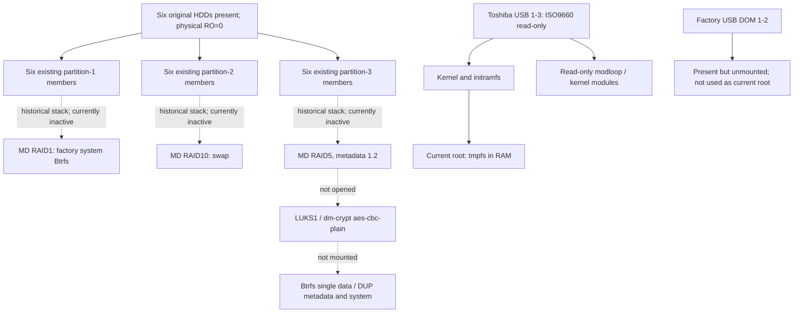

# ReadyNAS RN426 — Alpine Linux Audit for Tenerix Zero

Audit date: **2026-10-31**. Passive target observations: approximately **17:44–17:51 UTC**, after authentication and a release check. Documentation and source review continued locally. Repository baseline: `7e4d4f1`.

Evidence classifications:

- **VERIFIED ON ALPINE** — observed on this running RN426 during this audit.
- **VERIFIED FROM SOURCE** — established by the identified public source, package metadata, or the checksum-verified official ISO; not necessarily exercised on hardware.
- **BASELINE / OPERATOR-REPORTED** — historical measurements or information supplied by the operator, explicitly attributed.
- **INFERRED** — a supported engineering assessment, not an experimental result.
- **UNKNOWN / NOT TESTED** — insufficient evidence or a test outside this authorization.

Baselines read: [factory hardware audit](readynas-rn426-audit.md), [factory boot audit](readynas-rn426-boot-audit.md), [Debian Live audit](readynas-rn426-debian13-audit.md), [IT8613E build investigation](hardware/it8613e/README.md), [panel implementation and hardware results](hardware/front-panel/README.md), and [serial Alpine ISO build](hardware/alpine-serial/README.md). Their historical findings are preserved. Later operator-reported Debian PWM tests supplement the earlier build-only driver report; they are not Alpine results.

## 1. Executive summary and exact Alpine environment

**INFERRED:** Alpine is a viable foundation for Tenerix Zero, and **4 GiB of system storage is practical**. It is **not yet qualified for unattended use with the production volume**. The main gates are actual storage interoperability, cooling observability and fail-safe policy, reproducible kernel/driver updates, and persistent boot/recovery. A successful Live session does not resolve those gates.

**VERIFIED ON ALPINE:** the RN426 boots Alpine **3.24.3 Standard**, kernel **6.18.58-0-lts**, using the external Toshiba USB and Legacy BIOS path. Four CPU cores, RAM, serial console, both AHCI controllers, both USB storage devices, I801/iSMT and all four ixgbe PCI functions initialize. **eth3** carries the SSH audit at **1000 Mbit/s full duplex**. The other three interfaces are administratively down and have not demonstrated traffic.

**VERIFIED ON ALPINE:** all six production HDDs remain visible, but **there are no assembled MD arrays, no device-mapper block devices, no active swap and no mounted HDD filesystem**. All HDDs report `ro=0`. A final sysfs snapshot records **zero completed writes, zero sectors written and zero discards** on each HDD and the internal DOM. Reads have occurred during this boot. These counters are evidence for this kernel session, not hardware write protection or a guarantee about firmware, drive-internal activity, earlier boots or future startup behavior.

**VERIFIED ON ALPINE:** no CPU/board hwmon readings, fan RPM or PWM attributes are currently exposed. `coretemp` exists but is not loaded; the stock `it87` lacks the required IT8613E implementation. No module was loaded to change this. The only thermal-zone sample is the unusable ACPI value **0 °C**. Cooling cannot currently be monitored adequately through this Live session.

**Recommendation — INFERRED:** use **architecture C: kernel/initramfs and two selectable boot generations on the internal DOM, with a conventional Alpine root on the existing small system RAID1**. Keep data RAID activation separate and explicit. No partition resizing or additional permanent storage is needed in this design. It requires future writes to the DOM and system RAID1, and therefore separate implementation authorization; none were performed here.

### Identification evidence

```text
$ uname -a
Linux localhost 6.18.58-0-lts #1-Alpine SMP PREEMPT_DYNAMIC
2026-10-21 10:53:34 x86_64 Linux
$ cat /etc/alpine-release
3.24.3
$ cat /media/sdh/.alpine-release
alpine-standard-3.24.3 261021
$ cat /proc/cmdline
BOOT_IMAGE=/boot/vmlinuz-lts modules=loop,squashfs,sd-mod,usb-storage
console=tty0 console=ttyS0,115200n8 initrd=/boot/initramfs-lts
```

`sdh` here is a transient name correlated with USB topology, not an identifier for future commands. The observed release marker and arguments match the prepared serial ISO; a fresh full-image checksum on the NAS was not taken.

| Item | Actual observation |
|---|---|
| DMI | NETGEAR; product and board `ReadyNAS 426` |
| Firmware | AMI baseline; observed `RN426v35`, `01/29/2018` |
| Boot mode | EFI sysfs absent; running external BIOS/ISOLINUX path consistent with the operator and image baseline |
| CPU | Atom C3538 @ 2.10 GHz, family 6/model 95/stepping 1; CPUs `0-3` online |
| CPU features | `lm`, `aes`, `pclmulqdq`, `sha_ni`, SSE4.2, VT-x |
| Microcode | **0x20**, old-microcode warning; Debian baseline had applied **0x3e** |
| Kernel configuration | Read from the already-mounted Live medium; SHA-256 `7a917830169f855362d1271dfcd90b37bda8766dd39bce7062385f964ecdc3d2`, identical to the locally inspected official ISO config |
| Console | `/proc/consoles`: tty0 and ttyS0 enabled; UART 16550A, I/O `0x3f8`, **IRQ 7**; active VT100 getty |
| Kernel taint | `2052`, bits 2 and 11; not an external it87-module taint claim |
| Current environment | BusyBox, musl **1.2.6-r3**, OpenRC **0.63.2-r0**, apk-tools **3.0.8-r0**, OpenSSH **10.3_p1-r1** |

The target was reached using password authentication already authorized by the operator. Host-key verification remained enabled. No password, authentication database, key or SSH private-key contents were saved or inspected.

## 2. Hardware compatibility matrix

IDs below are PCI vendor **8086** unless a USB ID is given. Bindings were read from sysfs, not inferred from a module name alone.

| Subsystem / identity | Alpine observation | Assessment |
|---|---|---|
| Atom C3538 / four cores / RAM | Running amd64 userspace, four online CPUs, normal brief idle sample | **Working** for Live operation; stress, long-term reliability and NAS throughput untested |
| CPU frequency management | `acpi-cpufreq`, `schedutil`, 800–2100 MHz range | **Working interface**; sampled about 2.1 GHz, no power/thermal qualification |
| Host/system functions `00:00.0/1980`, `00:04.0/19a1` | Enumerated, no driver link | No demonstrated essential failure |
| Event collector/bridges `00:05.0/19a2`, `00:06.0/19a3`, `00:16.0/19d1`, `00:17.0/19d2` | `pcieport` | **Working enumeration** |
| AHCI `00:13.0/19b2`, `00:14.0/19c2` | `ahci`; six disks recognized, SATA 6 Gbit/s links | **Working enumeration/link**; no new I/O, SMART, hotplug or performance test |
| xHCI `00:15.0/19d0` | `xhci_hcd`; USB2 and USB3 root hubs | **Working** for current USB Live boot; USB3 throughput untested |
| Internal DOM, `13fe:5200`, USB **1-2** | USB DISK 3.0, 480 Mbit/s; current `sdg`, 491520 sectors | Present, unmounted; factory files not accessed |
| External Toshiba, `0930:6544`, USB **1-3** | TransMemory, 480 Mbit/s; current `sdh`, 60549120 sectors | **Working** Live boot medium, ISO9660 mounted read-only |
| X553 functions `02:00.0/.1`, IDs `15e4` | Both `ixgbe`, eth0/eth1 | Driver bound; **traffic untested** |
| X553 functions `03:00.0/.1`, IDs `15e5` | Both `ixgbe`, eth2/eth3; eth3 active | eth3 **working**; eth2 traffic untested |
| iSMT `00:12.0/19ac` | `ismt_smbus`, adapter i2c-0 | **Controller registered**; transactions not tested |
| I801 `00:1f.4/19df` | `i801_smbus`, adapter i2c-1 | **Controller registered**; no enclosure access performed |
| LPC/eSPI `00:1f.0/19dc` | `lpc_ich` | Bound; board-specific functions still separate |
| ME/PMC/SPI `00:18.0/19d3`, `00:1f.2/19de`, `00:1f.5/19e0` | Enumerated without driver links | **Unknown** optional functionality; not the working UART |
| Denverton GPIO | `CONFIG_PINCTRL_DENVERTON` disabled; platform object/resources exist, no GPIO chip | **Missing kernel driver in this build**; existing userspace panel path needs separate validation |
| IT8613E GPIO | `CONFIG_GPIO_IT87` disabled | **Missing**; no direct probing performed |
| CPU temperature | `coretemp.ko` available, not loaded; no hwmon instance | **Supported but inactive**, no temperature demonstrated on Alpine |
| IT8613E board temperature/tach/PWM | Stock it87 available but lacks chip support; no relevant sysfs | **Requires backport and hardware test** |
| OLED / navigation buttons | No vendor drivers or input endpoints; existing application not run | **Requires existing custom integration plus Alpine adaptation** |
| Status/bay LEDs | `/sys/class/leds` empty | **Missing software endpoints**; physical/autonomous activity unobserved |
| Power/reset buttons | Loaded `button` module, but input inventory only PC Speaker | **Unknown / not tested**; module presence does not prove delivery or safe actions |
| RTC | `rtc_cmos`, rtc0, boot clock initialization | **Registered**; accuracy, alarm and power-loss behavior untested |
| Hardware watchdog | `wdat_wdt`, watchdog0, **inactive**, timeout 30, nowayout 0 | **Registered**, reset behavior untested; device never opened |
| QAT `01:00.0/19e2` | Modules loaded; initialization fails and PCI device remains unbound | **Not working**; unnecessary for AES-NI or basic NAS operation |
| ECC/EDAC | ECC disabled on channel 0; pnd2 registration error -22 | **No verified ECC protection**; not a diagnosis of faulty RAM |

### Network mapping and measured limitations

```text
PCI          Alpine   Driver   Link / traffic
02:00.0      eth0     ixgbe    administratively down; RX/TX packets 0
02:00.1      eth1     ixgbe    administratively down; RX/TX packets 0
03:00.0      eth2     ixgbe    administratively down; RX/TX packets 0
03:00.1      eth3     ixgbe    carrier=1; speed=1000; duplex=full
```

**VERIFIED ON ALPINE:** eth3 has the supplied LAN IPv4 address, a router default route and a link-local IPv6 address. SSH proves bidirectional traffic. At initial/final samples RX/TX errors were **0/0**, while RX drops increased **206 → 328** and TX drops remained **1**. These counters need later investigation; they are not evidence of a broken link, and no cause was established. No network load, cable swap, settings change or external connectivity test was run. `ethtool` is absent, so fresh NIC firmware-version information is unavailable.

**OPERATOR-REPORTED:** DHCP was used to establish the session. **VERIFIED ON ALPINE:** `/etc/network/interfaces` is absent; the `networking` service is not enabled in the inspected runlevels, and no DHCP client appears in the process-name snapshot. Address retention now is not proof of automatic setup or renewal after a future boot. SSH is manually started rather than enabled in the current default runlevel. Persistent DHCP and SSH-key administration still need deliberate provisioning later.

The generic ixgbe “10 Gigabit” banner does not make these 1 GbE functions 10 GbE ports. Printed connector mapping remains unverified. Published evidence omits full MACs and other unnecessary private identifiers.

## 3. Comparison with Debian 13 findings

| Area | Debian baseline and later tests | This Alpine session |
|---|---|---|
| Kernel / libc / init | 6.12.107, glibc, systemd | 6.18.58, musl, OpenRC |
| Legacy USB / UART | Working | Working Live boot; active serial getty and UART RX/TX counters |
| Active NIC | `enp3s0f0`, PCI 03:00.0 in Debian audit | eth3, PCI 03:00.1; a different function, not only a renaming |
| AHCI / USB | Working enumeration and Live operation | Same basic result |
| MD startup | All three original arrays automatically assembled before audit | **No arrays assembled** in current Alpine state |
| CPU temperatures | coretemp measured 33–34 °C in audit | coretemp not loaded, no usable reading |
| IT8613E | Missing initially; later backport and operator-reported PWM tests succeeded | Stock implementation insufficient; no load or PWM test |
| OLED/buttons | Later panel task verified custom text and all five buttons | Not exercised; two definite software portability issues identified |
| Denverton GPIO | Built-in driver failed with -61 | Driver disabled, platform resources still listed |
| Watchdog | WDAT registered, inactive | Same registration/inactive state |
| QAT / ECC | QAT failure, ECC-disabled/EDAC failure | Similar failures persist |
| Microcode | 0x3e after early update | **0x20**, vulnerability warnings remain |
| Resources | Earlier Debian audit around 185 MiB used | Alpine current short idle sample **104–108 MiB used**; not an equal-service benchmark |

The Debian fan result supplied for this task is **IT8613E rev 3 at 0xa30; PWM2 128 about 1980 RPM, PWM2 80 about 1516 RPM; board about 31 °C during five minutes**. It supports feasibility on this board, not correctness of an Alpine module or an unattended fan policy. The panel report separately records actual Debian text/button events. Neither is relabeled an Alpine measurement.

## 4. Storage compatibility analysis

### Current observed state and historical layout

```text
$ cat /proc/mdstat
Personalities :
unused devices: <none>
$ cat /proc/swaps
Filename                Type        Size        Used        Priority
```

**VERIFIED ON ALPINE:** `/proc/partitions` contains the six HDDs and their three partitions, the two USB devices and loop0, but no md or dm block devices. The mount inventory contains no original HDD filesystem. The final state agrees with the initial sample. No MD personality, Btrfs or dm-crypt module is loaded.

**BASELINE:** all three original arrays use **metadata 1.2**. Each HDD has a 4 GiB partition 1, a 512 MiB partition 2 and the remaining data partition 3. The system RAID1 is about 4 GiB usable; six 512 MiB members in RAID10 near=2 provide about **1.5 GiB total swap**, not a 1.5 GiB partition on each disk. Data is six-member RAID5, left-symmetric, 64 KiB chunk. The actual crypt layer is LUKS1, **aes-cbc-plain**, 256-bit key size. Filesystem allocation is Btrfs **data single / metadata DUP / system DUP**, one Btrfs device over MD, not native Btrfs RAID5.



This audit did not inspect any production superblock, RAID member header, LUKS header, key file, Btrfs tree or user file. Historical UUIDs, serial numbers and private share names are unnecessary here and not repeated.

### Exact kernel and userspace capabilities

```text
CONFIG_MD=y
# CONFIG_MD_AUTODETECT is not set
CONFIG_MD_RAID1=m
CONFIG_MD_RAID10=m
CONFIG_MD_RAID456=m
CONFIG_BLK_DEV_DM=m
CONFIG_DM_CRYPT=m
CONFIG_CRYPTO_AES=y
CONFIG_CRYPTO_CBC=y
CONFIG_CRYPTO_AES_NI_INTEL=m
CONFIG_BTRFS_FS=m
CONFIG_BTRFS_FS_POSIX_ACL=y
# CONFIG_BTRFS_EXPERIMENTAL is not set
```

**VERIFIED ON ALPINE:** `modinfo` locates exact-ABI raid1, raid10, raid456, dm_crypt and btrfs modules. For example:

```text
raid456 depends: async_tx,async_raid6_recov,raid6_pq,async_pq,async_xor,async_memcpy
dm_crypt depends: dm-mod,trusted,encrypted-keys
btrfs depends: xor,raid6_pq
vermagic: 6.18.58-0-lts SMP preempt mod_unload modversions
```

Some BusyBox `modinfo` queries using hyphens did not resolve; repeated queries with actual underscore module names located `dm_crypt`, `i2c_dev` and `hwmon_vid`. No `modprobe`, even for discovery, was used.

| Required layer | Public source / package capability | Current target result |
|---|---|---|
| MD metadata 1.2 and RAID1/10/5 | Standard MD v1 metadata and personalities supported; Alpine `mdadm` **4.3-r3** available | mdadm absent; original arrays not assembled or tested |
| LUKS1 | Alpine `cryptsetup` **2.8.6-r0**; upstream `open --type luks1` supported | CLI absent; no unlock or key access |
| AES-CBC-plain | AES/CBC configured; exact dm-crypt source retains `crypt_iv_plain_gen` and the `plain` selection | Not instantiated; actual decryption untested |
| AES-NI | CPU `aes` flag and matching aesni_intel module | Throughput and loaded crypto implementation untested |
| Btrfs | Driver available; `btrfs-progs` **6.17.1-r1** in v3.24/main | Tools absent; existing metadata not inspected |
| Recovery mount semantics | `rescue=nologreplay` parsed by 6.18.58 and requires read-only mounting | Source verification only, no mount |
| Existing single/DUP profiles | Established, supported upstream profiles | Actual production volume interoperability untested |

References: [kernel MD documentation][MD], [cryptsetup 2.8.6 open semantics][CRYPT], [exact dm-crypt implementation][L6-crypt], [Btrfs profile/status documentation][B-status]. The profile documentation supports availability, not acceptance of this vendor-managed filesystem.

**INFERRED:** the complete MD → LUKS1 → Btrfs stack is implementable on Alpine without converting data. LUKS activation should honor the existing header, not invent new cipher/IV arguments. `plain` is a 32-bit sector-derived IV in the reviewed source; it is not interchangeable with `plain64`, XTS or a new encryption format. No re-encryption, header conversion or keyslot change belongs in an OS installation. The exact NETGEAR key-file preprocessing/VPD dependency remains unknown from the factory audit and must be resolved through a separately controlled recovery test, not guessed.

## 5. Btrfs backward compatibility and recoverability

### What is known, and what is not

**BASELINE:** ReadyNAS uses kernel **4.4.218.x86_64.1**, `btrfs-tools` **4.16-netgear6**, and mounted the data volume with `nospace_cache`. Its sysfs exposed `big_metadata`, `extended_iref`, `mixed_backref` and `skinny_metadata`. This is not an exhaustive current feature-mask dump. Vendor Btrfs patches were not available in the earlier audit, so equivalence to upstream 4.4 cannot be assumed.

**VERIFIED FROM SOURCE:** Btrfs maintains a stable disk format and records incompatible extensions through superblock flags. That design supports newer kernels reading older filesystems; it does **not** promise that every filesystem modified by a newer kernel remains writable by an older vendor kernel. See [upstream format policy][B-status], [6.18.58 supported masks][L6-fs] and [upstream 4.4.218 masks][L4-ctree].

The exact 6.18.58 `fs.h` supports these stable incompat features: mixed backrefs, default subvolume, mixed groups, big metadata, LZO, Zstd, RAID56, extended inode refs, skinny metadata, no-holes, metadata UUID, RAID1C3/4, zoned mode and simple quotas. Supported compat-ro flags include free-space-tree, free-space-tree-valid, verity and block-group-tree. **Extent-tree-v2 and raid-stripe-tree are excluded by the image's disabled experimental option.** Supported by a driver is different from enabled on this volume.

### Feature activation and older-kernel consequences

| Feature/action | Automatic versus explicit in this investigation | Consequence for upstream 4.4 / audit policy |
|---|---|---|
| Existing mixed_backref, big_metadata, extended_iref, skinny_metadata | Already observed historically; 6.18 also ensures mixed-backref and large-node flags as appropriate | Upstream 4.4 supports these; not evidence of a vendor-only format |
| Free-space tree / `space_cache=v2` | An explicit v2 request can create the tree during RW mount and set compat-ro flags; an existing tree is retained | Introduced in **4.5**; upstream 4.4 has `COMPAT_RO_SUPP=0`, so cannot mount it RW |
| `nospace_cache` | Explicitly clears v1/v2 mount choices in this exact parser; prevents selecting v2 on a filesystem without it | Useful conservative test setting, **not a general no-upgrade switch** |
| Already-enabled free-space tree plus `nospace_cache` | Exact 6.18 check refuses disabling it without `clear_cache` | Stop and inspect baseline; do not add a conversion/clear operation to make a mount succeed |
| Zstd compression | Explicit compression policy or file property can select it; mount/write paths can set COMPRESS_ZSTD | Upstream 4.4 lacks it, preventing normal mount; do not enable it or recompress files |
| No-holes | Supported by both inspected kernels; modern mkfs defaults differ from old mkfs | Not a reason to enable/tune anything on production; preserve baseline |
| Metadata UUID, RAID1C3/4, simple quotas | Require corresponding creation/conversion/configuration; not a blanket first-mount upgrade | Unsupported new formats must not be enabled for a legacy-compatible test |
| Verity / block-group tree | Explicit feature use/conversion; compat-ro effects | Can prevent old-kernel RW access; not permitted for baseline-preserving testing |
| Checksum algorithm / sector size / existing single/DUP profiles | No general automatic replacement merely because a newer kernel is used | Do not reformat, convert checksum or balance-convert profiles |

Feature introduction dates are documented in [Btrfs feature history][B-history]; behavior assertions above are tied to exact source, not a statement about every current or future release.

**Important version distinction:** current online documentation describes newer defaults, including free-space-tree as a default. In **this exact 6.18.58 source**, `btrfs_init_fs_context()` zero-initializes the options, and `btrfs_set_free_space_cache_settings()` respects explicit choices and otherwise adopts an on-disk v2 tree or an active v1 cache. It does not indiscriminately create v2 on every old, cache-disabled filesystem. Bare `space_cache` parses as v1 here. The subpage/v1 compatibility path can select v2 in its specific case; block/page-size assumptions still require validation. Do not apply latest-manual defaults blindly to this image. Conversely, this source review is not permission to try an unspecified RW mount. [Exact parser and cache selection][L6-super]

The inspected upstream 4.4 source supports the four historically observed features and no-holes, but **no compat-ro features**. This is a reference comparator, not proof that NETGEAR never backported free-space-tree support. Until vendor code or a test demonstrates otherwise, treat enabling v2 as losing the old system's RW path. Removing v2 later involves another metadata-changing operation, not a guaranteed rollback.

### Mount-time writes before an application writes a file

**VERIFIED FROM SOURCE:** `open_ctree()` calls tree-log replay before its `sb_rdonly()` early return. A plain read-only mount can therefore write. With the NOLOGREPLAY option set, that path is skipped. `rescue=nologreplay` is supported and belongs to the hard-read-only option mask; it must not be combined with a proposed RW test. [Exact open/mount path][L6-disk]

`btrfs_start_pre_rw_mount()` performs filesystem-root/orphan cleanup, relocation recovery, free-space-tree maintenance, cache-state updates, and attempts to resume pending balance/device-replace work. Later UUID-tree maintenance and ordinary transactions can also change metadata. `skip_balance` prevents automatic balance resume; it does not suppress every mount-time action. `nospace_cache` does not disable log replay, orphan cleanup, transaction commits, quota accounting or relocation recovery. Exact code: [pre-RW initialization][L6-disk]. See also [upstream recovery/mount-option documentation][B-mount].

**INFERRED:** ordinary transactions using only old supported formats are intended to remain format-compatible; there is no evidence here that any newer-kernel write automatically makes every old filesystem unreadable. Nevertheless, unchanged feature masks are **necessary evidence, not sufficient proof** of compatibility with a heavily modified 4.4 implementation. New transactions and log records, stricter tree validation, bug fixes and vendor quota/snapshot behavior may expose interoperability defects without a convenient new incompat bit. Conversely, disabling a feature does not undo file deletions or previous transactions. **A safe return to the original kernel cannot be guaranteed by this audit.**

### Separate proposed compatibility procedures — none executed

**A. Preserve a recoverable baseline first.**

1. Establish independent, verified data backup/recovery capacity and controlled custody of the legitimate unlock material. Existing RAID redundancy, Btrfs snapshots and the factory DOM are not independent data backups. This audit did not inspect or copy a key or acquire any image.
2. Under a separate maintenance authorization, obtain consistent member/volume copies or a complete restorable equivalent while writes are quiesced. Record disk order, array metadata/layout, LUKS header and filesystem baseline through an approved sensitive-data workflow. Keep immutable originals separate from all working copies.
3. A LUKS-header backup is security-sensitive; protect it outside Git and do not confuse it with a data backup. A Btrfs metadata-only dump is useful diagnostically but cannot restore all data. A snapshot of the same filesystem also shares the failure domain and superblock features.
4. Prove a restore/read path on separate storage before any production RW acceptance. Capacity for a genuine baseline of this approximately 55 TiB volume is a real outstanding prerequisite, not an administrative detail.

**B. Future read-only verification on protected copies.**

1. Disable auto-activation in the test image before attachment. Use physically write-protected originals only if a separately reviewed process authorizes them; prefer independent copies. Verify every layer, not only an MD read-only label.
2. Assemble only the copied existing array, strictly read-only, without force, recovery, resync or metadata recreation; open only its copied LUKS container read-only using authorized key handling. These are future operations, not commands executed now.
3. Before mounting, record all Btrfs superblock mirrors and raw compat/compat-ro/incompat masks, generation, log-root state, checksum type, sector/node sizes, device count and profiles. A future `btrfs inspect-internal dump-super -a` against the copied decrypted device is an inspection candidate, **not authorized on today's originals**. Confirm exact tool semantics and avoid any repair mode.
4. Mount the copy with **`ro,rescue=nologreplay,skip_balance,nodiscard`** and verified read-only lower layers. If baseline cache flags are known absent, explicitly retaining `nospace_cache` can be evaluated; do not use `clear_cache` to bypass a conflict. No rescue modes that ignore checksums/bad roots should be added silently. Missing log replay can hide the newest uncommitted updates and is not a full recovery certification.
5. Validate representative files against independent checksums, subvolumes/snapshots, permissions, xattrs/ACLs and relevant quota expectations. Never mount a production filesystem and its UUID-identical clone in the same kernel without a separately designed isolation strategy.
6. After releasing the test mappings, compare copy hashes/block-change records and metadata baselines. Stop on any write, unsupported feature or filesystem warning. Preserve results locally.

**C. Future explicitly authorized RW testing on a fresh disposable copy.**

1. Start again from the immutable baseline, not the copy altered by prior experiments. No writable attachment of the only originals is acceptable as the initial compatibility test.
2. Inspect feature masks and inherited compression properties first. For a cache-disabled legacy baseline, evaluate **`rw,nospace_cache,skip_balance,nodiscard,noatime,compress=no`**, with autodefrag disabled and no administrative conversions. These options reduce selected changes; **they do not stop ordinary metadata transactions or prove compatibility**. `rescue=nologreplay` is intentionally absent because the kernel requires it to be read-only.
3. Perform a short, bounded set of create/read/rename/delete/fsync operations in a designated disposable test directory, including representative snapshots/ACLs only where explicitly included. Watch logs and memory. No NFS clients, background maintenance, quota changes, balance, repair or stress load during the first test.
4. Cleanly stop writes/unmount the copy. Compare all superblock feature masks and relevant metadata with baseline; generations and data will legitimately change. Record exactly which flags changed, not only a symbolic summary. Any unexpected flag is a stop condition, not permission to clear it.
5. Test the modified copy with an isolated, matching ReadyNAS/vendor-kernel environment: RO first, and RW only on another disposable branch/copy if legacy RW is an acceptance requirement. Upstream 4.4 alone does not reproduce NETGEAR code. A successful finite test reduces uncertainty but cannot guarantee every future workload.

**Prohibited for maximum legacy compatibility:** new feature toggles through btrfstune/sysfs/ioctls, `space_cache=v2`, cache clearing/rebuilding, Zstd policy or recompression, checksum/UUID conversions, simple-quota/verity changes, balance/profile conversion, add/remove/replace/resize, repairs/rescues, automatic scrub/balance/defrag/discard, and any LUKS/MD conversion. Routine RW operation itself requires a recoverable baseline. Retaining the old OS is not a final design requirement; that does not remove the need to protect data during this transition.

## 6. Automatic RAID assembly and disk-write risks

**VERIFIED ON ALPINE:** no array is currently assembled, and no original mount/swap/unlock is active. **VERIFIED FROM SOURCE:** this should not be interpreted as a universal Alpine promise.

The exact **mkinitfs 3.14.1** source is particularly relevant:

```c
/* nlplug-findfs/nlplug-findfs.c: start_mdadm(), around line 503 */
char *mdadm_argv[] = {
    MDADM_PATH, "--incremental", "--run", "--quiet", devnode, NULL
};
if (use_mdadm)
    spawn_command(&spawnmgr, mdadm_argv, 0);
/* use_mdadm is enabled when /sbin/mdadm is executable. */
```

When its filesystem identification returns `linux_raid_member`, discovery can call this function. The Live init script invokes `nlplug-findfs` for boot repository/apkovl discovery. Local inspection of the exact ISO initramfs found **RAID personality modules and nlplug-findfs, but no mdadm executable or mdadm.conf**. The root package inventory also lacks mdadm. This explains the observed non-assembly plausibly; it is not a trace proving every historical boot branch. [Versioned discovery source][MK-nlplug], [versioned init script][MK-init]

The same discovery source can mount candidate filesystems with `MS_RDONLY` while looking for repositories/overlays. That is not an isolation guarantee for journaled filesystems or Btrfs. Normal startup also loads device drivers and invokes mdev. The current `/lib/mdev/persistent-storage` calls `blkid` on discovered devices; the audit read the script but did not execute it or trigger events. Boot-time reads are therefore expected, even with no arrays assembled at audit time.

Additional future activation paths:

| Path | Reviewed behavior / risk |
|---|---|
| Kernel legacy autodetect | Disabled here; in general not the userspace mechanism for this native MD 1.2 layout |
| mkinitfs RAID feature | Includes `/sbin/mdadm`, `/etc/mdadm.conf` and RAID modules; adding it can change early-boot behavior |
| OpenRC `mdadm-raid` | Starts configured arrays through `mdadm --assemble --scan --quiet`; orders before fsck/swap |
| OpenRC `btrfs-scan` | Loads Btrfs and runs device scan before localmount; registration, not a filesystem mount |
| OpenRC `dmcrypt` | Supports configured encrypted targets and removable key media; must not be enabled blindly |
| `fsck`, `localmount`, `swap` | Can check, mount and activate items from configuration; current fstab only has noauto removable-media placeholders |
| udev/eudev added later | Can introduce additional incremental-assembly rules; this session uses mdev |

**Design only:** for a hardware-only image, omit mdadm from early userspace and disable activation rules/services, swap/resume, storage overlays and broad boot discovery where possible. For the proposed MD-root installation, whitelist **only the system array** in early userspace, with a reviewed MD policy excluding the data/swap arrays. `AUTO -all` plus correct explicit ARRAY/ignore policy is a candidate to validate against mdadm 4.3, not a complete physical write barrier. The reviewed `--incremental --run` path makes broad discovery particularly important to test. No such policy was applied.

Inspect the **finished initramfs**, not just `/etc` on the build machine. `raid=noautodetect`, stopping a monitor, an MD `read-auto` state, or generic dracut parameters cannot be assumed to suppress this mkinitfs userspace code. Test boot and hotplug policy against disposable MD 1.2 arrays, including foreign arrays, before production attachment. Physical isolation or verified write blockers remain the strongest protection for experiments. [Kernel MD behavior][MD], [Alpine MD package/service source][APK-md]

### Counter evidence and its limits

The audit read `/sys/class/block/{sda,...,sdf,sdg}/stat`, not the block devices. All seven showed write-I/O count **0**, write-sector count **0**, discard count **0**. Example:

```text
sda: reads completed=112; sectors read=14120; writes completed=0;
     sectors written=0; discards completed=0; sectors discarded=0
sdg (DOM): reads completed=92; sectors read=5034; writes/discards=0
```

These are reassuring observations, not assurance that production disks were inaccessible. All six HDDs and the DOM still have `ro=0`. No protection setting was changed. No fresh partition-table, blkid, SMART, mdadm, cryptsetup or Btrfs probe was issued by this audit.

## 7. IT8613E fan-driver portability

**VERIFIED ON ALPINE:** stock `it87.ko` exists; its metadata reports dependencies `hwmon,hwmon-vid` and vermagic **`6.18.58-0-lts SMP preempt mod_unload modversions`**. Stock file SHA-256 is `08054442cb091d113e7466e237ddfb5e07a8f291f5d9ae15bd733c849e700cf7`. It is not loaded. Matching hwmon_vid and coretemp modules exist. The Debian binary must not be inserted into this kernel.

**VERIFIED FROM SOURCE:** exact upstream 6.18.58 `it87.c` lacks IT8613E and is **byte-identical** to the 6.12.107 source already retained in the repository:

```text
SHA-256 for both baseline it87.c files:
d3f9079cd77c725817ea448f52af9adba9e8bd057feb4d4e4643896adcbba4ee
```

Source comparison used Linux 6.18.58 commit **`2926d88bb7fc4608fd942453d929c39e4e5ec006`** and Alpine package recipe commit **`5fe63f789de75f6a71001cf2de771f922bedd0d2`**. The recipe's listed Alpine patches do not add IT8613E or alter the reviewed Btrfs sources. [Exact hwmon source][L6-it87], [Alpine 6.18.58 recipe][APK-lts58]

The existing three upstream commits remain the relevant feature series:

1. `28e319062056586c255bac750eca2b595c19c31f` — per-chip PWM temperature-map counts.
2. `ab003112b4948774057bde1c488b0bdbd96d687c` — register-map infrastructure and masks/shifts.
3. `600a85f556b783b5c619c4b6a576d5b2471be1ca` — IT8613E support.

**VERIFIED LOCALLY, file-only test:** applying the raw first mainline patch with zero fuzz fails in **two IT8689-context hunks**, as expected for a stable driver without IT8689. This is not a reason to force patch application. A separate **dry run** of our consolidated, already-reviewed backport against the exact 6.18.58 baseline succeeds with zero fuzz. No adapted source or module was built on the NAS, and no new driver code is part of this audit deliverable. Full API/ABI build validation remains outstanding. The existing Makefile deliberately targets Debian and must not simply be replayed on Alpine.

### Headers and reproducible maintenance

**VERIFIED FROM REPOSITORY METADATA:** v3.24 now offers `linux-lts` and `linux-lts-dev` **6.18.59-r0**, while the running ISO kernel is **6.18.58-0-lts**. The canonical v3.24/main URL for **`linux-lts-dev-6.18.58-r0.apk` returned HTTP 404** during this audit. No archive search was misrepresented as a successful download. The exact header/build-tree package was not available at that URL; a retained authenticated package, a suitable archive, or reproduction of the exact Alpine build is required before a 6.18.58 module build.

`linux-headers` **7.0.0-r1** in this repository is userspace API headers, **not** the kernel's external-module build tree. Neither it nor 6.18.59 development files are substitutes for 6.18.58 ABI data. The Alpine `_dev()` package recipe includes generated headers, build scripts, `.config`, kernel release and **Module.symvers**. Keep those exact inputs, not merely upstream source headers.

**Proposed build environment:** a separate Alpine builder with exact `linux-lts-dev`, GCC/Make/binutils/musl development files and the package's dependencies: Perl, gmp/mpc/mpfr development libraries, elfutils-dev, Bash, flex, bison and zstd; BTF configuration may additionally require matching tooling. Do not add the large toolchain to the NAS runtime. Inspect compiler/configuration, module CRCs, dependencies and signing policy for each kernel. The running kernel has MODVERSIONS enabled, signature enforcement not forced in the ISO config, and lockdown `[none]`; those facts do not replace actual module validation.

**INFERRED recommendation:** maintain an Alpine `abuild` package against an exact kernel package/revision, with pinned upstream series and source hashes. Stage a new kernel, modules, initramfs and matching custom module together, test on an isolated machine/chassis and publish them as one reviewed update set. Keep the preceding kernel/module generation selectable. Do not use automatic in-place compilation at NAS boot, force vermagic, overwrite stock modules unrecorded, or boot a kernel whose cooling support was not built. Once the supported Alpine LTS driver includes equivalent upstream support, remove the local backport rather than maintaining duplicate implementations.

Loading is not passive: the reviewed initialization touches Super I/O configuration, monitoring, limits and tachometer state. Unloading does not restore the old registers. Debian success does not establish safe current Alpine initialization or a daemon-crash fail-safe. Future load testing needs working independent CPU temperature readings, known airflow/recovery, an on-site operator, exact-ABI validation and explicit authorization. No PWM reduction is part of the first Alpine load test. Do not use force_id, polarity fixes or resource-conflict bypasses to overcome an unexpected result.

## 8. OLED and navigation-button portability

**VERIFIED FROM EXISTING IMPLEMENTATION:** the pinned integration is Python plus Pillow, Linux mmap/ioctl interfaces and the reviewed upstream dependency. It does not require TrueNAS, ZFS or a panel kernel module. The safety adapter prevents shared EN/RST from going low, preserves pad configuration bits and reads MSP430 register 0x04 only after the documented interrupt assertion/rearm. Preserve those guards and the prohibition on register 0x02 writes.

**VERIFIED ON ALPINE:** Python/Pillow/fonts are not installed. `/dev/mem` exists; `/run/lock` exists. I801 is registered as **i2c-1**, but `i2c_dev` is not loaded and no `/dev/i2c-*` character interfaces are present. No GPIO class chips or panel input endpoints exist. No panel program or even its MMIO preflight was executed.

| Requirement | Availability / adaptation |
|---|---|
| Python | v3.24/main **3.14.10-r1** available; existing code is Python 3, not tied to glibc binaries |
| Pillow | `py3-pillow` **12.2.0-r0**, in **v3.24/community**; not a pip requirement |
| Fonts | `font-dejavu` **2.37-r6** in main; package contains `/usr/share/fonts/dejavu/DejaVuSansMono{,-Bold}.ttf` |
| Existing renderer paths | Hardcoded Debian `/usr/share/fonts/truetype/dejavu/...`; **must be adapted** to the Alpine package's actual paths |
| Existing ownership check | `Panel.__init__()` invokes **systemctl**, raising FileNotFoundError on plain Alpine; **must be replaced with an OpenRC-appropriate, fail-closed ownership check** |
| fuser / exclusion | Retain advisory lock and owner checks; package `psmisc` provides the intended full fuser behavior |
| I2C | Matching `i2c_dev` available, not loaded; adapter discovery by I801 name already handles bus-number changes |
| Privilege / MMIO | Root access needed; strict-devmem policy and resource ownership require separate validation, not a bypass |

**The existing implementation cannot run unchanged.** The two confirmed issues are the systemd check and font locations. No compatibility shim, extra daemon or new integration source was added during this audit.

The exact kernel config has `CONFIG_DEVMEM=y`, `CONFIG_STRICT_DEVMEM=y` and **`CONFIG_IO_STRICT_DEVMEM=y`**. Lockdown is off, but that alone does not authorize or guarantee mapping. `/proc/iomem` lists **0xfdc20000–0xfdc20fff** and **0xfdc50000–0xfdc50fff** as `denverton-pinctrl.0` resources even though the driver is disabled/unbound. Under the reviewed kernel's `devmem_is_allowed()` / `resource_is_exclusive()`, busy or exclusive regions may be rejected. Resource names alone do not establish the full flags/access decision; attempted mapping was deliberately skipped. Do not add `iomem=relaxed` or weaken the kernel policy to force success. [Exact x86 access policy][L6-mem], [resource exclusion policy][L6-resource]

**Proposed OpenRC integration:** one long-running exclusive owner, started after filesystem/module and device availability checks, with I801/i2c-dev preconditions, before optional display consumers; networking/data mounts are not prerequisites for a basic status page. Use the actual OpenRC service mechanism with controlled termination, no EN/RST reset on stop and no MCU configuration. Service supervision, failure reporting and Python shutdown behavior need an isolated test. Installing/enabling such a service is not part of this audit.

**INFERRED footprint:** Python/Pillow/font package files add tens of MiB, and a simple renderer/button process should fit comfortably in 4 GiB. Its actual Alpine RSS, startup time and frame latency are **not measured**. The Debian frame time of about 158 ms must not be advertised as an Alpine measurement. Avoid repeated Python launches or storage scans for screen content; reuse the existing single-owner API after the minimal port.

## 9. NFS and minimal package/service requirements

Package availability was checked by downloading public v3.24 x86_64 indexes to the development machine and running an **apk simulation in a local Alpine container**. No package indexes were refreshed and no packages were installed on the NAS. Versions reflect this audit date, not a permanent promise for the branch.

| Purpose | Available package/version | Future service/configuration requirement |
|---|---|---|
| Base and networking | alpine-base 3.24.3-r0; ifupdown-ng 0.13.0-r0; BusyBox DHCP | Explicit persistent eth3/identity policy, loopback, DHCP renewal and failure handling |
| Kernel / early boot | linux-lts currently 6.18.59-r0; mkinitfs 3.14.1-r0 | Reviewed root-only assembly, paired boot generations; running kernel remains 6.18.58 |
| Early Intel microcode | intel-ucode 20260812-r0 | Stage before main initramfs; verify applied CPU revision and vulnerability status after later authorized boot |
| Administration | openssh-server 10.3_p1-r1 and its common OpenRC subpackage | Persist host keys and authorized public keys through a controlled provisioning workflow; no password/secret in Git |
| MD | mdadm 4.3-r3, mdadm-openrc | Root-array early assembly; separate explicit data activation; monitoring without broad unexpected assembly |
| Encryption | cryptsetup 2.8.6-r0, cryptsetup-openrc | Explicit target and key handling, no generic removable-key search or conversions |
| Filesystem | btrfs-progs 6.17.1-r1 | Validated options, correct subvolume mounts, no automatic maintenance in first deployment |
| System-root utilities | e2fsprogs 1.47.4-r0 if ext4 is selected | Exact root filesystem checks/recovery policy; ext4 kernel support is available as a module; never apply these tools to data Btrfs |
| File export | nfs-utils 2.6.4-r6, nfs-utils-openrc, rpcbind 1.2.9-r0 | Exports only after correct data mount; persistent NFS recovery/client state |
| Disk health | smartmontools 7.5-r0 | Later explicit drive identity and read-only health monitoring; no self-tests without separate approval |
| CPU/board monitoring | coretemp; backported it87 and hwmon dependencies; lm-sensors optional | Plausible sensors, channel mapping and alarms; lm-sensors is not a driver and sensors-detect is unnecessary |
| Fan policy | Our separately qualified controller/service | Exact board policy, full-speed recovery and failure behavior validated before unattended use |
| Front panel | Python/Pillow/DejaVu/psmisc and reviewed adapter | Minimal OpenRC/font changes and isolated hardware test |
| Time | chrony 4.8-r7 | Correct wall clock for logs and client services |
| Bootloader | syslinux 6.04_pre1-r19, or retained compatible factory loader | Exact BIOS/FAT path, serial configuration, backup and boot tests |

**VERIFIED ON ALPINE:** NFSD module/configuration and dependencies are present, but no NFS service or exports are running. The source package's `nfs` init script needs `portmap` and `rpc.statd`, optionally idmap/GSS services; rpcbind supplies portmap integration. It loads nfsd and mounts the nfsd control filesystem when started. None was started. NFSv4-only can simplify an eventual network exposure policy, but do not assume the stock OpenRC script automatically eliminates all auxiliary daemons. [Versioned NFS package/service source][APK-nfs]

**Design requirement:** data-array readiness → authorized unlock → exact Btrfs mount → export service. A missing mount must prevent export startup, rather than exporting the empty directory on the OS root. Shutdown must reverse that order. Preserve `/var/lib/nfs` recovery/client identity across reboot to avoid unnecessary state loss. Do not treat an NFS server on a different OS as automatically preserving every ReadyNAS filehandle, UID/GID, ACL or client mapping; validate disposable-client behavior separately.

No web UI, Docker, Kubernetes, ZFS, Samba server or general NAS control plane is required for the stated scope. The Python dependency is already included by Alpine's current nfs-utils packaging, as well as being useful for the panel. Do not install unrelated firmware bundles merely because they are available. `linux-firmware-none` can satisfy the generic firmware dependency in the reviewed simulation; retain **explicit intel-ucode** and add any actual required device firmware only after evidence. This selection does not repair QAT, which is optional here.

## 10. Boot architecture comparison

**BASELINE:** the factory DOM is 240 MiB physical, with a roughly **224 MiB FAT16 partition**, BIOS SYSLINUX **6.03**, kernel/initramfs plus factory recovery payload. Historical free space was about **127 MiB** with factory payloads retained. This audit did not mount it or refresh free-space/contents information. The new design need not preserve ReadyNAS OS, but modifying/reclaiming factory files still requires a verified full-module backup and separate authorization.

**VERIFIED ON ALPINE:** current Live boot asset sizes, read from the already-mounted Toshiba ISO:

```text
/boot/vmlinuz-lts      14,603,264 bytes
/boot/initramfs-lts    22,545,217 bytes
/boot/modloop-lts     307,933,184 bytes
total                345,081,665 bytes
```

Kernel + initramfs are about **35.43 MiB**; two such pairs about **70.86 MiB**, before microcode, loader files and reserve space. The **293.67 MiB modloop alone exceeds the entire DOM**. Copying the Standard ISO's complete boot layout onto the DOM is not feasible. These sizes describe the current image, not a custom mkinitfs result.

| Criterion | A. Alpine on existing system RAID1, boot mechanism unspecified | B. DOM diskless/RAM-root | C. DOM boot assets + system RAID1 root |
|---|---|---|---|
| Fit without repartitioning | Root fits; independent HDD boot is not established | Full stock Live payload **does not fit**; custom module/package subset required | **Plausible**, paired kernels/initramfs fit after exact budget/backup |
| BIOS loader | Cannot assume factory FAT Syslinux can read MD 1.2/Btrfs on HDDs | Syslinux FAT can load local kernel/initramfs | Same existing BIOS/FAT path can be reused after exact-image testing |
| HDD-only boot issue | GPT/MD 1.2 layout has no verified GRUB BIOS embedding/boot partition; no resizing/additional partition allowed | Not applicable | Avoids depending on HDD boot sectors or firmware selecting an HDD |
| Early MD | Needs mdadm/initramfs before root | Can avoid MD for base OS, but persistence may reintroduce it | Include matching AHCI/SCSI, MD core, raid1, mdadm and explicit system-array identity |
| Root filesystem | Existing system partition contents must be replaced or carefully repurposed later | tmpfs plus apkovl and cached/squashed packages/modules | Conventional small root, preferably a fresh simple filesystem on **only** the existing system MD array |
| Persistent config/state | Normal `/etc` and `/var` | DOM apkovl/cache or system-RAID-backed persistence; NFS recovery state needs a deliberate home | Normal root persistence; DOM contains only boot assets/config |
| OpenRC | Conventional startup after switch_root | Restore overlay/packages before OpenRC; manage lbu commits | Conventional startup after root-only assembly and switch_root |
| Update process | Conventional packages, but boot storage still unresolved | Rebuild/test compact image and atomically manage overlay/cache versions | Stage kernel/initramfs on DOM and exact modules on root, then explicitly select tested generation |
| Rollback | Depends on a solved boot path | Keep prior complete RAM image/overlay set if space allows | Select previous boot generation; package/root rollback is a separate problem |
| Power loss | Root journal/recovery; boot risk depends on implementation | FAT/overlay updates and lost RAM-only state need recovery design | FAT boot updates remain vulnerable; avoid overwriting active assets, keep console/recovery USB |
| One system-member failure | RAID1 can serve surviving synchronized members if early boot handles degraded root | DOM-only OS independent of HDDs unless persistence uses RAID | Root RAID1 can survive a member failure; degraded-root boot must be explicitly tested |
| Maintenance burden | Low after solving boot; otherwise incomplete architecture | Highest: package/module selection, overlay, state persistence and tight flash budget | **Lowest practical choice for these constraints**, with paired boot/update tooling |

**INFERRED recommendation:** C is a concrete way to implement A with the existing hardware. Do not pretend A already includes an independent HDD BIOS path. Do not use a generic whole-disk installer or recreate the existing MD array to achieve it. A future fresh filesystem on the system RAID1 would replace the old OS and write partition-1 members only; that remains prohibited in this audit and must be separately reviewed by array UUID/membership, never guessed from md numbering. Partition-3 data, its MD metadata and LUKS header must remain outside that operation.

Six-member system RAID1 redundancy does not imply the data RAID5 tolerates five failures; the data array normally tolerates **one** member failure. The DOM remains a single boot failure point even with mirrored root. Keep a verified backup and an independently bootable recovery image; recovery USB need not be permanently attached. DOM flash endurance, sustained writes and power-failure tolerance are unmeasured.

For B, a custom subset might fit, but its size must be measured before selecting it. Keeping package/config persistence on the 4 GiB RAID1 makes it a hybrid too, with extra RAM-root complexity and persistence ordering. Network-fetched packages at every boot would add an avoidable network dependency. A hardware-specific RAM image remains useful for rescue/testing, even if it is not the production root architecture. [Alpine diskless persistence documentation][AL-diskless], [system-disk mode][AL-sys], [installation guidance][AL-install], [exact diskless boot source][MK-init]

## 11. Installed size, RAM and performance observations

### Actual Live measurements

```text
MemTotal:     3974996 kB
MemAvailable: 3632320 kB  (initial sample)
free -m:     3882 MiB total, 104–108 MiB used, 3540–3547 MiB available
Swap:        0
root tmpfs:  about 1.9 GiB limit, 17.5 MiB used
/run:        about 776 MiB limit, 60 KiB used at initial sample
load average: 0.00 0.03 0.02
Slab:        46460 kB; unreclaimable portion 26640 kB at initial sample
```

A two-second `/proc/stat` interval changed aggregate counters by **1 user tick and 800 idle ticks**, approximately **0.125% busy** across the system. This is a brief idle observation without a load generator. It predicts neither encrypted throughput nor six-disk workload temperatures.

The read-only SquashFS modloop is about 294 MiB compressed; traversing its module-file metadata reports about **516 MiB** uncompressed file usage. That is not 516 MiB of permanently resident module RAM. Live root uses **tmpfs**, not Debian's SquashFS lower-root/overlay scheme. `df` free space on tmpfs is a limit and is not extra physical RAM available beyond the same memory pool.

### Package simulation on the development computer

The already-available official Alpine container was pinned to:

```text
docker.io/library/alpine:3.24.3@sha256:
c26612752c78b18faacd63c7d50f4592c2e7b0f25e0e20e82bd74e465c57ab0d
```

The **`--simulate`** transaction for base + LTS kernel + microcode + MD/crypto/Btrfs + NFS + SSH + SMART + panel dependencies + chrony + syslinux reported:

```text
106 proposed additions to the base container
OK: 253.9 MiB in 122 packages
```

The log's package lines say “Installing” even in simulation; **no install transaction was executed**. Index sizes for those additions sum to approximately **245.86 MiB installed files / 186.76 MiB APK downloads**; the final 253.9 MiB includes the base container. This uses current repository kernel **6.18.59**, not a claim that the running 6.18.58 system was changed.

Largest selected direct components: kernel about **152.5 MiB**, Python about **22.5 MiB**, Intel microcode about **14.6 MiB**, DejaVu about **9.8 MiB**, before their other dependencies and caches. `linux-firmware-none` avoids pulling the comprehensive firmware set; this is an evidence-based size model, not a universal firmware recommendation.

**INFERRED planning budget:** allow roughly **0.5–1.0 GiB** on the system RAID1 for an installed OS, boot-support files, two kernel/module generations, configuration/state and modest controlled logs/cache; preserve **at least 1 GiB free** for staging and recovery until a real image is measured. The existing approximately 4 GiB usable root is ample for this minimal scope. Unbounded logs/APK caches or copying the whole Live module tree changes that budget. Keep build toolchains and debug artifacts off the production root.

The simulation is a package-size model, not a complete installation manifest: add the selected system-root filesystem utilities and our future custom packages. For example, indexed e2fsprogs itself is about 0.38 MiB installed before any additional dependencies; that does not materially change the 4 GiB assessment.

**INFERRED runtime budget:** a small NFS/SSH/monitoring/panel installation should fit comfortably within 4 GiB; provision an initial **250–600 MiB idle OS/services budget**, leaving most RAM for caches and NAS workloads. This estimate has not been measured with those services running. A 55 TiB Btrfs filesystem, many snapshots/qgroups, free-space reconstruction without a cache, MD stripe buffers and NFS clients can increase pressure substantially. Mount-time latency/RAM and steady-state behavior need testing on copies. No storage-size-to-RAM formula establishes safety.

Likely bottlenecks are the 1 GbE links, four-core CPU during parity/encryption work, HDD access patterns and memory pressure. AES-NI capability does not establish a measured cipher rate. Do not aggregate four interfaces into an untested throughput claim. ECC protection is not currently demonstrated. Existing swap need not be activated to run the Live audit or initial experiments.

## 12. Kernel update and rollback strategy

**Design only; no package/kernel/boot changes performed.**

1. Build and archive an exact manifest for each release: Alpine/aports source revisions, kernel package revision, config, development tree/Module.symvers, compiler, custom-module inputs, initramfs, microcode and SHA-256 hashes. Preserve signed APK provenance. Archive exact dev packages before mirrors replace them; the missing 6.18.58 dev URL demonstrates this operational need.
2. Use a separate Alpine builder. Package the driver for that exact ABI. Check it87 initialization changes on every upstream update; successful compilation alone is not hardware qualification.
3. Build a narrowly scoped initramfs for the existing system RAID1, correct root filesystem and serial settings. Include enough BIOS/USB/SATA/root support to recover predictably; do not copy factory `reason=` logic or broad factory discovery. Data/swap arrays are not needed for an initial root/SSH boot.
4. Store immutable, separately named **current and previous kernel/initramfs pairs on the DOM**; matching module trees stay in the corresponding root `/lib/modules/<release>`. Budget any early microcode payload. Keep serial default/timeout and explicit recovery selection. Test exact Syslinux 6.03 image-size/loading behavior on disposable media before relying on it.
5. Stage and verify new files before any final default selection. Never overwrite the sole working kernel/initramfs. FAT/config updates are not a power-failure-atomic transaction; a backup and attended console/recovery route remain necessary. Do not assume factory ADV one-shot semantics or automatic post-panic fallback are already proved.
6. Make every boot pass basic root/network/thermal checks before allowing data activation and NFS. First boots after updates remain attended. No boot-success watchdog/reboot policy is assumed safe without testing.
7. Selecting the previous kernel is **kernel rollback**, not full package/root rollback. In-place userland upgrades, root filesystem transactions and data-volume changes are separate. Use an independently restorable OS backup/package manifest and verify restoration in a test environment. Do not add a speculative multi-slot root layout or resize data to solve this audit's design problem.
8. Test degraded system RAID1 boot, missing DOM/recovery-media behavior, update interruption and orderly service shutdown on replacement disks. No deliberate failure/power experiment belongs on the connected production members.

Reliable updates also require persistent SSH host identity/network configuration and a qualified cooling path. The current manually prepared Live session has neither established automatic network/SSH startup nor an Alpine thermal controller, so its operational state must not be captured as a finished production configuration.

## 13. Outstanding risks and actual problems

### Relevant kernel evidence

```text
[0.000000] x86/CPU: Running old microcode
[1.217275] DMAR: [Firmware Bug]: No firmware reserved region can cover this RMRR ...
[1.230926] DMAR: [Firmware Bug]: Your BIOS is broken; bad RMRR ...
[1.305389] Register File Data Sampling: Vulnerable: No microcode
[2.481505] EDAC MC: Ver: 3.0.0
[22.414922] EDAC pnd2: ECC disabled on channel 0
[22.414932] EDAC pnd2: Failed to register device with error -22.
[23.875935] ixgbe 0000:03:00.0: PCI INT A: not connected
[30.616801] c3xxx 0000:01:00.0: Failed to send admin msg 3 to accelerator 2
[30.616807] c3xxx 0000:01:00.0: Failed to send init message
[30.718886] c3xxx 0000:01:00.0: probe with driver c3xxx failed with error -14
[155.392640] ixgbe 0000:03:00.1 eth3: NIC Link is Up 1 Gbps, Flow Control: RX/TX
```

**VERIFIED ON ALPINE:** `/sys/devices/system/cpu/vulnerabilities/old_microcode` reports **Vulnerable**; `reg_file_data_sampling` reports **Vulnerable: No microcode**; `spec_store_bypass` reports **Vulnerable**. Microcode packaging/early application is a real production requirement, not a BIOS-flash request in this audit. The exact update's effect must be measured later.

VF BAR allocation failures also occur on the four NIC functions. SR-IOV capability/resource warnings do not negate working ordinary eth3 traffic. “Firmware logging not supported” on ixgbe is not evidence of absent networking firmware. Unconnected SATA-port messages reflect unused controller ports, not failed connected drives. QAT reset/init failure consumed roughly five seconds; AES-NI is independent. The ECC-disabled message is a protection limitation, not proof of bad memory. No remedial action was taken for any warning.

| Priority | Risk / remaining unknown | Gate before production |
|---|---|---|
| **Critical** | Unvalidated modern-kernel access to the sole existing encrypted Btrfs volume; no recoverable full-data baseline established here | Protected-copy interoperability and recoverability tests; no first RW test on originals |
| **Critical** | No current temperature/tach observability or qualified Alpine cooling policy | Exact-ABI driver build and supervised no-reduction load, then policy/failure testing |
| **High** | Adding mdadm to early userspace can introduce automatic activation | Root-only allowlist and disposable-array boot/hotplug tests |
| **High** | Key-file format/derivation and vendor Btrfs behavior remain unverified | Separately authorized, isolated recovery tests and vendor-source investigation |
| **High** | DOM single failure point, FAT update interruption and untested old-loader loading limits | Full verified backup, clone testing, two boot generations and serial recovery |
| **High** | Old microcode and vulnerability status | Correct early microcode staging and verification on later boot |
| **Medium** | DHCP/SSH currently manual; long-term renewal/startup unproven | Persistent reviewed network/SSH provisioning, no configuration change now |
| **Medium** | Panel code requires two software changes; strict MMIO access may be denied | Minimal port, pure tests, then separately authorized guarded hardware test |
| **Medium** | Network drops, remaining NICs, real file-server performance and thermal load unknown | Bounded tests on disposable storage and controlled clients |
| **Medium** | QAT/EDAC failures, firmware DMAR warnings, no verified ECC | Accept documented optional limitations or investigate separately; no casual firmware change |

No current Btrfs error was observed because Btrfs is not active. That cannot certify the original filesystem as healthy or compatible. Likewise, a booted RAM root with no HDD mounts demonstrates no current root-filesystem dependency on HDD data; a physical **boot with HDDs absent** was not performed in this task, so that complete behavior remains inferred, not verified.

## 14. Recommended next experiment — not executed

**Next implementation decision:** proceed toward architecture C, but validate hardware and recovery before any DOM or system-RAID installation. The current production members must not become the test fixture.

**Exact next experiment recommended:** prepare an Alpine hardware-test environment and an exact-ABI IT8613E build **on the development machine**, then conduct one separately authorized, supervised **sensor-only first load** on the RN426 with production HDDs physically isolated during an approved maintenance window.

Prerequisites and scope:

1. Resolve exact kernel/dev-package availability. Either retrieve authentic 6.18.58 inputs or separately approve a complete tested newer Alpine kernel/header pair for a new test image. Never substitute a different ABI for the running kernel. Compile and statically validate off-target first; no NAS installation is part of this audit.
2. Confirm UART recovery and an independent airflow/recovery method. Arrange powered-off physical HDD isolation under separate authorization; this report does not authorize shutdown, removal or reboot. Preserve order and keep key media outside the experiment.
3. Boot the prepared test medium with data activation disabled. Establish **coretemp readings first**, then authorize insertion of the exact reviewed IT8613E module with its dependencies. Inspect chip identification, board temperature and fan tach only. **Do not reduce fan speed or copy Debian PWM values during this first Alpine load.**
4. Observe for at most about a minute with an on-site operator and conservative agreed temperature/airflow abort thresholds. Stop on an unexpected chip, ACPI/resource conflict, implausible sensors, falling/stalled airflow or new warnings. Neither unloading nor rebooting is an assumed register rollback. If independent cooling recovery is unavailable, postpone loading and investigate that blocker first.
5. After hardware observability is established, minimally adapt the panel's OpenRC ownership check/font locations, run pure software tests and seek separate guarded panel-test authorization. Do not combine competing GPIO owners or weaken devmem restrictions.

**Separate storage experiment after that:** reproduce the intended MD 1.2 → LUKS1 AES-CBC-plain → Btrfs single/DUP stack on disposable media, test auto-assembly prevention/root-only activation and NFS ordering, then execute the protected-copy RO procedure from section 5 using an actual recoverable data baseline. A synthetic filesystem proves the plumbing, not acceptance of NETGEAR's actual filesystem. RW testing remains a distinct later authorization.

The old ReadyNAS OS need not remain the final OS, and external USB need not remain permanently attached. Preserving a recoverable data baseline, a boot-recovery path and known-safe cooling remains necessary regardless of that choice.

## 15. Read-only inspection record and source provenance

### Commands actually executed against the NAS

All result captures were redirected **on the development computer** under a local temporary directory. Reviewed inline shell command lists were passed through SSH to `sh -s`; no diagnostic script/file was created on the NAS. No existing arbitrary script was executed. No target package install/index update, module action, device rebind, mount/unmount, storage probe, service action, configuration edit or power action occurred.

| Category | Commands / precise interfaces used |
|---|---|
| SSH | Authorized `ssh` with `IdentitiesOnly=yes`, normal host-key verification and a task-owned local control socket; initial key-only attempts failed, then password authentication succeeded; closed only that control connection at completion |
| Identity | `date -u`, `uname -a/-r`, `/etc/alpine-release`, `/etc/os-release`, selected DMI vendor/board/BIOS attributes, existence of EFI sysfs |
| Kernel/console | `/proc/cmdline`, `/proc/consoles`, `/proc/tty/driver/serial`, `/proc/modules`, `/proc/sys/kernel/{tainted,modules_disabled}`, `/proc/interrupts`, `dmesg`, `modinfo` for named existing modules |
| CPU/RAM | Selected `/proc/cpuinfo`, `/proc/{meminfo,loadavg,uptime,stat}`, `free -m`, named cpufreq/vulnerability attributes, existing thermal-throttle paths; two-second sleep between CPU counter samples |
| Live filesystem | `df -h`, `/proc/mounts`; named Live USB release/config files, config/module SHA-256, `wc -c` on kernel/initramfs/modloop, `du -sk` on OS/module directories only |
| Storage state only | `/proc/{partitions,mdstat,swaps}`, block-device sysfs path/size/ro, existing md state attributes if present, existing disk I/O counters; **no production device opened** |
| PCI/USB | Enumerate PCI sysfs vendor/device/class/driver links and USB idVendor/idProduct/product/speed; no PCI configuration writes or USB reset |
| Networking | Existing `ip address/route`, `/proc/net/route`, selected eth0–3 sysfs path/state/counters, `netstat -lnt`; no packet test or setting change |
| Sensors/enclosure | Existing hwmon temperature/tach/PWM attributes if present (none), thermal-zone type/temp, GPIO/LED/RTC/I2C/watchdog class metadata, I2C adapter names, `/proc/bus/input/devices`, selected watchdog attributes; **never opened watchdog/I2C/devmem devices** |
| Software/startup | `apk info -vv`, command availability, `rc-status -a`, `rc-update show`, `ps -o pid,comm`; named `/etc/{fstab,modules,inittab}`, selected mdev/init scripts read as text, check for network interfaces file |
| MMIO policy | Selected `/proc/iomem` names only, platform-device/driver links; attempted resource-descriptor file was absent; **no register mapping/read/write** |

One batch returned nonzero because optional `/dev/i2c-*` paths were absent. BusyBox did not support the attempted `dmesg -l` filter, so warnings were selected locally from the full `dmesg` capture. `stty -F /dev/ttyS0 -a` produced a 115200/8N1 attribute listing but also a “Not a tty” diagnostic in the SSH collection context; it is not presented as a clean independent serial-session test. UART driver counters and inittab provide separate evidence. `/etc/network/interfaces` and a platform `resource` descriptor were absent. No unavailable diagnostic was “fixed” by changing target state.

### Local-only inspections and simulations

- Read the repository instructions and baseline reports; compare exact driver sources and perform a zero-fuzz **patch dry run** in local temporary directories. Raw mainline-patch context failures were recorded, not suppressed.
- Fetch public upstream kernel/source files, versioned Alpine startup/service archives and v3.24 package indexes over HTTPS. Download service APKs for **tar/file inspection only**, not execution. No NAS data was sent to an external research service.
- Inspect the already-retained, checksum-verified official ISO tree and its gzip/cpio initramfs listing. No new image, apkovl, kernel, module or installation was produced in this audit.
- Run only a package **simulation** inside the existing rootless local Alpine container, with no physical-device passthrough. The simulated command was `apk add --simulate --no-cache alpine-base linux-lts linux-firmware-none intel-ucode mdadm cryptsetup btrfs-progs nfs-utils openssh-server smartmontools python3 py3-pillow font-dejavu psmisc chrony syslinux`. No host or NAS package installation occurred.
- Write this sanitized report, check it, and commit/push only this report. Raw SSH output and downloaded temporary inputs are not committed.

### Exact source references and integrity anchors

Linux **v6.18.58** resolves to commit **`2926d88bb7fc4608fd942453d929c39e4e5ec006`**. Alpine's **6.18.58-r0** recipe is pinned to **`5fe63f789de75f6a71001cf2de771f922bedd0d2`**. The current **6.18.59-r0** index entry points to **`36d3ca8442f7d978ad15bf4be74b7a4ff7bf815e`**. These are different releases; the latter was only used for availability/size planning.

| Locally inspected public input | SHA-256 |
|---|---|
| 6.18.58 `fs/btrfs/super.c` | `9c744b20c472d15bfcb104c1a028e689088b003d435fc57c46f5a728ab9173a8` |
| 6.18.58 `fs/btrfs/disk-io.c` | `3667addc7c411ef01c3f473a72d4668c07788193f44f44059ab6a872742f4610` |
| 6.18.58 `fs/btrfs/fs.h` | `03954752ceff4b69d2af579d6e146a6629f61c4edfebd933d1cc4f1c4692e8e9` |
| 4.4.218 `fs/btrfs/ctree.h`, upstream comparator | `f4be75574d35027562e7617eeb47e3abee0d04fff505604850eabacbec4c72c1` |
| mkinitfs 3.14.1 source archive | `1f9078bc3630b974fc63c1660518d09cef69a5afb04c6cb28299db19fe0bd648` |
| mkinitfs 3.14.1 `nlplug-findfs.c` | `691cbb0a22155fe42af634669503eebae79986e97b6c50b818be9c34c632ef15` |
| Alpine 6.18.58 APKBUILD at pinned commit | `1fbd7774d88ffc9c42ba09d24396f3122b1854ae202546cb7c35eb80f5b05506` |
| v3.24/main x86_64 APKINDEX archive, observed snapshot | `e652eb0f9eaa4239512cee071c0149aaf4f153b5c54239e0f6ef800df1ff698a` |
| v3.24/community x86_64 APKINDEX archive, observed snapshot | `baa48fec68b77366c6cfdbc70dacca3bf9714720c7d882c88c9d0ae22fe781de` |

The browsed “latest” Btrfs manuals already describe newer releases than 6.18.58. They are used for documented concepts/history; exact behavior/defaults were checked against the pinned 6.18.58 code. A public source hash proves which bytes were reviewed, not the provenance of the entire running binary or filesystem. Optional upstream source/archive signatures were not independently authenticated in this audit; package availability is distinguished from installation/build validation.

[L6-super]: https://github.com/gregkh/linux/blob/2926d88bb7fc4608fd942453d929c39e4e5ec006/fs/btrfs/super.c
[L6-disk]: https://github.com/gregkh/linux/blob/2926d88bb7fc4608fd942453d929c39e4e5ec006/fs/btrfs/disk-io.c
[L6-fs]: https://github.com/gregkh/linux/blob/2926d88bb7fc4608fd942453d929c39e4e5ec006/fs/btrfs/fs.h
[L4-ctree]: https://github.com/gregkh/linux/blob/v4.4.218/fs/btrfs/ctree.h
[L6-crypt]: https://github.com/gregkh/linux/blob/2926d88bb7fc4608fd942453d929c39e4e5ec006/drivers/md/dm-crypt.c
[L6-it87]: https://github.com/gregkh/linux/blob/2926d88bb7fc4608fd942453d929c39e4e5ec006/drivers/hwmon/it87.c
[L6-mem]: https://github.com/gregkh/linux/blob/2926d88bb7fc4608fd942453d929c39e4e5ec006/arch/x86/mm/init.c
[L6-resource]: https://github.com/gregkh/linux/blob/2926d88bb7fc4608fd942453d929c39e4e5ec006/kernel/resource.c
[MK-nlplug]: https://gitlab.alpinelinux.org/alpine/mkinitfs/-/blob/3.14.1/nlplug-findfs/nlplug-findfs.c
[MK-init]: https://gitlab.alpinelinux.org/alpine/mkinitfs/-/blob/3.14.1/initramfs-init.in
[APK-lts58]: https://gitlab.alpinelinux.org/alpine/aports/-/blob/5fe63f789de75f6a71001cf2de771f922bedd0d2/main/linux-lts/APKBUILD
[APK-md]: https://gitlab.alpinelinux.org/alpine/aports/-/tree/d9e76d56b8efdb3c879c678cefc18616b04b82a4/main/mdadm
[APK-nfs]: https://gitlab.alpinelinux.org/alpine/aports/-/tree/7831ef13a9d4ad46cbf4962aa573f81225e8220d/main/nfs-utils
[B-status]: https://btrfs.readthedocs.io/en/latest/Status.html
[B-history]: https://btrfs.readthedocs.io/en/latest/Feature-by-version.html
[B-mount]: https://btrfs.readthedocs.io/en/latest/ch-mount-options.html
[MD]: https://docs.kernel.org/admin-guide/md.html
[CRYPT]: https://gitlab.com/cryptsetup/cryptsetup/-/blob/v2.8.6/man/cryptsetup-open.8.adoc
[AL-install]: https://docs.alpinelinux.org/user-handbook/0.1a/Installing/setup_alpine.html
[AL-diskless]: https://wiki.alpinelinux.org/wiki/Diskless_Mode
[AL-sys]: https://wiki.alpinelinux.org/wiki/System_Disk_Mode
